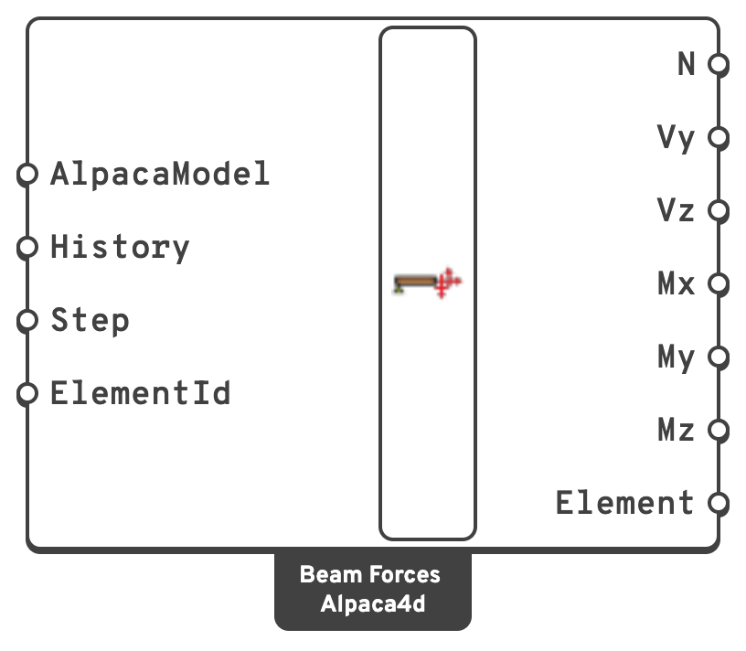

# Beam Forces

Internal forces along every beam element — the axial force, two shears, torsion and two
bending moments.

## 🔧 Grasshopper component

`Beam Forces (Alpaca4d)` — **Alpaca4d ▸ 08_NumericalOutput**

<figure><figcaption></figcaption></figure>

### Inputs

| Name | Nick | Type | Default | Description |
| --- | --- | --- | --- | --- |
| AlpacaModel | `AlpacaModel` | Model | — | The analysed model. |
| History | `History` | Boolean | `false` | Read every recorded step instead of one. The outputs become trees `{step; element}`. **Step** is ignored. |
| Step | `Step` | Integer | `0` | Analysis step. |
| ElementId | `ElementId` | Text (list) | *(empty)* | Read only some of the beams: an ElementId, a wildcard over them, a tag, or a regular expression. Empty reads them all. |

### Outputs

The six forces are **data trees, one branch per beam element**, keyed by its tag. Within a
branch, the values are at the element's integration points, ordered from the I end to the J end.

| Name | Nick | Type | Description |
| --- | --- | --- | --- |
| N | `N` | Number (tree) | Axial force, in `kN`. Positive is tension. |
| Vy | `Vy` | Number (tree) | Shear along the local *y* axis, in `kN`. Vy = dMz/dx. |
| Vz | `Vz` | Number (tree) | Shear along the local *z* axis, in `kN`. Vz = dMy/dx. |
| Mx | `Mx` | Number (tree) | Torsion about the local *x* axis, in `kN·m`. Right-hand rule about *x*. |
| My | `My` | Number (tree) | Bending about the local *y* axis, in `kN·m`. Positive puts the +*z* side in tension. |
| Mz | `Mz` | Number (tree) | Bending about the local *z* axis, in `kN·m`. Positive puts the +*y* side in compression. |
| Element | `Element` | Element (list) | The beams read, in the order of the branches. Deconstruct them for the tag and the geometry. |

## 📈 When to use it

**Use it when**

- You need design forces — the numbers that go into a code check.
- You want the maximum moment in a member: take the branch and find its extreme.
- You are exporting to a spreadsheet or a downstream design tool.

**Do not use it when**

- You want to see the diagram → [View Results](../visualisation/view-results.md), with *Beam forces* picked as the result,
  draws any of the six in the viewport.


**The resolution is the element discretisation.** Forces are sampled at the integration
points of each element — five per element, Newton–Cotes. A single element spanning a whole
beam gives you five points, and the peak moment will be missed unless it happens to fall on
one of them.

This is the same reason [Gravity Load](../loads/gravity.md) asks you to split beams. Five or
more elements per span is a reasonable default.


## 💡 Local axes

`My` and `Mz` are about the element's **local** axes, set by the **ZAxis** input of the
[ForceBeamColumn](../elements/force-beam-column.md) component. Turn on **Local Axes** in
[Model View](../visualisation/model-view.md) if you are unsure which way round they are on a
given member — it is the most common source of a moment that looks like it is about the
wrong axis.

## ➕ Signs

The forces are signed as OpenSees reports them, in the element's local axes: *x* runs from the
I end (the start of the line) to the J end, and *y* and *z* are the ones **Local Axes** draws in
Model View. Left without a **ZAxis**, a beam has *y* pointing up and *z* horizontal.

| Force | Positive when | Stress it causes |
| --- | --- | --- |
| N | the member is in tension | σ = N / A |
| Mz | the +*y* side is in compression — sagging, on a beam with *y* up | σ = −Mz · y / Iz |
| My | the +*z* side is in tension | σ = +My · z / Iy |
| Vy | Vy = dMz/dx: a cantilever fixed at I and loaded at J towards −*y* | |
| Vz | Vz = dMy/dx: a cantilever fixed at I and loaded at J towards +*z* | |
| Mx | a torque about +*x* is applied at the J end (right-hand rule) | |

The two shears do not follow the same rule. That is OpenSees's convention, not a slip: it
defines each shear as the slope of the moment it goes with, and Mz and My take opposite signs
for the same curvature. [Beam Stresses](beam-stresses.md) and [Utilisation](utilisation.md)
use these signs as they are.

## 💡 Sections without shear

A [Generic Section](../sections/parametric-cross-section.md) with **AlphaY** or **AlphaZ** of 0 is
rigid in shear, and OpenSees records only N, Mz, My and Mx along a beam made of it. Vy and Vz are then
worked out as the slopes of Mz and My along the beam. That is exact for the loads Alpaca4d puts
on beams: under a uniform load the moments are quadratic along the beam.
