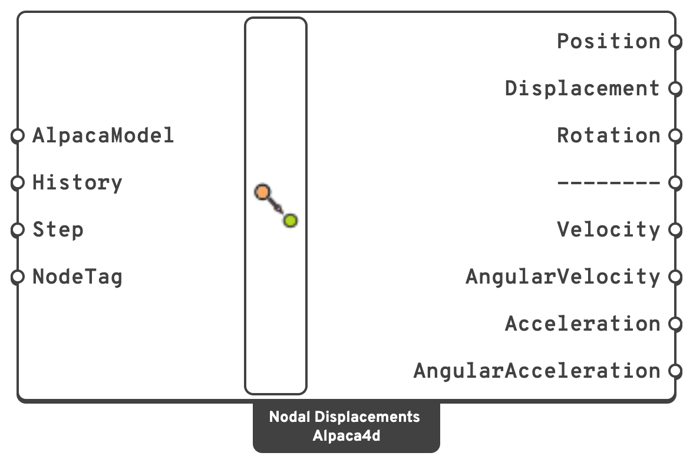

# Nodal Displacements

Displacement, rotation, velocity and acceleration at every node of the model.

## 🔧 Grasshopper component

`Nodal Displacements (Alpaca4d)` — **Alpaca4d ▸ 08_NumericalOutput**

<figure><figcaption></figcaption></figure>

### Inputs

| Name | Nick | Type | Default | Description |
| --- | --- | --- | --- | --- |
| AlpacaModel | `AlpacaModel` | Model | — | The analysed model. |
| History | `History` | Boolean | `false` | Read every recorded step instead of one. Each output becomes a tree `{step}` holding that step's value per node. **Step** is ignored. |
| Step | `Step` | Integer | `0` | Analysis step, or mode number for a modal model. |
| NodeTag | `NodeTag` | Integer (list) | *(empty)* | Read only these nodes, by tag. Empty reads every node. |

### Outputs

| Name | Nick | Type | Description |
| --- | --- | --- | --- |
| Position | `Position` | Point (list) | Where each node read sits, undeformed. Read with **NodeTag**, this is what ties the results back to the model. |
| Displacement | `Displacement` | Vector (list) | Translation at each node, in `m`, global axes. |
| Rotation | `Rotation` | Vector (list) | Rotation at each node, in `rad`, global axes. |
| -------- | `--------` | — | A visual separator. Nothing comes out of it. |
| Velocity | `Velocity` | Vector (list) | Velocity, in `m/s`, global axes. Transient analysis only. |
| AngularVelocity | `AngularVelocity` | Vector (list) | Angular velocity, in `rad/s`, about the global axes. Transient analysis only. |
| Acceleration | `Acceleration` | Vector (list) | Acceleration, in `m/s²`, global axes. Transient analysis only. |
| AngularAcceleration | `AngularAcceleration` | Vector (list) | Angular acceleration, in `rad/s²`, about the global axes. Transient analysis only. |

The lists are ordered by node tag, which is the order [Assemble](../assemble.md) numbered the
nodes in — not the order you drew anything. Read with **NodeTag**, they hold the nodes asked
for, still in tag order.

## 📈 When to use it

**Use it when**

- You need a deflection to check against a limit.
- You want the displaced shape as data rather than as a picture.
- You are extracting a response history at a control node: sweep **Step** and collect one
  component.

**Do not use it when**

- You only want to *look* at the deformed shape →
  [View Results](../visualisation/view-results.md) draws it directly.


On a model from [Natural Vibration](../analysis/natural-vibration.md), **Displacement** is
the **mode shape**, and `Step` selects the mode. Each mode is scaled so that its largest
translation is 1, and its rotations by the same factor, so the magnitudes are not physical
displacements — only their relative values mean anything.

