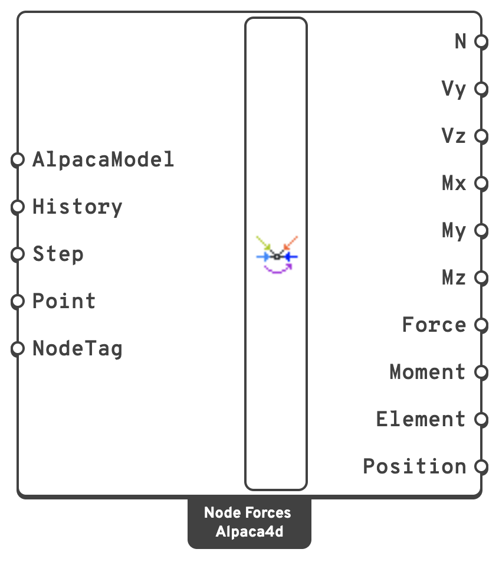

# Node Forces

The forces that every beam and truss brings into a node: what a joint has to carry, member by
member, for designing the connection there.

## 🔧 Grasshopper component

`Node Forces (Alpaca4d)` — **Alpaca4d ▸ 08_NumericalOutput**

<figure><figcaption></figcaption></figure>

### Inputs

| Name | Nick | Type | Default | Description |
| --- | --- | --- | --- | --- |
| AlpacaModel | `AlpacaModel` | Model | — | The analysed model. |
| History | `History` | Boolean | `false` | Read every recorded step instead of one. Every output becomes a tree `{step; tag}`. **Step** is ignored. |
| Step | `Step` | Integer | `0` | Analysis step. |
| Point | `Point` | Point (list) | — | The nodes to report, by where they are. A point within the model's tolerance of a beam end picks the node there. |
| NodeTag | `NodeTag` | Integer (list) | — | The nodes to report, by tag. Taken together with **Point**. Leave both empty to report every node a beam meets. |

### Outputs

Every output is a **data tree, one branch per node**, keyed by the node's tag: `{tag}`, or
`{step; tag}` with **History**. The branches come in tag order, whatever order the points were
given in; **Position** says which node each one is. Within a branch there is one item per member
meeting at the node, in the same order in every output.

| Name | Nick | Type | Description |
| --- | --- | --- | --- |
| N | `N` | Number (tree) | Axial force in each member at the node, in `kN`. Positive is tension. |
| Vy | `Vy` | Number (tree) | Shear along the member's local *y* axis at the node, in `kN`. Vy = dMz/dx. |
| Vz | `Vz` | Number (tree) | Shear along the member's local *z* axis at the node, in `kN`. Vz = dMy/dx. |
| Mx | `Mx` | Number (tree) | Torsion in the member at the node, in `kN·m`. |
| My | `My` | Number (tree) | Bending about the member's local *y* axis at the node, in `kN·m`. Positive puts the +*z* side in tension. |
| Mz | `Mz` | Number (tree) | Bending about the member's local *z* axis at the node, in `kN·m`. Positive puts the +*y* side in compression. |
| Force | `Force` | Vector (tree) | The force each member puts on the node, in `kN`, in global axes. |
| Moment | `Moment` | Vector (tree) | The moment each member puts on the node, in `kN·m`, about the global axes. |
| Element | `Element` | Element (tree) | The members meeting at the node. Deconstruct them for the tag, the ElementId and the curve. |
| Position | `Position` | Point (tree) | Where the node is, once per branch: the point to draw **Force** and **Moment** at. |

## 📈 When to use it

**Use it when**

- You are designing a connection: a gusset plate where the diagonals of a truss meet its chord,
  a bolt group at a beam end, a base plate under a column. Pick the node and you get every member
  that arrives there with its end forces.
- You want the force in each member of a truss at a joint, the way the method of joints gives
  it.
- You are checking that a joint balances. Add up **Force** over a branch: at a node with no load
  and no support the members' forces cancel, and otherwise they balance the load and the
  reaction there.

**Do not use it when**

- You want the forces all along a member → [Beam Forces](beam-forces.md).
- You want what a support holds back → [Reaction Forces](reaction-forces.md).

To draw the forces, plug **Position** and **Force** into Grasshopper's *Vector Display*: the
outputs share one tree, so they pair up branch for branch.

## ➕ Two ways of reading the same forces

**N** to **Mz** are each member's own section forces at the end that touches the node, in its
local axes and with the signs [Beam Forces](beam-forces.md#signs) uses. They are the first or the
last value of that member's branch in Beam Forces, whichever end is at the node. **N** reads the
same from either end; read the shears and moments with the member's local axes in mind, which
**Local Axes** in [Model View](../visualisation/model-view.md) draws.

**Force** and **Moment** are the same end forces turned into global axes and signed as **what
the member does to the node**. A member in tension pulls the node towards itself, and one in
compression pushes it away. Signed this way they do not depend on which end of a member is at the
node, and those at one node add up:

> sum of **Force** + load on the node + support reaction = 0

and the same for **Moment**.

## 💡 Notes

- **Picking a node.** Only the nodes a beam or a truss meets are searched, so a point on a beam
  end finds that node even where another element's node stands at the same place. A point that is
  not within the model's tolerance of one, a tag the model does not have, and a node no beam meets
  are each named in a warning rather than dropped without a word.
- **Fast on large models.** The model is read as a graph: its nodes linked by its beams, every
  beam filed under its two end nodes in one pass. Finding a node's members then costs only as much
  as there are members at it, and only their rows are read from the recorder file. On a grillage of
  7,320 beams, Node Forces takes 20 ms for one node and under 0.2 s for all 3,721 of them; Beam
  Forces takes about 0.5 s over the same beams.
- **Exact at the ends.** The forces are taken from the section that both integrations Alpaca4d
  writes put at each end of a beam. A force-based beam's section forces come out of equilibrium
  with its end forces and its loads, so distributed and point loads on the member are included.
- **Trusses** bring an axial force and nothing else. A truss is always corotational, so its
  **Force** runs along the bar where it has moved to. For a cable that sags under its load, that
  is the direction it pulls in.
- **Only beams and trusses are read.** A shell, a solid or a [Spring Link](../elements/spring-link.md) at the
  same node carries force into it too, and Node Forces does not read that. Neither does it read
  what a constraint such as a rigid link carries. A remark names the nodes that other elements
  share, because there the members alone do not balance.
