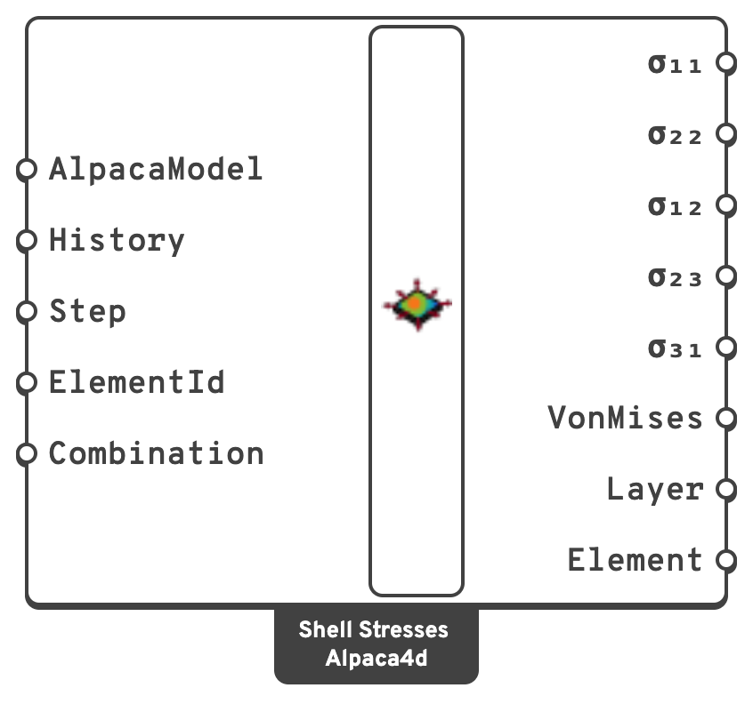

# Shell Stresses

The stresses through the thickness of every shell element: the in-plane components, the
transverse shears and Von Mises, at the top, the middle and the bottom of the section.

## 🔧 Grasshopper component

`Shell Stresses (Alpaca4d)` — **Alpaca4d ▸ 08_NumericalOutput**

<figure><figcaption></figcaption></figure>

Applies to every [ASD Shell](../elements/shell.md), on a
[Plate Fiber Section](../sections/plate-fiber.md) or a
[Layered Shell Section](../sections/layered-shell.md).

### Inputs

| Name | Nick | Type | Default | Description |
| --- | --- | --- | --- | --- |
| AlpacaModel | `AlpacaModel` | Model | — | The analysed model. |
| History | `History` | Boolean | `false` | Read every recorded step instead of one. The outputs become trees `{step; element; layer}`. **Step** is ignored. |
| Step | `Step` | Integer | `0` | Analysis step. |
| ElementId | `ElementId` | Text (list) | *(empty)* | Read only some of the shells: an ElementId, a wildcard over them, a tag, or a regular expression. Empty reads them all. |
| Combination | `Combination` | Text (list) | *(empty)* | Which load combinations to read, by name or by place from 0; empty reads every one. Each result then has the combination's place in front of its path: `{combination; element; layer}`, or `{combination; step; element; layer}` with **History**. **Layer** and **Element** stay flat lists. See [Load Combination](../loads/load-combination.md). |

### Outputs

Three branches per shell element, `{element; layer}`: layer 0 is the top, 1 the middle, 2 the
bottom. Each branch holds one value per integration point of the element.

| Name | Nick | Type | Description |
| --- | --- | --- | --- |
| Sigma11 | `σ₁₁` | Number (tree) | Direct stress along local *x* (axis 1), in `kN/m²`. |
| Sigma22 | `σ₂₂` | Number (tree) | Direct stress along local *y* (axis 2), in `kN/m²`. |
| Sigma12 | `σ₁₂` | Number (tree) | In-plane shear stress, in `kN/m²`. |
| Sigma23 | `σ₂₃` | Number (tree) | Transverse shear stress in the 2–3 plane, in `kN/m²`. |
| Sigma31 | `σ₃₁` | Number (tree) | Transverse shear stress in the 3–1 plane, in `kN/m²`. |
| VonMises | `VonMises` | Number (tree) | Von Mises equivalent stress, from the five components above, in `kN/m²`. |
| Layer | `Layer` | Text (list) | The name of each layer: `Top`, `Middle`, `Bottom`, in the order of the branches. Top is the face on the side local *z* points to. |
| Element | `Element` | Element (list) | The shells read, in the order of the branches. Deconstruct them for the tag and the geometry. |

## 📈 When to use it

**Use it when**

- You are checking a steel or aluminium plate against its yield stress: Von Mises at the top
  and the bottom is the number to compare with `Fy`.
- You are following a plate that yields: with a
  [J2Plasticity](../materials/ND.md) material, Von Mises rises to `Fy` step by step and stays
  there where the plate has yielded.
- You want each layer of a [Layered Shell Section](../sections/layered-shell.md) on its own:
  the concrete cover against the steel, say.

**Do not use it when**

- You want a contour → [Model View](../visualisation/model-view.md), with *Shell stresses*
  ticked and the layer picked in *Layer through the thickness*.
- You are designing reinforcement → [Shell Forces](shell-forces.md) gives the moments and
  forces per unit width that design formulas take.

## 💡 Where Top, Middle and Bottom are

| Section | Top and Bottom | Middle |
| --- | --- | --- |
| [Plate Fiber Section](../sections/plate-fiber.md) | On the faces exactly: the outer two of its five points through the thickness. | On the mid-surface exactly. |
| [Layered Shell Section](../sections/layered-shell.md) | At the centres of the outer layers, half a layer in from the faces. | The centre of the middle layer. With an even number of layers, the layer just above the mid-surface. |

The top is the face on the side local *z* points to, the blue arrow of **Local Axes** in
[Model View](../visualisation/model-view.md). Which side that is follows the order of the
mesh's vertices, not the world: a mesh whose faces point down has its Top layer underneath.

## 💡 Sign convention

Local *x*, *y* and *z* are axes 1, 2 and 3 of **Local Axes** in Model View, as for
[Shell Forces](shell-forces.md). A positive direct stress is tension. A positive `mxx` on Shell
Forces puts the Top layer in tension: σ₁₁ there is positive.


**These are local-axis results, and the local axes are per face** unless you set them. Set
**Local X Axis** on the [ASD Shell](../elements/shell.md) component for any model whose
σ₁₁ and σ₂₂ you intend to compare from one face to the next. Von Mises is the same in any axes.


## 🔗 Relation to OpenSees

It reads the `section.fiber.stress` result of the [MPCO Recorder](../mpco-recorder.md): the
stress at every point through the thickness of every integration point. The plate fibre
material has no stress through the thickness, so each point has five components, not six.
