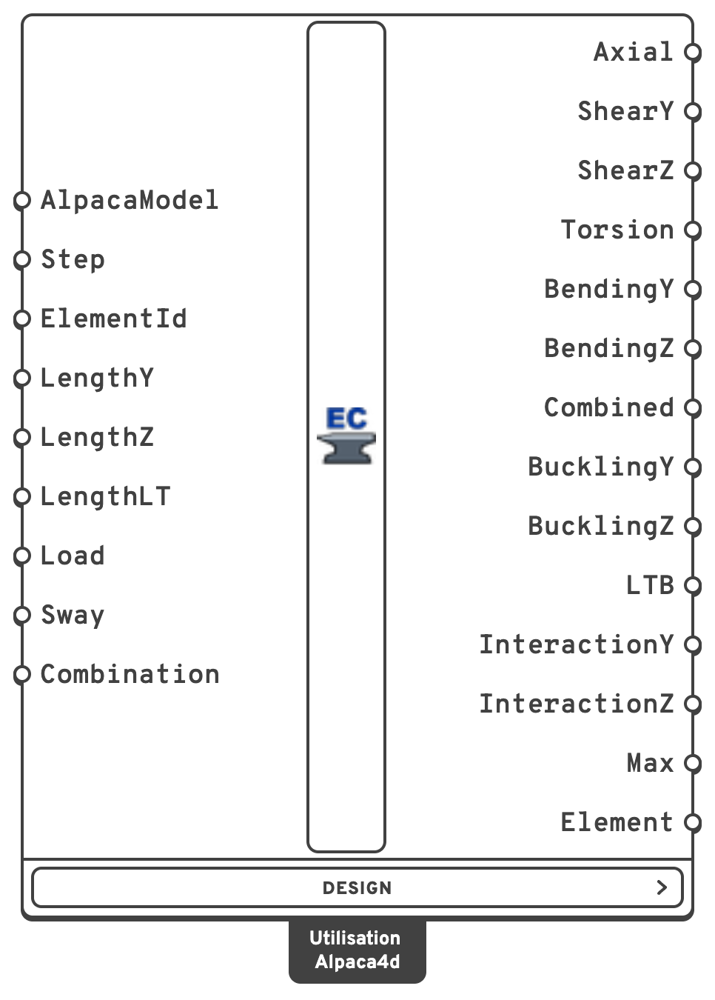
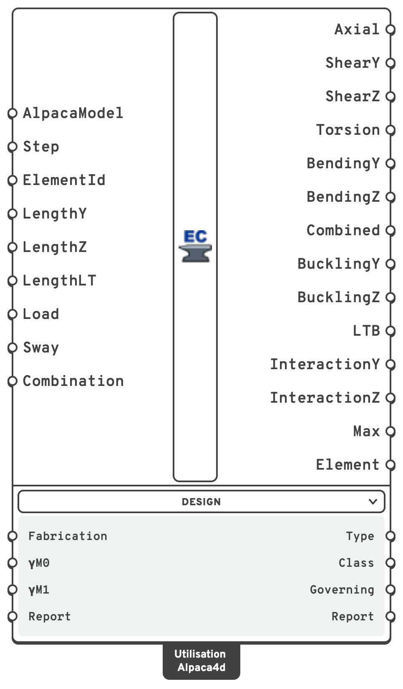

# Utilisation

Checks beams against the design code of their material and reports how much of each resistance
they use: **1 is exactly at the limit**. A switcher with a type per material, picked in the
drop-down under it, each with the inputs and outputs of its code:

- **Steel**, to **EN 1993-1-1** (Eurocode 3) — cross-section resistance, flexural buckling,
  lateral-torsional buckling and bending with compression as a member.
- **Timber**, to **EN 1995-1-1** (Eurocode 5) — cross-section resistance, column buckling and
  lateral-torsional buckling, with k_mod from the service class and the duration of the loads:
  see **Timber** below.

Each type checks its own material alone. A model of both takes two Utilisation components, one of
each type; a beam of the other material comes back with its **Type**, nothing checked, and a remark.

## 🔧 Grasshopper component

`Utilisation (Alpaca4d)` — **Alpaca4d ▸ 08_NumericalOutput**

<figure><figcaption></figcaption></figure>

<figure><figcaption>
With every menu open
</figcaption></figure>

### Inputs — Steel

| Name | Nick | Type | Default | Description |
| --- | --- | --- | --- | --- |
| AlpacaModel | `AlpacaModel` | Model | — | The analysed model. |
| Step | `Step` | Integer | `0` | Which recorded step to check. |
| ElementId | `ElementId` | Text (list) | *(empty)* | Check only some of the beams: an ElementId, a wildcard over them, a tag, or a regular expression. Empty checks them all. |
| LengthY | `LengthY` | Number (list) | *(empty)* | Buckling length L_cr about local *y* — the minor axis of an I — in `m`. One value for every beam, or one per beam checked, in the order of the **Element** output. Empty takes each beam's own length, node to node. |
| LengthZ | `LengthZ` | Number (list) | *(empty)* | Buckling length L_cr about local *z* — the major axis of an I. As **LengthY**. |
| LengthLT | `LengthLT` | Number (list) | *(empty)* | Distance between lateral restraints, for lateral-torsional buckling, in `m` — see **Lateral-torsional buckling** below. One value, or one per beam, as **LengthY**. Empty takes each beam's own length. |
| Load | `Load` | Text (list) | `ShearCentre` | Where the load along the beam acts on its section, for lateral-torsional buckling: `ShearCentre`, `Destabilising` (or `Top`) — on the face it comes from, gravity on the top flange, which the beam carries sideways as it twists — or `Stabilising` (or `Bottom`), hung from the face it goes towards. `ShearCentre` neither helps nor hinders. One value, or one per beam, as **LengthY**. |
| Sway | `Sway` | Boolean (list) | `false` | The beam is part of a frame that buckles by swaying: Cm = 0.9 about both axes (Table B.3). One value, or one per beam, as **LengthY**. |
| Combination | `Combination` | Text (list) | *(empty)* | Load combinations to read, by name or by place from 0. Empty reads every one, a branch each: each result has the combination's place in front of its path, `{combination}`, a value per beam. **Element** and **Type** stay flat lists. Every combination is checked, serviceability ones too: name the ultimate ones to check only those. See [Load Combination](../loads/load-combination.md). |

### Inputs — Timber

| Name | Nick | Type | Default | Description |
| --- | --- | --- | --- | --- |
| AlpacaModel | `AlpacaModel` | Model | — | The analysed model. |
| Step | `Step` | Integer | `0` | Which recorded step to check. |
| ElementId | `ElementId` | Text (list) | *(empty)* | Check only some of the beams, as for steel. |
| LengthY | `LengthY` | Number (list) | *(empty)* | Buckling length L_cr about local *y* — across a rectangle's Width — in `m`, for k_c. One value for every beam, or one per beam checked, in the order of the **Element** output. Empty takes each beam's own length, node to node. |
| LengthZ | `LengthZ` | Number (list) | *(empty)* | Buckling length L_cr about local *z* — across a rectangle's Height. As **LengthY**. |
| LengthLT | `LengthLT` | Number (list) | *(empty)* | Distance between lateral restraints, for lateral-torsional buckling (6.3.3), in `m`. One value, or one per beam, as **LengthY**. Empty takes each beam's own length. |
| Load | `Load` | Text (list) | `ShearCentre` | Where the load acts on the section, for lateral-torsional buckling: `ShearCentre` (the centroid of a rectangle), `Destabilising` (or `Top`) or `Stabilising` (or `Bottom`). One value, or one per beam, as **LengthY**. |
| Combination | `Combination` | Text (list) | *(empty)* | Load combinations to read, as for steel. Each is checked with k_mod for its own patterns. |


**Lengths left empty are each beam's own length, held at both ends.** A member drawn as several
beams needs its whole length given — each beam's own is only a piece of it — and so do a sway
column and a cantilever, whose free tip is not held at all.


### Outputs — Steel

One item per beam, in the order of the **Element** output. A check that could not be made is
**empty**, never zero.

| Name | Nick | Type | Description |
| --- | --- | --- | --- |
| Axial | `Axial` | Number (list) | N against A·fy/γM0, in tension or compression (6.2.3, 6.2.4). |
| ShearY | `ShearY` | Number (list) | Vy against the plastic shear resistance, reduced for torsion (6.2.6, 6.2.7). Along the web of an I. |
| ShearZ | `ShearZ` | Number (list) | Vz against the plastic shear resistance, reduced for torsion. Across the flanges of an I. |
| Torsion | `Torsion` | Number (list) | St. Venant shear stress against fy/√3 (6.2.7). |
| BendingY | `BendingY` | Number (list) | My — the minor axis of an I — against Wpl·fy or Wel·fy, reduced for shear (6.2.5, 6.2.8). |
| BendingZ | `BendingZ` | Number (list) | Mz — the major axis of an I — against Wpl·fy or Wel·fy, reduced for shear. |
| Combined | `Combined` | Number (list) | Bending about both axes with axial force and shear (6.2.9, 6.2.10). |
| BucklingY | `BucklingY` | Number (list) | Flexural buckling about local *y* — the minor axis of an I (6.3.1). Zero when the beam is not in compression. |
| BucklingZ | `BucklingZ` | Number (list) | Flexural buckling about local *z* — the major axis of an I (6.3.1). |
| LTB | `LTB` | Number (list) | Lateral-torsional buckling (6.3.2): the major axis moment against χLT·W·fy/γM1, the worst piece between lateral restraints. Zero with no major axis bending, and for a tube or a round bar. |
| InteractionY | `InteractionY` | Number (list) | Bending and axial compression as a member (6.3.3, Annex B): the one of (6.61) and (6.62) whose χ is about local *y* — (6.62) for an I. Zero with no bending, or with bending about one axis and no compression. |
| InteractionZ | `InteractionZ` | Number (list) | As **InteractionY**, about local *z* — (6.61) for an I. |
| Max | `Max` | Number (list) | The largest of the above. Empty when a check that applies could not be made. |
| Element | `Element` | Element (list) | The beams checked. |

### Outputs — Timber

One item per beam, as for steel.

| Name | Nick | Type | Description |
| --- | --- | --- | --- |
| Axial | `Axial` | Number (list) | N against f_t,0,d with k_h in tension (6.1.2), or f_c,0,d in compression (6.1.4). |
| ShearY | `ShearY` | Number (list) | Vy: 1.5 V / (k_cr A) — 4V/3 for a circle — against f_v,d (6.1.7), k_cr = 0.67. |
| ShearZ | `ShearZ` | Number (list) | Vz, as **ShearY**. |
| Torsion | `Torsion` | Number (list) | St. Venant shear stress against k_shape·f_v,d (6.1.8). |
| BendingY | `BendingY` | Number (list) | My, across a rectangle's Width: σ_m,d against f_m,d with k_h (6.1.6). |
| BendingZ | `BendingZ` | Number (list) | Mz, across a rectangle's Height: σ_m,d against f_m,d with k_h (6.1.6). |
| Combined | `Combined` | Number (list) | Bending about both axes with axial force, k_m on the other axis: (6.11)-(6.12) in bending, (6.17)-(6.18) with tension, (6.19)-(6.20) with compression. |
| BucklingY | `BucklingY` | Number (list) | σ_c,0,d against k_c·f_c,0,d, buckling about local *y* (6.3.2). Zero when the beam is not in compression. |
| BucklingZ | `BucklingZ` | Number (list) | As **BucklingY**, about local *z*. |
| LTB | `LTB` | Number (list) | Lateral-torsional buckling, the worst piece between lateral restraints: σ_m,d against k_crit·f_m,d (6.33), and (6.35) with compression. Zero with no major axis bending, and for a circle. |
| InteractionY | `InteractionY` | Number (list) | Compression with bending, buckling about local *y*: (6.23). Zero with no compression, or with λ_rel ≤ 0.3 about both axes, when (6.19)-(6.20) in **Combined** are all 6.3.2(2) asks. |
| InteractionZ | `InteractionZ` | Number (list) | As **InteractionY**, about local *z*: (6.24). |
| Max | `Max` | Number (list) | The largest of the above. Empty when a check that applies could not be made. |
| Element | `Element` | Element (list) | The beams checked. |

### Design menu

Below the component, folded away until you open it. Its inputs are set once per project and then
left alone; its outputs say more about a beam than how loaded it is.

**Steel**

| Input | Nick | Type | Default | Description |
| --- | --- | --- | --- | --- |
| Fabrication | `Fabrication` | Text | `Rolled` | How the sections were made: `Rolled` (rolled I-sections and hot-finished hollow sections) or `Welded` (welded I-sections and cold-formed hollow sections). Sets the buckling curves (Tables 6.2, 6.4, 6.5) and an I's shear area. |
| γM0 | `γM0` | Number | `1.0` | Partial factor for the resistance of cross-sections. A National Annex may set another value. |
| γM1 | `γM1` | Number | `1.0` | Partial factor for the resistance of members to instability. A National Annex may set another value. |
| Report | `Report` | Boolean | `false` | Write the **Report** output. Off by default: on a large model the text is most of the work, and off, none of it is written. |

| Output | Nick | Type | Description |
| --- | --- | --- | --- |
| Type | `Type` | Text (list) | What the beam is made of, from its material: `Steel`, `Timber`, or `Unknown` when the material has no design grade. |
| Class | `Class` | Integer (list) | Cross-section class, 1 to 4, the worst along the beam. |
| Governing | `Governing` | Text (list) | Which check gives **Max**, or which checks could not be made. |
| Report | `Report` | Text (list) | Everything worked out on the way — grade, fy, class, section properties, resistances, where each check governs and what is not covered. Put it in a panel to check a member by hand. Empty unless the **Report** input is on. |

**Timber**

| Input | Nick | Type | Default | Description |
| --- | --- | --- | --- | --- |
| ServiceClass | `ServiceClass` | Integer (list) | `1` | The service class, 1, 2 or 3 (EN 1995-1-1 2.3.1.3), which sets k_mod with the duration of the loads: 1 heated indoors, 2 covered but unheated, 3 exposed to the weather. One value, or one per beam, as **LengthY**. |
| γM | `γM` | Number | *(empty)* | The partial factor for the material. Empty takes Table 2.3's recommended value — 1.3 for solid timber, 1.25 for glulam, 1.0 in an accidental combination. A National Annex may set others. |
| Report | `Report` | Boolean | `false` | Write the **Report** output, as for steel. |

| Output | Nick | Type | Description |
| --- | --- | --- | --- |
| Type | `Type` | Text (list) | What the beam is made of: `Timber`, `Steel`, or `Unknown`. |
| kmod | `kmod` | Number (list) | k_mod each beam was checked with: Table 3.1, from its service class and the shortest load duration of the combination. |
| Governing | `Governing` | Text (list) | Which check gives **Max**, or which checks could not be made. |
| Report | `Report` | Report (list) | Everything worked out on the way, as an object: a Panel shows it as text; [Deconstruct](../utility/deconstruct.md) splits it into its values — Grade, the strengths, ServiceClass, Duration and DurationSource, Kmod, GammaM and GammaMSource, KhY, KhZ, KhTension, the section's properties, the design strengths (Ft0d, Fc0d, FmYd, FmZd, Fvd), KcY, KcZ, Mcr, Kcrit, Max, Governing — and **Checks**, which a second Deconstruct splits into each check's Name, Value, Clause, Section, Position and Detail. Empty unless the **Report** input is on. |


**Steel, not checked yet:** torsional and torsional-flexural buckling (6.3.1.4) — which can govern a pair
of angles in compression — warping torsion, shear buckling of slender webs (EN 1993-1-5) and
Class 4 sections. **6.3.3 is for doubly symmetric sections only**: an I with unequal flanges or a
pair of angles in compression and bending gets no interaction, and no **Max**.

**Timber, not checked yet:** compression and tension across the grain (6.1.5 — bearing at
supports and under point loads), shear and torsion together, notched, curved and tapered members
(6.4, 6.5), system strength k_sys (6.6), connections, fire, and the serviceability checks —
deflection with k_def and vibration.

Frame stability is the model's: the forces are the analysis's, with whatever second-order
effects and imperfections it includes.


## 💡 Where the grade comes from

From the beam's **material**. Make it with [Material Database](../materials/MaterialDatabase.md),
which stamps the grade on it, or give a [Uniaxial](../materials/Uniaxial.md) material the name
of its grade: `S355`, `S355JR`, `s355 j2` and `S 355` are all S355; `C24`, `GL24h` and `gl 24 h`
are timber classes. A material with any other name is `Unknown` and is left unchecked, with a
warning.

fy follows EN 1993-1-1 **Table 3.1** for the section's thickest plate, including the lower value
for plates thicker than 40 mm:

| Grade | t ≤ 40 mm | 40 < t ≤ 80 mm |
| --- | --- | --- |
| S235 | 235 | 215 |
| S275 | 275 | 255 |
| S355 | 355 | 335 |
| S450 | 440 | 410 |

## 💡 Axes

Alpaca4d's local axes, as in [Beam Forces](beam-forces.md): local *y* along the depth of the
section as drawn, local *z* across it. For an I that makes **bending about z the major axis** —
EN 1993-1-1's y-y — and **ShearY** the shear along the web. So `BendingZ` and `BucklingZ` are the
major axis of an I, `BendingY` and `BucklingY` the minor.

## 💡 What is checked

| Check | Clause | How |
| --- | --- | --- |
| Class | 5.5, Table 5.2 | Every flange, web and wall, for the stress it carries at each integration point |
| Axial | 6.2.3, 6.2.4 | N / (A fy/γM0) |
| Shear | 6.2.6, 6.2.7(9) | V / (Av fy/√3/γM0), the shear area from 6.2.6(3), reduced for the torsional shear stress |
| Torsion | 6.2.7 | τt / (fy/√3/γM0), St. Venant — the only torsion the analysis has |
| Bending | 6.2.5, 6.2.8 | M / (W fy/γM0): Wpl for Class 1 and 2, Wel for Class 3. Past half the shear resistance, fy is reduced over the shear area — (6.30) for an I |
| Combined | 6.2.9, 6.2.10 | Class 1 and 2: the reduced plastic moments M_N,Rd and the biaxial criterion (6.41), with the exponents of the shape. Class 3: the largest direct stress against fy/γM0 |
| Buckling | 6.3.1 | N / (χ A fy/γM1) about each axis, for the largest compression along the beam, with the buckling curve of Table 6.2 |
| LTB | 6.3.2 | M / (χLT W fy/γM1) for every piece between lateral restraints, M_cr from the beam's own moment diagram — see below |
| Interaction | 6.3.3, Annex B | (6.61) and (6.62) with the interaction factors of Annex B (method 2), the largest N and M along the beam |

Every cross-section check is made at **every integration point** — five along a beam — and the
worst is reported; the **Report** says where.

The reduced plastic moments by shape:

| Section | M_N,Rd | Exponents in (6.41) |
| --- | --- | --- |
| [I Section](../sections/h-section.md), equal flanges | (6.36) to (6.38) | 2 on Mz, 5n ≥ 1 on My |
| [Rectangular Hollow](../sections/rectangular-hollow.md), uniform walls | (6.39), (6.40) | 1.66 / (1 − 1.13n²) ≤ 6 |
| [Circular](../sections/circular.md), tube or bar | M_pl (1 − n^1.7) | 2 |
| [Rectangular](../sections/rectangular.md) | M_pl (1 − n²) | 1 |
| Unequal I, uneven box, [Double L-Angle](../sections/double-angle.md) | none given | the linear sum of 6.2.1(7) |


**Combined** is reported as the largest of each moment over its reduced resistance and the
left-hand side of (6.41). It is ≤ 1 exactly when (6.41) holds — but where (6.41) alone would turn a
member at 90% of its reduced moment into 0.81 (an exponent of 2), this reads 0.9. Some tools report
the left-hand side alone, so their number can be lower for the same member.


## 💡 Buckling curves

Table 6.2, from the shape and **Fabrication** — `Rolled` picks the rolled I and hot-finished rows,
`Welded` the welded I and cold-formed ones:

| Section | Major axis | Minor axis |
| --- | --- | --- |
| Rolled I, h/b > 1.2, tf ≤ 40 mm | a | b |
| Rolled I, h/b > 1.2, 40 < tf ≤ 100 mm | b | c |
| Rolled I, h/b ≤ 1.2, tf ≤ 100 mm | b | c |
| Rolled I, h/b ≤ 1.2, tf > 100 mm | d | d |
| Welded I, tf ≤ 40 mm | b | c |
| Welded I, tf > 40 mm | c | d |
| Hollow, rectangular or circular, hot finished | a | a |
| Hollow, cold formed | c | c |
| Solid bar, rectangular or round | c | c |
| Double L-Angle | b | b |

From fy = 460 N/mm² the rolled I and hot-finished rows take Table 6.2's S460 column instead —
a0, a or c. An I with **unequal flanges** takes the welded rows whatever **Fabrication** says — nobody rolls
one.

Buckling may be ignored where λ̄ ≤ 0.2 or N_Ed ≤ 0.04 N_cr (6.3.1.2(4)); the check then reads the
cross-section's compression at γM1.

## 💡 Lateral-torsional buckling

**M_cr** is worked out on the moment diagram each beam actually carries, rather than read from
tables of C1 and C2: the classical energy solution LTBeam uses, with the beam's lateral deflection
and twist as sine series. EN 1993-1-1 gives no formula for M_cr and asks only that it allow for the
loading, the moment distribution and the restraints, which this does. Between its nodes a beam under
a uniform load carries a parabola, so the diagram through the integration points is exact. The
**Report** gives the C1 it amounts to.

- **Restraints.** Each beam is held sideways and against twist at both ends and at equal steps no
  longer than **LengthLT** in between, and is free to rotate and warp at each of them — fork
  supports, k = kw = 1. Each piece is checked on its own part of the diagram.
- **Longer than the beam**, **LengthLT** stands for an unrestrained length the beam is only part of,
  or for a cantilever's effective length. The rest of that length's diagram cannot be known from this
  beam, so its peak moment is taken as uniform over all of it — the most severe distribution.
- **Load height.** `Destabilising` puts the load on the extreme fibre it comes from, `Stabilising` on
  the one it goes towards; which face that is follows from the direction of the load along the beam.
- **Monosymmetric sections** — an I with unequal flanges, a pair of angles — include the Wagner
  term, with the shear centre where it is.
- **χLT** by **6.3.2.3** for a rolled or equivalent welded I, with the recommended λ̄LT,0 = 0.4 and
  β = 0.75 and curves b to d of Table 6.5, **without** the modification f of 6.3.2.3(2) — a National
  Annex may allow it, and leaving it out is the safe side. Everything else by the general case
  **6.3.2.2**, curve d for anything but an I.
- Lateral-torsional buckling may be ignored where λ̄LT ≤ λ̄LT,0 or M_Ed ≤ λ̄LT,0² M_cr
  (6.3.2.2(4)); **LTB** then reads the cross-section at γM1. 6.3.3 takes χLT from the curve all
  the same: compression lowers the moment a beam buckles at.

A tube or a round bar is the same about every axis and cannot buckle sideways. A box can, if it is
long and narrow enough.

## 💡 Bending and compression (6.3.3)

(6.61) and (6.62), the standard's y being the major axis, with Annex B's interaction factors —
Table B.2 for open sections, which can twist, Table B.1 for boxes and tubes. Cm comes from Table B.3
on each beam's own diagram — unless its buckling length about that axis is longer than the beam, when
the diagram that matters is not the beam's and Cm = 1, or unless **Sway** is on, when it is 0.9.
CmLT is that of the piece between restraints with the lowest χLT.

Both are reported for every beam with compression and bending, and for a beam bent about both axes
without compression — the only rule EN 1993-1-1 has that puts lateral-torsional buckling and minor
axis bending together.

## ⚠️ Class 4, and checks that could not be made

**Class 3 at low stress.** A part that fails the Class 3 limit is given the second chance of
**5.5.2(9)**: it is Class 3 after all if it meets the limit with ε raised by √(fy/γM0 / σcom,Ed),
σcom,Ed the compression it actually carries. Without it, every point of a slender I where the moment
passes through zero would read as Class 4 under the slightest axial force — the web of an IPE 300 in
S355 is Class 4 in pure compression. Such a section is checked elastically, and the component says so
with a remark.

**Class 4.** A section still Class 4 after that needs the effective properties of EN 1993-1-5, which
are not worked out yet. The beam is **not checked at all** — its outputs are empty — and the
component warns.

**Class 4 for buckling only.** 5.5.2(10) forbids the second chance for member buckling, which is
classified by Table 5.2 alone. A beam whose section is Class 4 in compression gets its cross-section
checks, but its **buckling is not checked** unless N_Ed ≤ 0.04 N_cr — and then **Max is empty** and
**Governing** reads `Not checked: BucklingY, BucklingZ`. A largest value over the checks that were
made would read as a verdict on the beam, and it is not one.

The component's messages:

| Message | Level | Means |
| --- | --- | --- |
| *... have a material with no design grade and are not checked* | Warning | **Type** is `Unknown`. Give the material a grade. |
| *... are Class 4 and are not checked at all* | Warning | The section is Class 4 even at the stress it carries. Outputs empty. |
| *... are Class 4 by Table 5.2 alone, so their member checks are not made and Max is empty* | Warning | Cross-section checked; buckling, LTB and 6.3.3 not. |
| *... are not doubly symmetric ... 6.3.3 covers doubly symmetric members only* | Warning | An unequal I or a pair of angles in compression and bending: no interaction, no **Max**. |
| *... use a section with no shape* | Warning | A [Generic Section](../sections/parametric-cross-section.md): no plates to check. |
| *... have checks that could not be made, so no Max* | Warning | Anything else missing — see the **Report**. |
| *... taken as Class 3 under 5.5.2(9)* | Remark | Checked, elastically, at the low stress the part carries. |
| *Buckling lengths left empty are each beam's own length* | Remark | A lengths input is empty; give lengths for members drawn as several beams, sway columns and cantilevers. |
| *... beam(s) are timber, left to the Timber type* (or *steel, left to the Steel type*) | Remark | Beams of the other material, not checked by this type: use a second Utilisation of the other type for them. |
| *... timber beam(s) are not checked* | Warning | Timber type: a section that is not a solid rectangle or circle, or a grade without a strength the check needs. |
| *k_mod from the shortest load duration of each combination* | Remark | Timber type: what timber is checked with, and what it is not checked for yet. |
| *Load pattern(s) ... have no Duration* | Remark | Timber type: those patterns count as permanent. Set their duration in the [Load Pattern](../loads/load-pattern.md)'s **Duration** menu. |

## 💡 Timber, EN 1995-1-1

The **Timber** type checks a beam whose material is an EN 338 class (C14 to C50, D30 to D70) or an
EN 14080 glulam class (GL20h to GL32h, GL20c to GL32c) to EN 1995-1-1, with the recommended values
throughout.
Its section must be a solid [Rectangular](../sections/rectangular.md) or a solid
[Circular](../sections/circular.md) section; any other is left unchecked, with a warning. Mz bends
across the rectangle's **Height**, My across its **Width**.

Every design strength is f_d = k_mod·f_k/γM (2.14):

- **k_mod**, Table 3.1 — the **kmod** output — from the beam's **ServiceClass** (Design menu, 1 unless given) and the
  **duration of the loads**: the shortest among the load patterns of the combination checked
  (3.1.3(2)). Each pattern's duration is set in its [Load Pattern](../loads/load-pattern.md)'s
  **Duration** menu. A pattern left **Not set** counts as permanent, the lowest k_mod, and the
  component names it in a remark — so a model whose patterns have no duration is checked on the
  safe side.

  | Service class | Permanent | Long-term | Medium-term | Short-term | Instantaneous |
  | --- | --- | --- | --- | --- | --- |
  | 1, 2 | 0.60 | 0.70 | 0.80 | 0.90 | 1.10 |
  | 3 | 0.50 | 0.55 | 0.65 | 0.70 | 0.90 |

- **γM**, Table 2.3: 1.3 for solid timber, 1.25 for glulam, 1.0 in a combination of type
  `Accidental` from [Load Combination](../loads/load-combination.md) — or the **γM** given.
- **k_h** on f_m,k and f_t,0,k for a member less deep than the reference: (150/h)^0.2 ≤ 1.3 for
  solid timber up to ρ_k 700 kg/m³ (3.1), (600/h)^0.1 ≤ 1.1 for glulam (3.2), with the depth each
  moment bends across, and the largest side in tension.

| Check | Clause | How |
| --- | --- | --- |
| Axial | 6.1.2, 6.1.4 | σ_t,0,d / f_t,0,d, or σ_c,0,d / f_c,0,d |
| Shear | 6.1.7 | 1.5 V / (k_cr A) — 4V / (3 k_cr A) for a circle — against f_v,d, k_cr = 0.67 |
| Torsion | 6.1.8 | τ_tor,d against k_shape f_v,d: 1 + 0.15 h/b ≤ 2 for a rectangle, 1.2 for a circle |
| Bending | 6.1.6 | σ_m,d / f_m,d about each axis |
| Combined | 6.1.6, 6.2.3, 6.2.4 | (6.11)-(6.12) in bending, (6.17)-(6.18) with tension, (6.19)-(6.20) with compression; k_m = 0.7 for a rectangle, 1.0 for a circle |
| Buckling | 6.3.2 | σ_c,0,d / (k_c f_c,0,d) about each axis, for the largest compression along the beam; β_c 0.2 for solid timber, 0.1 for glulam |
| Interaction | 6.3.2 | (6.23) and (6.24) at every integration point with the largest compression; left to (6.19)-(6.20) when λ_rel ≤ 0.3 about both axes, as 6.3.2(2) says |
| LTB | 6.3.3 | (6.33) σ_m,d / (k_crit f_m,d), and (6.35) with compression, k_c about the minor axis |

**σ_m,crit** is M_cr / W "according to the classical theory of stability, with 5-percentile
stiffness values" (6.3.3(2)): M_cr is worked out on the beam's own moment diagram, as for steel —
fork supports every **LengthLT**, the load at the height **Load** gives — with E_0,05 and G_0,05.
For a uniform moment it is (6.32) exactly; for a uniform load it is within 1.4% of Table 6.1's
l_ef = 0.9 l. G_0,05 is tabulated for glulam (540 N/mm²) and G_mean·E_0,05/E_0,mean for solid timber.

The [Wave Roof Hall](https://alpaca4d.github.io/examples/wave-roof-hall/) example checks glulam arches
and purlins on the Timber type and their steel frame on the Steel type, over six ULS combinations.


**Every combination is checked, serviceability ones too**, each with k_mod for its own patterns:
name the ultimate ones in **Combination** to check only those. A model without combinations has
all its patterns acting at once, and the shortest of them sets k_mod.


## 💡 Sharp corners

The check uses the section the analysis used. An [I Section](../sections/h-section.md) — including
the [Steel Section Library](../sections/library.md) profiles — has **no root radius**, and a hollow
section no corner radius. Against a rolled catalogue section that makes A and Wpl a few percent low
(an IPE 300's Wpl,y is 602 cm³ against the catalogue's 628) and a web's c/t a little high: all on the
safe side. Box walls are classified on their flat width h − 3t, as the section tables do for
hot-finished tubes.

## 📈 When to use it

**Use it when**

- You want to know whether steel or timber members are big enough, and which check governs.
- You are sizing members: feed **Max** back into a section choice.

**Do not use it when**

- The member is a pair of angles or an unequal I in compression, where torsional-flexural
  buckling or 6.3.4 may govern → check those yourself; this component does not yet.
- You only want the stresses → [Beam Stresses](beam-stresses.md).

## ✅ How it is checked

The rules are set against published worked examples, each in its own units and to the digits
printed:

| Source | Member | Checked |
| --- | --- | --- |
| JRC 2014, *Eurocodes — Design of steel buildings with worked examples*, Example 1 | HEB 340 column, S355 | class, N_c,Rd, λ̄, curves, χ, N_b,Rd |
| ibid., Example 2 | IPE 400 beam, S355 | class, M_pl,Rd, V_pl,Rd, shear area, shear buckling limit |
| Gardner & Nethercot, *Designers' Guide to EN 1993-1-1*, Example 6.6 | UKB 457×191×98, S275 | class, N_pl,Rd, M_pl,Rd, M_N,y,Rd |
| ibid., Example 6.7 | CHS 244.5×10 column, S355 | **end to end through Alpaca4d's own section**: class, N_cr, λ̄, χ, N_b,Rd, utilisation 0.71 |
| Structville, *Design of steel columns for biaxial bending* | UKC 254×254×89, S275 | M_N,y,Rd, M_N,z,Rd, β, (6.41), χ |
| ECCS No. 119, Worked Example 5, as SOFiSTiK verification DCE-EN24 | IPE 500, S235, 3.75 m | M_cr,0 895 kNm, **C1 1.194 of a −100 / 199 / −100 kNm diagram** against SOFiSTiK's eigenvalue analysis, λ̄LT, χLT by 6.3.2.2 |
| Schneider, *Bautabellen für Ingenieure*, Example 8-41, as SOFiSTiK verification DCE-EN29 | HEA 200 beam-column, S235, 8 m held at mid-length | λ̄, χ, N_cr, λ̄LT, χLT by 6.3.2.3, Cmy, CmLT, kyy, kzy, (6.61) 0.96, (6.62) 0.79 — and end to end through Alpaca4d's own HEA 200 |

The critical moment is also held to the closed forms — uniform moment, doubly and singly
symmetric — and to the C1 and C2 of ENV 1993-1-1 Annex F. Then every shape against hand formulas,
members worked by hand, and the whole chain — a recorder file solved by OpenSees, read and checked.

**Timber** is set against Swedish Wood, *Design of timber structures, Volume 3: Examples* (edition
3:2022, EN 1995-1-1 without a National Annex), to the digits printed:

| Source | Member | Checked |
| --- | --- | --- |
| Example 3.1 | C24 joist 45 × 220, 4.5 m | k_mod, k_h, f_m,d 14.8, f_v,d 2.46, V_Rd 10.9 kN, bending 0.94, shear 0.41 |
| Example 3.4 | GL30c beam 115 × 630, 10 m | γM, k_h, W_y, f_m,y,d 19.20, f_v,d 2.24, bending 0.51, shear 0.22; σ_m,crit 19.1, λ_rel,m 1.25, k_crit 0.62, M_Rd 90.6 kNm from the book's own σ_m,crit |


For Example 3.4's lateral-torsional buckling Utilisation reads **1.10** where the book has **0.82**,
on the safe side, for two reasons. Its point load at mid-span puts a triangle in the moment diagram,
not a parabola, so the peak moment is taken as uniform over **LengthLT** (C1 = 1), where Table 6.1
credits the point load with l_ef = 0.8 l. And σ_m,crit comes from (6.32), with glulam's G_0,05 =
540 N/mm² and the section's own torsion constant, where the book uses (6.33) — written for solid
softwood — which implies G/E = 1/16 against glulam's 1/20: about 20% higher for this section.


It is also held to Tables 2.3 and 3.1, k_h, k_c, k_crit and k_shape value by value; to EN 338:2016
and EN 14080 for the classes; every output of solid, glulam and round members to the expressions
written out by hand; M_cr to (6.32) and to Table 6.1; the load duration from the patterns through
each combination; and the whole chain, three timber cantilevers solved by OpenSees.


End to end, the Schneider column reads **1.00** for (6.61) against the book's 0.96: Alpaca4d's
HEA 200 has no root radii, so its area is 5% low. M_cr comes out at 256 kNm against the book's
220.9, because the book's load-height term is DIN 18800's fixed 0.5 z_p whatever the diagram. Most
of each half's moment comes from the reaction, not from the top-flange load. With the load at the
shear centre the two agree: C1 1.336 against the book's ζ = 1.35.

