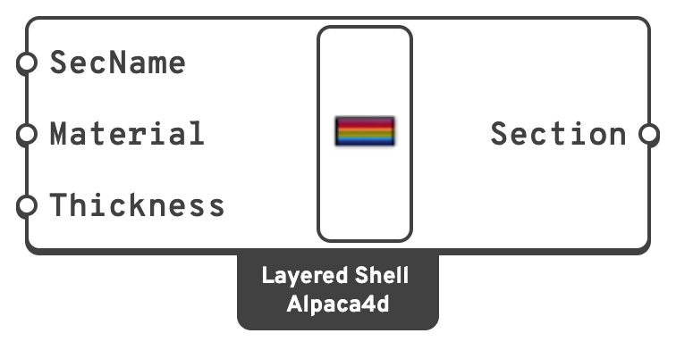

# Layered Shell Section

A **shell** section made as a stack of layers, each with its own
[nD material](../materials/ND.md) and thickness: reinforced concrete, cross-laminated timber,
a laminate, or steel that yields layer by layer.

## 🔧 Grasshopper component

`Layered Shell Section (Alpaca4d)` — **Alpaca4d ▸ 01_Section**, nickname `Layered Shell`

<figure><figcaption></figcaption></figure>

### Inputs

| Name | Nick | Type | Default | Description |
| --- | --- | --- | --- | --- |
| SectionName | `SecName` | Text | *(empty)* | Label for the section. Nothing in the analysis reads it. |
| Material | `Material` | Material (list) | — | The material of each layer, bottom face first. Any [nD](../materials/ND.md) material, orthotropic included. One material alone is used for every layer. |
| Thickness | `Thickness` | Number (list) | — | The thickness of each layer, in `m`, bottom face first, one per material. One material and one thickness is the whole section, split into 5 equal layers. |
| Colour | `Colour` | Colour | *(empty)* | The colour the section is drawn in when [Model View](../visualisation/model-view.md) colours the elements **by section**. Left empty, Model View gives each section a colour of its own. Display only: the analysis never reads it. |

### Outputs

| Name | Nick | Type | Description |
| --- | --- | --- | --- |
| Section | `Section` | Section | Shell section, for an [ASD Shell](../elements/shell.md). |

## 📈 When to use it

**Use it when**

- The shell is made of more than one material through its thickness: concrete with a layer of
  reinforcement near each face, the plies of a timber panel.
- The material yields: a [J2Plasticity](../materials/ND.md) steel plate yields one layer at a
  time from the faces in. Use eight layers or more.
- You want stresses at chosen depths: [Shell Stresses](../results/shell-stresses.md) reads the
  layer centres.

**Do not use it when**

- The shell is one elastic material → a [Plate Fiber Section](plate-fiber.md) is simpler and its
  Top and Bottom stresses sit on the faces.
- The layers slip on each other, as on a soft core → model the two skins as two shells with a
  connection between them. Here every layer shares one strain field, so the section comes out
  stiffer than a sandwich that slips.

## 💡 Building the stack

| You give | You get |
| --- | --- |
| One material, one thickness | 5 equal layers of that material, the thickness in all. A remark on the component says so. |
| One material, several thicknesses | That material in each layer, at the thicknesses given. |
| As many materials as thicknesses | Layer by layer, bottom face first. |

- **Bottom** is the face away from local *z*, the blue arrow of **Local Axes** in
  [Model View](../visualisation/model-view.md); the last layer is on the face local *z* points to.
- **At least three layers.** OpenSees takes no fewer; with one or two the component turns red.
- **Orthotropic layers are not turned.** Each takes its material's axes as they are, along the
  shell's local axes. A crossed ply is a second material with `Ex` and `Ey` exchanged.
- **The layers' order matters** only when they differ: an unsymmetric stack, such as reinforcement
  near one face only, bends as well as stretches under an in-plane force.
- [Model View](../visualisation/model-view.md) colours a layered shell **by material** in the
  material of its first layer.


[Shell Stresses](../results/shell-stresses.md) reads the stress at each **layer's centre**, so its
Top and Bottom are half a layer in from the faces. With five layers in a 10 mm plate that is 1 mm
in: the face stress of a plate in bending is 25% higher than at the centre of a 2 mm outer layer.
Thinner outer layers bring the reading closer to the face.


## 🔗 Relation to OpenSees

```tcl
section LayeredShell $secTag $nLayers $matTag1 $thickness1 $matTag2 $thickness2 ...
```

A J2Plasticity material is written in its plate form, the one a shell layer takes.
