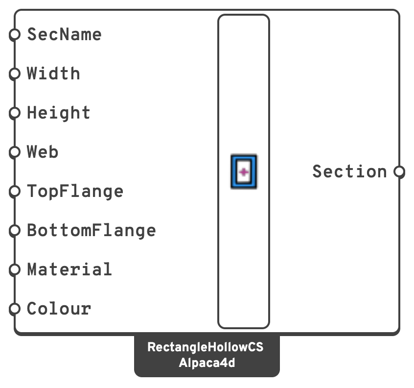

# Rectangular Hollow

A rectangular hollow (box) cross-section, with independently specified web and flange
thicknesses.

## 🔧 Grasshopper component

`RectangleHollow (Alpaca4d)` — **Alpaca4d ▸ 01_Section**

<figure><figcaption></figcaption></figure>

### Inputs

| Name | Nick | Type | Default | Description |
| --- | --- | --- | --- | --- |
| SectionName | `SecName` | Text | *(empty)* | Label for the section. |
| Width | `Width` | Number | `0.30` | Overall width, in `m`. |
| Height | `Height` | Number | `0.60` | Overall height, in `m`. |
| Web | `Web` | Number | `0.02` | Thickness of each vertical wall, in `m`. |
| TopFlange | `TopFlange` | Number | `0.02` | Thickness of the top wall, in `m`. |
| BottomFlange | `BottomFlange` | Number | `0.02` | Thickness of the bottom wall, in `m`. |
| Material | `Material` | Material | — | A [Uniaxial](../materials/Uniaxial.md) material. |
| Colour | `Colour` | Colour | *(empty)* | The colour the section is drawn in when [Model View](../visualisation/model-view.md) colours the elements **by section**. Left empty, Model View gives each section a colour of its own. Display only: the analysis never reads it. |

### Outputs

| Name | Nick | Type | Description |
| --- | --- | --- | --- |
| Section | `Section` | Section | Beam section, for a [ForceBeamColumn](../elements/force-beam-column.md). |

## 📈 When to use it

**Use it when**

- The member is a square or rectangular hollow section.
- You are modelling a box girder or a welded box column with different plate thicknesses top
  and bottom.

**Do not use it when**

- The profile is a catalogue RHS or SHS → [Steel Section Library](library.md), family `[]`,
  which has 246 of them.

## 🔗 Relation to OpenSees

```tcl
section Elastic $secTag $E $A $Izz $Iyy $G $J $alphaY $alphaZ
```
