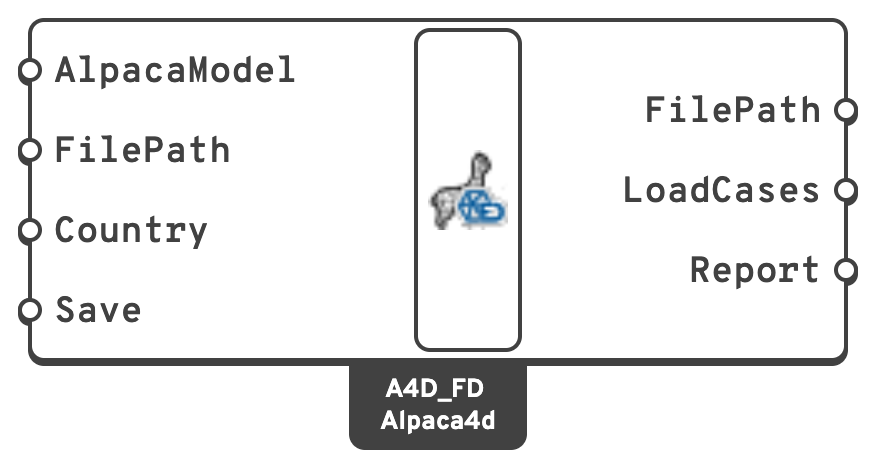

# Alpaca4D to FEM-Design

Writes an assembled model to a `.struxml` file that StruSoft's [FEM-Design](https://strusoft.com)
opens: its bars, plates and walls, supports and connections, one load case per load pattern, a
load combination and the masses. Materials and profiles from Alpaca4d's libraries become
FEM-Design's own, so FEM-Design can design with them.

## 🔧 Grasshopper component

`Alpaca4DToFEM-Design` — **Alpaca4d ▸ 10_Utility**

<figure><figcaption></figcaption></figure>

### Inputs

| Name | Nick | Type | Default | Description |
| --- | --- | --- | --- | --- |
| AlpacaModel | `AlpacaModel` | Model | — | The model, from [Assemble](../assemble.md), or an analysed one. |
| FilePath | `FilePath` | Text | *(empty)* | Where to write the file. Left empty it is written next to the Grasshopper definition, with its name. `.struxml` is added when the path has no extension. |
| Country | `Country` | Text | `common` | FEM-Design's national annex, whose material library Alpaca's materials are looked up in: `common` (the Eurocode's recommended values), `S`, `N`, `DK`, `FIN`, `H` or `LV`. The countries' names work too: `Sweden`, `Norway`... |
| Save | `Save` | Boolean | `false` | Write the file. Until then the model is converted, and the report shown, but nothing is written. |

### Outputs

| Name | Nick | Type | Description |
| --- | --- | --- | --- |
| FilePath | `FilePath` | Text | The file written, once Save is `true`. |
| LoadCases | `LoadCases` | Text (list) | FEM-Design's load cases: one per load pattern, in order, then the self-weight. |
| Report | `Report` | Text (list) | Everything the export left out or changed, errors first. The same messages show on the component. |

## 🗺️ What becomes what

Alpaca4d and FEM-Design both work in metres and kilonewtons. Masses go from kilograms to tonnes.

### Materials

| Alpaca4d | FEM-Design |
| --- | --- |
| A grade from [Material Database](../materials/MaterialDatabase.md) that FEM-Design's library has, such as `S355`, `C30_37` or `C24` | That library material: `S 355`, `C30/37`, `C24`. FEM-Design can design with it. |
| Any other material, such as a plastic or one typed in by hand | A custom material with Alpaca's E, G, Poisson's ratio and density. FEM-Design analyses it, but does not design with it. |

A library material is analysed with FEM-Design's own values. Where its modulus differs from
Alpaca's by more than 1% the report warns, and where its density differs by more than 2% it
says so, since FEM-Design's self-weight follows. Alpaca's `C30_37`, for one, has
E = 30 000 N/mm², and FEM-Design's C30/37 has 33 000 N/mm².

### Sections

| Alpaca4d | FEM-Design |
| --- | --- |
| An IPE, HEA, HEB or HEM from the [Steel Section Library](../sections/library.md), in a library steel | FEM-Design's profile of that name, when its height and width are the section's |
| A [circular](../sections/circular.md) tube or a [hollow rectangle](../sections/rectangular-hollow.md) of a catalogue size, in a library steel | FEM-Design's profile of that size: KCKR or CHS, KKR or VKR, cold-formed first |
| A [rectangle](../sections/rectangular.md) in a library concrete or timber, or a solid circle in concrete | FEM-Design's concrete or timber profile of that size |
| Any other [Rectangular](../sections/rectangular.md), [Circular](../sections/circular.md), [Rectangular Hollow](../sections/rectangular-hollow.md), [I](../sections/h-section.md) or [Double L-Angle](../sections/double-angle.md) section | A section drawn from its outline, named like `Alpaca, I, 300x200x6.5x10`, from which FEM-Design works out the properties |
| A [Generic Section](../sections/parametric-cross-section.md), known only by A, I and J | No section: the beam becomes a fictitious bar with the same EA, EI, GJ and mass per length, which FEM-Design does not design |

FEM-Design's library profiles have their root and corner radii, so their properties differ a
little from those Alpaca computes for the same profile.

### Elements

| Alpaca4d | FEM-Design |
| --- | --- |
| [Force Beam Column](../elements/force-beam-column.md) | A beam, or a column when it is vertical. A column drawn downwards is turned to run upwards. |
| [Beam With Hinges](../elements/beam-with-hinges.md) pinned at both ends, with no beam load on it | A truss |
| Any other Beam With Hinges | A beam or column with the same end releases |
| [Shell](../elements/shell.md) elements | Plates, and walls where they are vertical. The elements of one section that share edges and lie in one plane become one plate, holes included. |
| [Spring Link](../elements/spring-link.md) | A point connection with the link's springs, in the link's axes |
| [Brick](../elements/brick.md), [Ten Node Tetrahedron](../elements/ten-node-tetrahedron.md) | Not exported |

FEM-Design's local z runs along the depth of a section, which is Alpaca's local y, so a beam
keeps its orientation. A beam's ElementId becomes its name in FEM-Design, numbered: `Column.1`,
`Column.2`... Beams without one are `B.1`, `C.1`, `T.1` and `BF.1` for beams, columns, trusses
and fictitious bars; plates are `P.1` and walls `W.1`.

**Trusses.** A Beam With Hinges is a truss when both ends are free to turn in bending, every
translation is held, and torsion is released at one end at least, which is how a truss is
modelled in Alpaca4d. A member loaded along its length carries bending between its hinges,
which a FEM-Design truss cannot, so it stays a beam with hinges. A
[beam load](../loads/beam-load.md) without an element loads every beam, trusses included.

**Plates.** Shell elements are merged so that FEM-Design gets a few plates to mesh rather than
one per element. A warped quad, whose corners are not in one plane, becomes two triangles.
Where an opening touches the edge of a plate, or another opening, at a single corner, the
outline would touch itself, which FEM-Design does not take. Those elements become one plate
each. A layered shell section becomes a plate of its full thickness in the material of its
thickest layer.

### Supports and constraints

| Alpaca4d | FEM-Design |
| --- | --- |
| [Support](../elements/support.md) | A point support in the support's axes, rigid in what it holds and free in the rest |
| [Rigid Link](../constraints/rigid-link.md) | A point connection: rigid in translation for `bar`, in every direction for `beam` |
| [Equal DOF](../constraints/equal-dof.md) | A point connection, rigid in the tied directions only |
| [Rigid Diaphragm](../constraints/diaphragm.md) | A diaphragm over the outline round its nodes |

FEM-Design joins whatever meets at a point, so an Equal DOF or a Rigid Link between two nodes
in one place has nothing left to do there. It is not exported, and the report says so: release
the element's end instead. A FEM-Design diaphragm makes everything inside its outline rigid in
its plane. It has no retained node, so a load or a mass on that node needs an element there to
go on.

### Loads and masses

| Alpaca4d | FEM-Design |
| --- | --- |
| [Load Pattern](../loads/load-pattern.md) | A static load case with the pattern's name, or `LP1`, `LP2`... for a pattern without one |
| [Gravity](../loads/gravity.md) | The dead-load case `Self-weight`, in which FEM-Design works out the self-weight from its materials |
| [Point load](../loads/point-load.md) | Point loads, for the force and for the moment |
| [Beam load](../loads/beam-load.md) | A uniform line load along the bar |
| [Shell load](../loads/shell-load.md) | Surface loads over the parts of each plate that carry the same pressure |
| [Mass Point](../loads/mass-point.md) | A point mass, the same in every direction |
| A Uniform Excitation pattern | Not exported |

Alpaca4d applies every load pattern of a model at once. The combination **`Alpaca`** does the
same in FEM-Design: it adds every load case with its pattern's factor, times its time series'
factor, and the self-weight with its gravity factor. A linear analysis of it is the analysis
Alpaca4d runs.


FEM-Design's design checks depend on what each load case is, and Alpaca4d does not know. Load
cases come in as static and permanent, and the combination as ultimate, ordinary. Set their
types, durations and the combinations you need in FEM-Design.


## 📋 The report

Whatever the export cannot carry over is reported, on the component and in **Report**:

- an **error** when leaving it out changes the structure or its loads, such as a solid element
  or a dynamic excitation;
- a **warning** when it is approximated, such as a warped quad or a material whose modulus
  differs from FEM-Design's;
- a **remark** when it changes nothing but is worth knowing, such as a custom material or the
  number of elements exported.

Saving checks the file against FEM-Design's schema; anything that fails the check is an error,
since FEM-Design would not open the file as it is.

## 📈 When to use it

**Use it when**

- The structure has been shaped and checked in Grasshopper, and is to be designed in
  FEM-Design: steel, concrete and timber checks, reinforcement, connections, reports.
- You want a second opinion on Alpaca4d's results from another program.

**Do not use it when**

- You want FEM-Design's results back in Grasshopper. The export goes one way only.


FEM-Design runs on Windows, but the file can be written anywhere, Rhino for Mac included, and
opened in FEM-Design afterwards.

