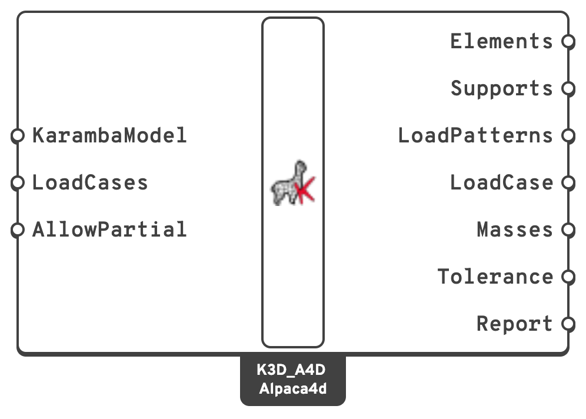

# Karamba3D to Alpaca4D

Turns an assembled Karamba3D 3.1 model into the parts of an Alpaca model: its elements, supports,
point masses and one load pattern per load case. Plug them into [Assemble](../assemble.md) with
elements, loads or constraints of your own, or with a dynamic excitation in place of Karamba's
loads, and analyse the model in OpenSees.

## 🔧 Grasshopper component

`Karamba3DToAlpaca4D` — **Alpaca4d ▸ 06_Assemble**, nickname `K3D_A4D`

<figure><figcaption></figcaption></figure>

Karamba3D 3.1 must be installed and loaded. Alpaca4d ships none of its files.

### Inputs

| Name | Nick | Type | Default | Description |
| --- | --- | --- | --- | --- |
| KarambaModel | `KarambaModel` | Karamba model | — | A model from Karamba3D's Assemble component, or an analysed one. |
| LoadCases | `LoadCases` | Text (list) | *(empty)* | The load cases to convert, by name. Left empty, every load case is converted. |
| AllowPartial | `AllowPartial` | Boolean | `false` | When something cannot be converted, nothing is output, so a model that differs from Karamba's is never analysed by accident. `true` outputs the rest anyway. |

### Outputs

| Name | Nick | Type | Description |
| --- | --- | --- | --- |
| Elements | `Elements` | Element (list) | Beams and shells, for Assemble's **Elements**, with any of your own. Each keeps its Karamba id as its ElementId. |
| Supports | `Supports` | Support (list) | For Assemble's **Supports**. |
| LoadPatterns | `LoadPatterns` | LoadPattern (tree) | One branch per load case, each holding that case's load pattern, self-weight included. Plugged into Assemble as it is, it gives one model per load case. |
| LoadCase | `LoadCase` | Text (tree) | The load case of each branch of LoadPatterns, in a tree of the same shape. |
| Masses | `Masses` | Load (list) | Karamba's point masses, as [Mass Point](../loads/mass-point.md) gives them, for a dynamic analysis: plug them into Assemble's **LoadPatterns** beside your excitation. A static analysis does not need them. |
| Tolerance | `Tolerance` | Number | A node tolerance that keeps Karamba's nodes apart, in `m`. Plug it into Assemble's **Tolerance**: its default can merge Karamba nodes that lie closer. |
| Report | `Report` | Text (list) | Everything the conversion left out or changed, errors first. The same messages show on the component. |

## 📈 When to use it

**Use it when**

- A model built in Karamba3D needs an analysis Karamba does not do: a time history, a pushover,
  a footfall check, or a material that yields.
- You want to check Karamba's results against a second solver.

**Do not use it when**

- The model is easier to build again in Alpaca4d than to convert: one with springs, joints or
  eccentricities, which are not converted yet (see below).

## 🗺️ What becomes what

The Karamba model must be in metres and kilonewtons, the units Alpaca4d works in. Masses come out
in kilograms.

| Karamba3D | Alpaca4d |
| --- | --- |
| Beam | [ForceBeamColumn](../elements/force-beam-column.md), local *y* along the depth of the section as Alpaca has it |
| Truss | A [beam with hinges](../elements/beam-with-hinges.md), released in bending at both ends and in torsion at one, so it carries axial force only |
| Rectangle, box, I or circle cross-section | Alpaca's own [Rectangular](../sections/rectangular.md), [Rectangular Hollow](../sections/rectangular-hollow.md), [I](../sections/h-section.md) or [Circular](../sections/circular.md) section, when its area and second moments are within 1% of Karamba's and its torsion constant within 5% |
| Any other cross-section, or one outside those limits | A [Generic Section](../sections/parametric-cross-section.md) with Karamba's properties |
| Shell | [ASD Shell](../elements/shell.md) triangles: a quadrilateral face is split into two |
| Shell material | Isotropic, from E and Poisson's ratio: its G is E / 2(1 + ν), not Karamba's |
| Support | [Support](../elements/support.md). A support with turned axes is held by a very stiff spring on an extra node. |
| Point load, uniform line load over a whole beam | The same loads, in the load pattern of their load case |
| Mesh load | The point loads on nodes and line loads on beams Karamba spreads it into |
| Gravity | Self-weight as loads of its own: a line load along each beam, and a share of each shell triangle's weight at its corners |
| Point mass | A mass on the node, acting in all three directions |

The load patterns carry their load case's name. Assemble applies every pattern of a branch at
once, so flatten the branches that should act together. For load combinations, flatten them all
into one model and add a [Load Combination](../loads/load-combination.md), naming the load cases.

## ⚠️ Not converted yet

These turn the component red, and nothing is output unless **AllowPartial** is `true`:

- springs, membranes, line joints between shells;
- beams with joints (hinges or springs at their ends) or an eccentricity; shells with an
  eccentricity;
- layered and orthotropic shell cross-sections;
- spring supports and prescribed displacements;
- concentrated forces and moments on beams, distributed moments, temperature and initial strain
  loads, imperfections and gaps; line loads that vary along a beam or cover part of it.

Karamba's load-case combinations are not converted either: a warning says so, and combining them
is up to you. A nonlinear Karamba material keeps its elastic modulus only, and the initial normal
force Karamba uses in second-order analysis is not carried over.


The **Report** gives the total load of each load case, in `kN`. Compare it with the sum of
Karamba's reactions, and with the reactions Alpaca4d finds, to check that nothing went missing.

