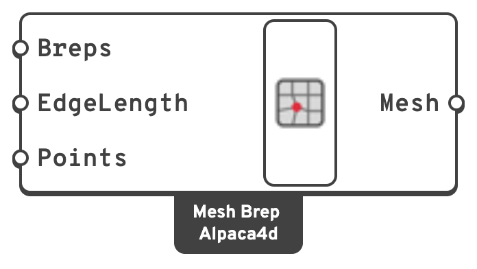

# Mesh Brep

Meshes surfaces and polysurfaces into quads for [ASD Shell](../elements/shell.md), with Rhino's
QuadRemesh. Faces that meet share the nodes along the edge between them, and the mesh has a node
at every point you give it: a support, a column, a point load.

## 🔧 Grasshopper component

`Mesh Brep (Alpaca4d)` — **Alpaca4d ▸ 10_Utility**

<figure><figcaption></figcaption></figure>

### Inputs

| Name | Nick | Type | Default | Description |
| --- | --- | --- | --- | --- |
| Breps | `Breps` | Brep (list) | — | Surfaces or polysurfaces to mesh, as one mesh. They are merged where they touch, so a wall standing on a slab shares the nodes along the line where it meets it. |
| Edge Length | `EdgeLength` | Number | `0.5` | The length the quads' sides aim for, in `m`. Every edge of the Brep is kept, so edges shorter than this make smaller quads around them. |
| Points | `Points` | Point (list) | *(empty)* | Points the mesh must have a node at. Each takes the nearest node and moves it onto itself, and the quads around it even out again. A point on an edge takes a node along that edge. |

### Outputs

| Name | Nick | Type | Description |
| --- | --- | --- | --- |
| Mesh | `Mesh` | Mesh | The quad mesh, joined into one. Feed it to [ASD Shell](../elements/shell.md). |

## 📈 When to use it

**Use it when**

- A shell model starts from surfaces: a wall with openings, a slab with a hole, a folded plate.
- Walls and slabs meet and must be joined there: one Mesh Brep over all of them gives them the
  same nodes along the line where they meet.
- Supports, columns or point loads must sit on a node: give their points to **Points**.

**Do not use it when**

- The shape is a series of profiles → [Mesh Loft](mesh-loft.md) gives quads that follow them.
- You want solids → [Turn geometry into solid elements](../../how-to/geometry/solids-from-geometry.md):
  bricks with [Mesh Series to Brick](mesh-series-to-brick.md), or
  [Ten Node Tetrahedra](../elements/ten-node-tetrahedron.md) from a tetrahedral mesh.

## 💡 What it does

QuadRemesh gives the smooth, mostly regular quads a shell model wants, but on its own it promises
no node at a support, and nothing joins a wall to the slab it stands on. Mesh Brep runs it so that
every face's boundary stays a line of mesh edges, then tidies the result:

- **Faces meshed apart are joined.** Where a wall meets a slab, the lines of nodes on either side
  are given the same count and welded into one. Where the counts cannot be evened out, a few quads
  are split into a quad and a triangle, and a remark says how many.
- **Edges are exact.** The nodes along each Brep edge sit on it, and the ones at its corners on
  them, so faces that share an edge share its nodes to the last digit.
- **Points take a node.** Each point moves the nearest node onto itself, and the nodes a few rings
  around it relax to even out the quads it pulled out of shape.


**Make the quads smaller than the points are apart.** Each point needs a node of its own to take:
with points 0.5 m apart along an edge, an **Edge Length** of 0.25 m. Too coarse a mesh leaves a
point with *found no node left to move onto it*, and a support or load given there is then not on
the model.


## ⚠️ Messages

| Message | What it means |
| --- | --- |
| *Point … is not on the Brep* | The point is further than the document tolerance from every face. It is left out. |
| *Point … found no node left to move onto it* | The nodes near it are already taken by other points. Make **Edge Length** smaller. |
| *The points at … are … apart, much closer than the quads are wide* | Two points, or a point and an edge, are closer than a quad: the quads between them are thin. |
| *Brep edge … was only roughly followed* | Nodes had to move to reach the edge, and the quads along it may be out of shape. |
| *An edge length of … would make about … quads* | More than 200 000 quads: usually an edge length typed in metres on a model in millimetres. |
| *The Breps could not be merged into one* | They touch in a way Rhino cannot merge, so their meshes would not be joined. |
| *Rhino's QuadRemesh could not mesh the merged Breps* | Usually a wall that meets a slab along a line stopping short of the slab's edges. Split the slab along that line, carried through to its edges, so the line is an edge of its own. |

## 💡 Examples

- [Lesson 9, Wall with a window](../../learn/09-wall-with-a-window.md) meshes a wall around its
  window, with a node on each support and load point.
- The [Connection Design](https://alpaca4d.github.io/examples/connection-design/) example meshes
  a steel connection in quads about 40 mm across, keeping the welds as edges.
