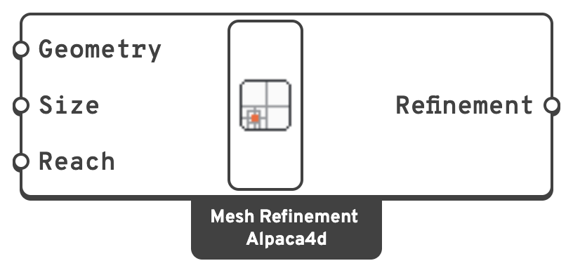

# Mesh Refinement

Says where [Mesh Solid](mesh-solid.md) and [Mesh Surface](mesh-surface.md) make smaller elements:
near a point, a curve, a surface or a mesh. The elements are **Size** at the geometry and grow back
to the mesh's own size away from it.

## 🔧 Grasshopper component

`Mesh Refinement (Alpaca4d)` — **Alpaca4d ▸ 10_Utility**

<figure><figcaption></figcaption></figure>

### Inputs

| Name | Nick | Type | Default | Description |
| --- | --- | --- | --- | --- |
| Geometry | `Geometry` | Generic | — | A point, curve, surface, Brep or mesh near which the elements are smaller. A list of them makes a refinement each. |
| Size | `Size` | Number | — | The edge length of the elements at the geometry, in `m`. |
| Reach | `Reach` | Number | *(empty)* | How far from the geometry the elements are back to the mesh's size, in `m`. Empty: they grow by about 30 % a ring, a gentle grading, which reaches the mesh's size at (mesh size − Size) / 0.3. |

### Outputs

| Name | Nick | Type | Description |
| --- | --- | --- | --- |
| Refinement | `Refinement` | Generic | Connect to the **Refinements** of [Mesh Solid](mesh-solid.md) or [Mesh Surface](mesh-surface.md). |

## 📈 When to use it

- Where stresses change quickly: round holes and openings, at re-entrant corners, at columns and
  point loads, along a fillet.
- Several at once: wire them all into **Refinements**. Where they overlap, the smallest size wins.

## 💡 What it does

A refinement only asks for smaller elements near its geometry: the mesh need not follow the
geometry, nor have nodes on it. For a node exactly at a point, give the point to the mesher's
**Points**, and for a line of nodes along a curve, Mesh Surface's **Curves**. To have both, wire the
same geometry into both.

gmsh measures the distance from points only, so the geometry is kept as points on it, half an
element apart. The distance is then out by a quarter of an element at most.


A **Reach** shorter than **Size** makes the elements jump from Size to the mesh's size within one of
them, and a remark says so. Leave it empty for a smooth grading.


## 💡 Examples

- The [Slab with Openings](https://alpaca4d.github.io/examples/slab-with-openings/) refines round
  its columns and along its openings' edges.
- The [Femur](../elements/ten-node-tetrahedron.md#femur) refines along the bone's neck.
