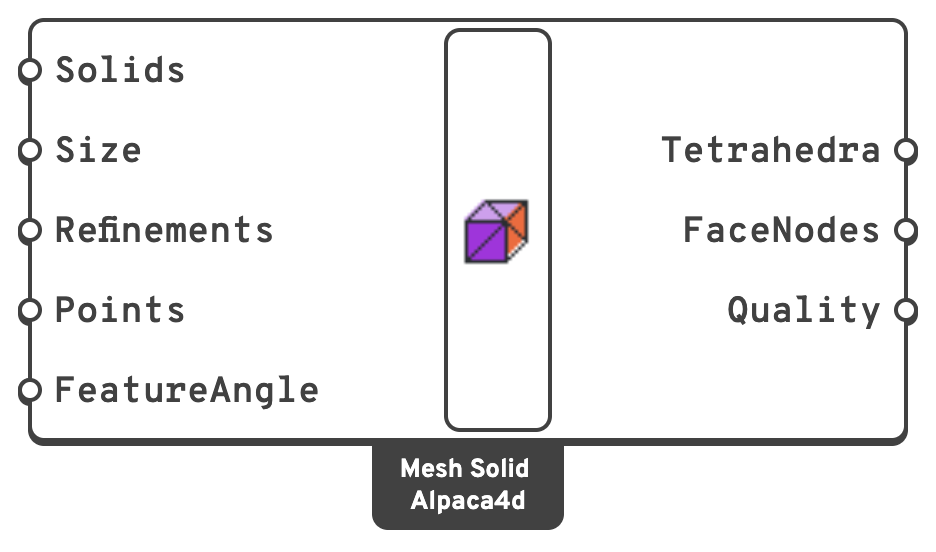

# Mesh Solid

Fills closed Breps and closed meshes with tetrahedra for
[Ten Node Tetrahedron](../elements/ten-node-tetrahedron.md), with [gmsh](https://gmsh.info). The
tetrahedra are smaller where a [Mesh Refinement](mesh-refinement.md) asks, and the mesh has a node
at every point you give it. Breps that touch are meshed as one, and share their nodes where they
meet.

## 🔧 Grasshopper component

`Mesh Solid (Alpaca4d)` — **Alpaca4d ▸ 10_Utility**

<figure><figcaption></figcaption></figure>

### Inputs

| Name | Nick | Type | Default | Description |
| --- | --- | --- | --- | --- |
| Solids | `Solids` | Generic (list) | — | Closed Breps or closed meshes to fill. Breps that touch or overlap are meshed as one, and share their nodes where they meet; where they overlap, the overlap goes to the first. Each closed mesh is meshed on its own. A box, an extrusion or a capped surface is taken as a Brep. |
| Size | `Size` | Number (list) | — | The edge length the tetrahedra aim for, in `m`, one for each solid; the last one is used for the rest. A footing can be coarser than the column on it. |
| Refinements | `Refinements` | Generic (list) | *(empty)* | Where the tetrahedra are to be smaller. Connect [Mesh Refinement](mesh-refinement.md). |
| Points | `Points` | Point (list) | *(empty)* | Points the mesh must have a node at, such as point loads and supports. A point inside or on a Brep is a node exactly; on a closed mesh's surface, the nearest node is moved onto it. A point in no solid is left out, with a warning. |
| Feature Angle | `FeatureAngle` | Number | `40` | Closed meshes only: edges that fold by more than this many degrees stay sharp. The surface between them is remeshed. |

### Outputs

| Name | Nick | Type | Description |
| --- | --- | --- | --- |
| Tetrahedra | `Tetrahedra` | Mesh (tree) | Four node tetrahedra, a branch `{solid}` for each solid. Feed them to [Ten Node Tetrahedron](../elements/ten-node-tetrahedron.md). |
| Face Nodes | `FaceNodes` | Point (tree) | The nodes on each face, a branch `{solid;face}`, the middles of the tetrahedra's edges included. A Brep's faces are numbered as Rhino numbers them; a closed mesh's are the patches gmsh cuts its surface into at its sharp edges. For supports and loads on a face. |
| Quality | `Quality` | Number (tree) | Each tetrahedron's shape, from 1 for a regular one down to 0 for a flat one, a branch for each solid. |

## 📈 When to use it

**Use it when**

- A solid is a closed Brep or a closed mesh: a footing, a bracket, a bone, a scanned sculpture.
- It needs smaller elements in places - round a hole, along a fillet, at a load - and larger
  ones elsewhere: wire a [Mesh Refinement](mesh-refinement.md) per place.
- Several solids touch and must work together, such as a column on its footing: give them all
  to one Mesh Solid. Their tetrahedra come out a branch each, so each can get its own material.

**Do not use it when**

- The body is thin → mesh its middle surface with [Mesh Surface](mesh-surface.md) for shells.
- A hexahedral mesh suits the shape → [Mesh Series to Brick](mesh-series-to-brick.md).

## 💡 What it does

Mesh Solid writes the geometry to files, has gmsh mesh them, and reads the mesh back. gmsh is
free, and you install it yourself, as you do OpenSees: see [Setup](../../setup.md#meshing-with-gmsh).

- **Breps** go to gmsh as STEP files, so it meshes their true faces: a cylinder's round face
  stays round. Breps that touch are cut into pieces where they meet, so the mesh has the same
  nodes on both sides of every interface. Points are cut into them too, which puts a node at each.
- **Closed meshes** go as STL. gmsh cuts their surface into patches at the edges sharper than
  **Feature Angle**, remeshes each patch at **Size**, and fills the whole.
- **Face Nodes** gives, for each face, the tetrahedra's corners on it and the middles of their
  edges, where [Ten Node Tetrahedron](../elements/ten-node-tetrahedron.md) puts its other six
  nodes. Support a face with all of them: held at its corners only, the edge nodes between them
  would be left free.


**Set Assemble Model's Tolerance below the smallest tetrahedron.** Its default, 1 cm, welds
nodes nearer than that together. Mesh Solid's remark gives the shortest edge: set
[Assemble Model](../assemble.md)'s **Tolerance** below it, 0.1 mm for most solids.



Mesh Solid runs every time an input changes, however many tetrahedra it is asked for. A Size
typed in metres on a model in millimetres asks for billions. Press **Escape** to stop gmsh.


## ⚠️ Messages

| Message | What it means |
| --- | --- |
| *Alpaca4d meshes with gmsh … It found none* | gmsh is not installed, or not where Alpaca4d looks. See [Setup](../../setup.md#meshing-with-gmsh). |
| *Solid … is a Brep that is not closed* | Mesh Solid fills closed Breps. For a surface, use [Mesh Surface](mesh-surface.md). |
| *Solid … is a mesh with holes in it* | Close it first, with Rhino's `FillMeshHoles`. |
| *Point … is in no solid, nor on one* | It is left out. |
| *The shortest element edge is …* | Set Assemble Model's Tolerance below it. |
| *The worst tetrahedron is shaped …* | A tetrahedron is nearly flat: stresses next to it are unreliable. A smaller Size, or a refinement there, helps. |
| *gmsh made no mesh … Its script is …* | gmsh failed. The message has its own words, and the folder its script and the geometry are in: open the script in gmsh to see where it stops. |
| *Stopped: gmsh was halted with Escape* | You pressed Escape while it meshed. |
| *gmsh was killed while it meshed* | It ran out of memory, most likely: the Size or a refinement asks for far too many tetrahedra. |

## 💡 Examples

- The [Femur](../elements/ten-node-tetrahedron.md#femur) fills a bone's closed surface with
  tetrahedra, finer along its neck.
