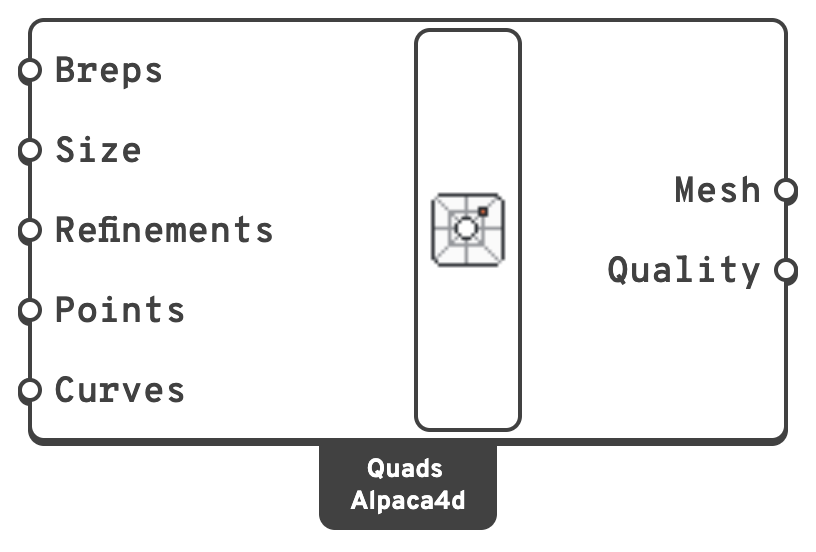

# Mesh Surface

Meshes surfaces and polysurfaces for [ASD Shell](../elements/shell.md), with [gmsh](https://gmsh.info):
quads by default, or triangles. The elements are smaller where a [Mesh Refinement](mesh-refinement.md)
asks, the mesh has a node at every point you give it, and a line of nodes along every curve. Faces
that touch share their nodes where they meet.

## 🔧 Grasshopper component

`Mesh Surface (Alpaca4d)` — **Alpaca4d ▸ 10_Utility**

<figure><figcaption></figcaption></figure>

### Inputs

| Name | Nick | Type | Default | Description |
| --- | --- | --- | --- | --- |
| Breps | `Breps` | Brep (list) | — | Surfaces or polysurfaces to mesh, as one mesh, sharing nodes where they touch. A closed polysurface is meshed as its faces: a lift core under a slab. |
| Size | `Size` | Number (list) | — | The edge length the elements aim for, in `m`, one for each Brep; the last one is used for the rest. |
| Refinements | `Refinements` | Generic (list) | *(empty)* | Where the elements are to be smaller. Connect [Mesh Refinement](mesh-refinement.md). |
| Points | `Points` | Point (list) | *(empty)* | Points the mesh must have a node at, such as point loads and columns. Each is a node exactly. A point on none of the surfaces is left out, with a warning. |
| Curves | `Curves` | Curve (list) | *(empty)* | Curves on the surfaces the mesh must have a line of nodes along, such as walls and beams. A beam drawn on the curve then shares the shell's nodes. A curve off the surfaces is left out, with a warning. |

### Outputs

| Name | Nick | Type | Description |
| --- | --- | --- | --- |
| Mesh | `Mesh` | Mesh | The mesh, joined into one, each element facing the way its surface does. Feed it to [ASD Shell](../elements/shell.md). |
| Quality | `Quality` | Number (list) | Each element's shape, in the mesh's face order: 1 for a square or an equilateral triangle, 0 for a flat one. |

### Right-click menu

| Item | Does |
| --- | --- |
| **Quads** | The default. gmsh meshes in triangles laid out in pairs, and joins them into quads. Where the mesh grades round a refinement, a few triangles are left; [ASD Shell](../elements/shell.md) takes them too. |
| **Triangles** | Triangles only. They grade evenly round refinements and tight curves. |

The component shows which one is on under its name.

## 📈 When to use it

**Use it when**

- A slab, a wall or a shell needs smaller elements in places: round columns, openings and point
  loads, and larger ones elsewhere.
- Columns, supports or point loads must sit on a node: give their points to **Points**.
- Beams or walls stand on a slab along a line: give the line to **Curves**, so they share its nodes.

**Do not use it when**

- You want quads only and the same size everywhere → [Mesh Brep](mesh-brep.md) gives pure quads,
  smoothly laid out by Rhino's QuadRemesh.
- The body is solid → [Mesh Solid](mesh-solid.md).

## 💡 What it does

Mesh Surface writes the Breps to STEP files, has gmsh mesh them, and reads the mesh back. gmsh is
free, and you install it yourself, as you do OpenSees: see [Setup](../../setup.md#meshing-with-gmsh).
gmsh cuts the Breps into pieces where they touch, and cuts the points and curves into them, so the
mesh is one, with a node at each point and element edges along each curve. A shell takes its local
axes from the way its element faces, so each element is turned to face the way its Brep face does.


**Set Assemble Model's Tolerance below the smallest element.** Its default, 1 cm, welds nodes
nearer than that together. Mesh Surface's remark gives the shortest edge: set
[Assemble Model](../assemble.md)'s **Tolerance** below it.



Mesh Surface runs every time an input changes, however many elements it is asked for. Press
**Escape** to stop gmsh.


## ⚠️ Messages

| Message | What it means |
| --- | --- |
| *Alpaca4d meshes with gmsh … It found none* | gmsh is not installed, or not where Alpaca4d looks. See [Setup](../../setup.md#meshing-with-gmsh). |
| *Point … is on none of the surfaces* | It is left out. |
| *Curve … does not lie on the surfaces* | It is left out. |
| *… elements, … of them triangles where the quads could not all pair up* | A remark: ASD Shell takes both. |
| *The shortest element edge is …* | Set Assemble Model's Tolerance below it. |
| *The worst element is shaped …* | An element is nearly flat: stresses next to it are unreliable. A smaller Size, or a refinement there, helps. |
| *gmsh made no mesh … Its script is …* | gmsh failed. The message has its own words, and the folder its script and the geometry are in: open the script in gmsh to see where it stops. |

## 💡 Examples

- The [Slab with Openings](https://alpaca4d.github.io/examples/slab-with-openings/) meshes a flat
  slab with a node on each column, finer round the columns and along a stair opening and a shaft.
