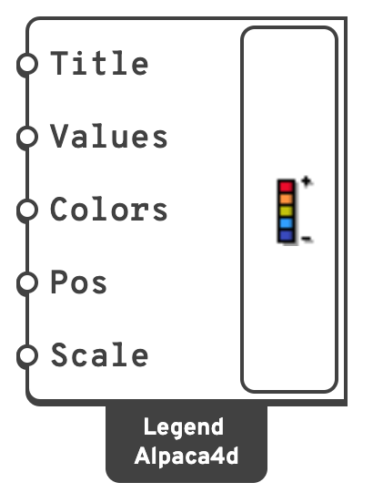

# Legend

Draws a fixed on-screen colour scale — the key that makes a contour readable.

## 🔧 Grasshopper component

`Legend (Alpaca4d)` — **Alpaca4d ▸ 09_Visualisation**

<figure><figcaption></figcaption></figure>

### Inputs

| Name | Nick | Type | Default | Description |
| --- | --- | --- | --- | --- |
| Title | `Title` | Text (list) | *(empty)* | Heading above the scale. Put the quantity and its unit here — `mxx [kN·m/m]`. With a branch of **Values** per legend, a title per legend, in the order of the branches. |
| Values | `Values` | Number (list) | *(empty)* | Numbers the labels run from the smallest to the largest of — the **Values** output of [Model View](model-view.md). To label a range of your own, give its two ends. One value more than there are colours labels the edges between the swatches instead of the swatches. Each branch is a legend of its own, drawn beside the one before. |
| Colors | `Colors` | Colour (list) | *Turbo* | The gradient, from the low end to the high — the **Colors** output of Model View. |
| Position | `Pos` | Integer | `0` | `0` left, `1` right, `2` bottom centre. |
| Scale | `Scale` | Number | `1.5` | Size multiplier. Values at or below zero fall back to `1.5`. The legend shrinks below it where it would not fit the viewport. |

### Outputs

None. The component draws straight to the viewport.

## 📈 When to use it

**Use it when**

- Any time you show a contour from [Model View](model-view.md). A contour without a scale says
  nothing.
- You are producing a figure for a report.

## 💡 Getting it to agree with the contour

The legend does **not** read [Model View](model-view.md) — it reads whatever you give it.
Wire the **Values** and **Colors** outputs of Model View into the inputs of the same names,
and the two stay in step: **Values** holds the value each colour stands for, over the **Range**
you gave Model View when you gave one.

With **Iso-surfaces** on in Model View, **Values** holds the edges of its bands — one value
more than there are colours — and the legend writes them on the lines between its swatches, so
each swatch reads as the band from the label above it to the label below.

With several results ticked in Model View, **Values** and **Colors** hold a branch per result,
and one Legend draws a legend for each, side by side — inwards from the edge at the left or the
right, upwards from the bottom. Give **Title** a list of titles, one per result in the order of
Model View's **Results** menu: `Uz [mm]`, then `Von Mises [MPa]`. A Legend of its own per result,
fed one branch through **Explode Tree**, can go at another **Position**.

If the numbers come from somewhere else, such as a [Results](../results/README.md) component,
give the legend the same **Colors** as the contour, and if you fixed a **Range** there, give
its two ends as **Values**.

The legend is drawn in **screen space**, so it stays put and stays the same size as you orbit
and zoom.
