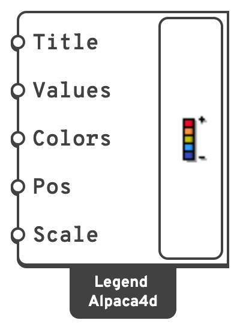

# Legend

Draws a fixed on-screen colour scale — the key that makes a contour readable.

## 🔧 Grasshopper component

`Legend (Alpaca4d)` — **Alpaca4d ▸ 09_Visualisation**

<figure><figcaption></figcaption></figure>

### Inputs

| Name | Nick | Type | Default | Description |
| --- | --- | --- | --- | --- |
| Title | `Title` | Text | *(empty)* | Heading above the scale. Put the quantity and its unit here — `mxx [kN·m/m]`. |
| Data | `Data` | Number (list) | *(empty)* | Numbers the labels run from the smallest to the largest of — the **Values** output of [View Results](view-results.md). To label a range of your own, give its two ends. One value more than there are colours labels the edges between the swatches instead of the swatches. |
| Colors | `Colors` | Colour (list) | *Turbo* | The gradient, from the low end to the high — the **Colors** output of View Results. |
| Position | `Pos` | Integer | `0` | `0` left, `1` right, `2` bottom centre. |
| Scale | `Scale` | Number | `1.5` | Size multiplier. Values at or below zero fall back to `1.5`. The legend shrinks below it where it would not fit the viewport. |

### Outputs

None. The component draws straight to the viewport.

## 📈 When to use it

**Use it when**

- Any time you show a contour from [View Results](view-results.md). A contour without a scale says
  nothing.
- You are producing a figure for a report.

## 💡 Getting it to agree with the contour

The legend does **not** read [View Results](view-results.md) — it reads whatever you give it.
Wire the **Values** and **Colors** outputs of View Results into **Data** and **Colors**, and
the two stay in step: **Values** holds the value each colour stands for, over the **Range**
you gave View Results when you gave one.

With **Iso-surfaces** on in View Results, **Values** holds the edges of its bands — one value
more than there are colours — and the legend writes them on the lines between its swatches, so
each swatch reads as the band from the label above it to the label below.

If **Data** comes from somewhere else, such as a [Results](../results/README.md) component,
give the legend the same **Colors** as the contour, and if you fixed a **Range** there, give
its two ends as **Data**.

The legend is drawn in **screen space**, so it stays put and stays the same size as you orbit
and zoom.
