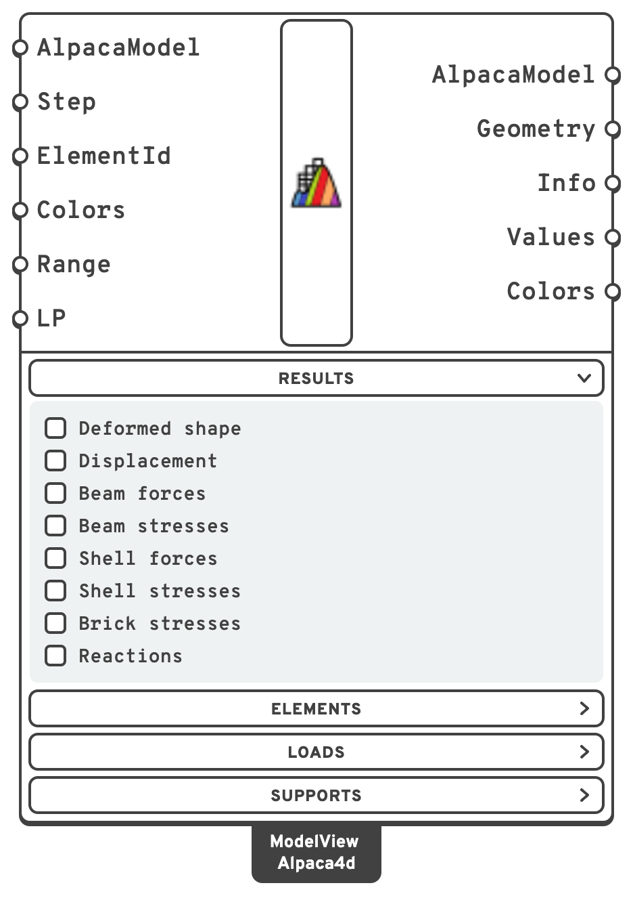
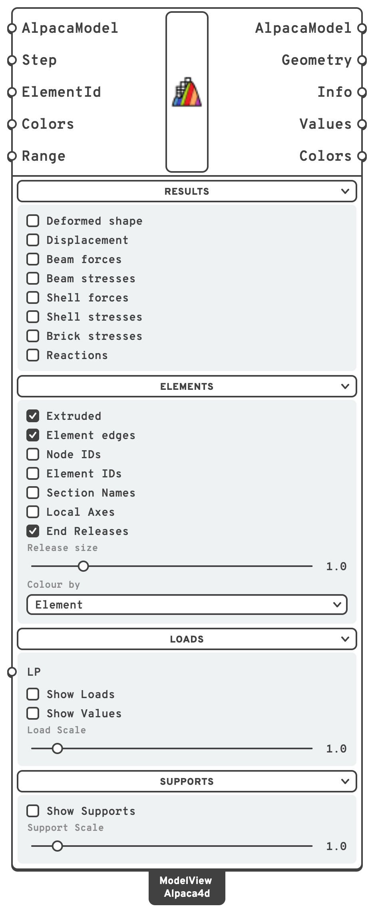
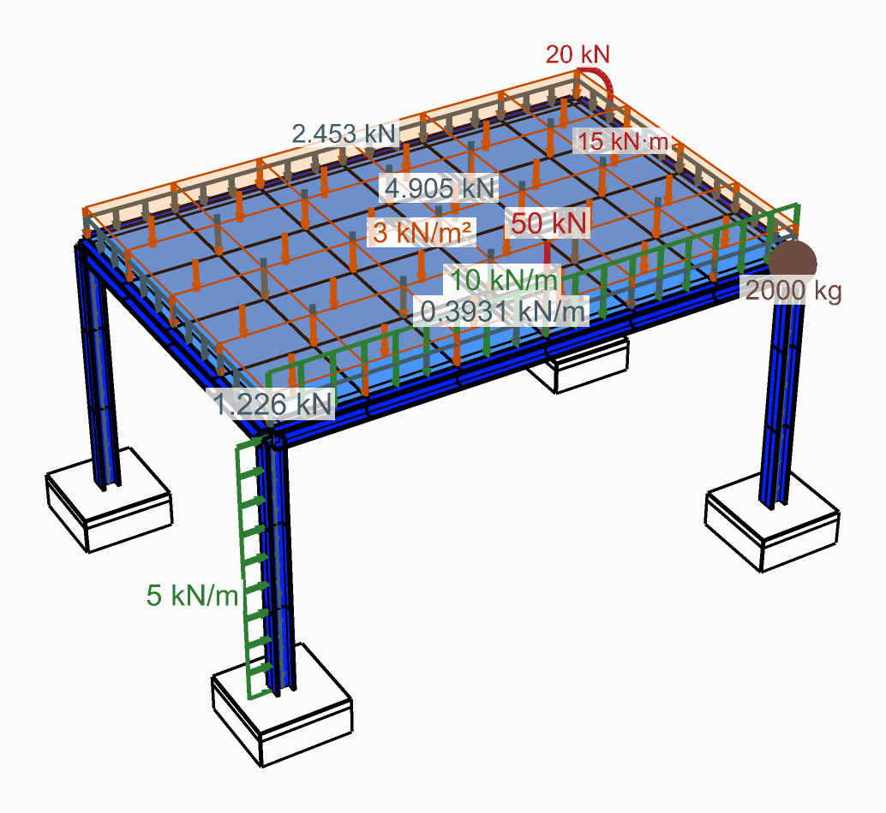
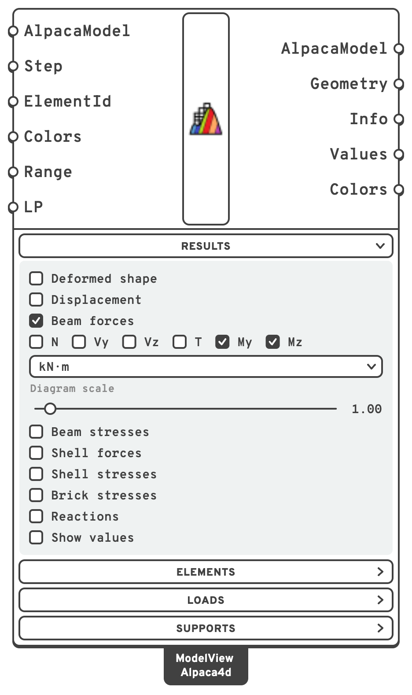

# Model View

Draws the model in the viewport, and its results — one or several at once: displacements, beam
force diagrams, beam stresses, shell forces, shell stresses, solid stresses and reactions. The
node and element ids, section names, local axes, end releases, loads and supports can be drawn
over either, so a model and its results are checked from one component.

## 🔧 Grasshopper component

`Model View (Alpaca4d)` — **Alpaca4d ▸ 09_Visualisation**

<figure><figcaption></figcaption></figure>

<figure><figcaption>
With every menu open
</figcaption></figure>

### Inputs

| Name | Nick | Type | Default | Description |
| --- | --- | --- | --- | --- |
| AlpacaModel | `AlpacaModel` | Model | — | The model to draw: from [Assemble](../assemble.md) to see it on its own, or from [Run Analysis](../analysis/run-analysis.md), [Natural Vibration](../analysis/natural-vibration.md) or [Linear Buckling](../analysis/linear-buckling.md) to see its results as well. The results are read from the recorder file the analysed model points at. |
| Step | `Step` | Integer | `0` | Which recorded step to draw, or which mode after a natural vibration or buckling analysis. |
| ElementId | `ElementId` | Text (list) | *(empty)* | Draw only some elements: an ElementId (`MyBeam_3`), a wildcard over them (`MyBeam*`, `Col_?`), an element tag (`47`) or a regular expression (`regex:^Col`), mixed freely. What is left out is greyed rather than hidden, so what you are looking at stays in the model around it. Empty draws them all. |
| Colors | `Colors` | Colour (list) | Turbo | The gradient to colour the results with, from the low end to the high. Connect [Colors](colors.md) for a ready-made one. With **Iso-surfaces** on, each colour is one band of values. Beam force diagrams ignore it and use the colour that belongs to the force. |
| Range | `Range` | Domain (list) | *(empty)* | The range each gradient is stretched over, in the unit picked for its result: one per result ticked, in the order of the **Results** menu, *Beam forces* left out as it has no gradient. A result given none fits what is drawn, which makes two steps impossible to compare: set it to compare them. |
| LoadPattern | `LP` | Integer | *all* | Draw the loads of one pattern only, by Id. Leave empty to draw all of them. It sits in the **Loads** menu. |

### Outputs

| Name | Nick | Type | Description |
| --- | --- | --- | --- |
| AlpacaModel | `AlpacaModel` | Model | The model, passed through so the component can sit inline. |
| Geometry | `Geometry` | Geometry (list) | What is drawn, as geometry: the elements and the results on them as coloured meshes, beams drawn as lines as lines, and force diagrams and reaction arrows. See [A copy beside the model](#a-copy-beside-the-model). |
| Info | `Info` | Text (list) | What is drawn, a line per result, with the unit it is in and the range it spans — `Displacement - Uz [mm], step 0, min -12.3, max 0` — or `Model - coloured by Section` with no result ticked. |
| Values | `Values` | Number (tree) | The value each colour stands for, one per colour of **Colors**, from the low end to the high — over **Range** when it is set — in the unit picked for the result. A branch per result ticked, in the order of the **Results** menu, *Beam forces* left out. With **Iso-surfaces** on, the edges of the bands instead, one more than there are colours. Feed it to the **Values** input of [Legend](legend.md). Empty with no result. |
| Colors | `Colors` | Colour (tree) | The gradient used, a branch for each branch of **Values**. Feed it to the **Colors** input of Legend, so the legends and the model agree. |

### Results menu

What to draw: tick one result, or several, and they are drawn together — see
[Several results at once](#several-results-at-once). The menu starts open; the other three start
folded — click a menu's header to unfold it. Each menu shows only the controls the choice uses:
under each result, its own controls, while it is ticked.

| Control | Default | Does | Shown |
| --- | --- | --- | --- |
| Deformed shape | off | Draws the model, or the results, on the deformed shape. Needs an analysed model, with no result too. | Always |
| Deformation scale | `1`, from 0 to 200; from −2 to 2 on a natural vibration or buckling model | How much the deformation is magnified. A natural vibration or buckling mode has no size of its own, so at 1 it is drawn with its largest movement 8 % of the model's diagonal, as far off the model as the force diagrams; any other displacement at true size. A mode goes either way, so a natural vibration or buckling model switches the slider to −2 to 2, and another model switches it back. A range of your own, set by double-clicking the slider, is kept whatever the model. | With **Deformed shape** on |
| Animate | off | Sweeps the deformation scale from the slider's least value to its greatest and back, moving the slider with it. It reads *Stop animation* while it runs. | With **Deformed shape** on |
| Displacement, Beam forces, Beam stresses, Shell forces, Shell stresses, Brick stresses, Reactions | off | A checkbox each: draws that result. A result needs an analysed model; ticked on one from Assemble, the model is drawn as it is, with a warning. | Always |
| Component | the first | Which component of the result to draw, below. Under *Beam forces*, a row of checkboxes instead — N, Vy, Vz, T, My, Mz — and every one ticked is drawn, a diagram each; N to start with. | Under each result ticked |
| Unit | in bold, below | The unit of the component picked — for *Beam forces*, one for the forces and one for the moments, each shown while one of its kind is ticked. | Under each result ticked |
| Diagram scale | `1`, from 0 to 20 | Stretches the beam force diagrams. | Under *Beam forces* |
| Layer through the thickness | Top | Top, Middle or Bottom. | Under *Shell stresses* |
| Read in which axes | Global | Global, or Local — the element's own axes, from its node numbering. | Under *Brick stresses* |
| Reactions drawn as | Selected component | Selected component, Resultant or All three. | Under *Reactions* |
| Arrow scale | `1`, from 0 to 20 | Stretches the reaction arrows. At 1, the largest arrow stands as far off the model as the largest diagram. | Under *Reactions* |
| Iso-surfaces | off | Colours in bands — one flat colour per range of values — instead of a smooth gradient. See [Iso-surfaces](#iso-surfaces). | With any result but *Beam forces* ticked |
| Show values | off | Writes values on the model, in the unit picked, to four significant figures: each beam's largest, at the tip of its diagram for beam forces; each shell or solid element's at its centre; each reaction at its arrow. | With any result ticked |

With no result ticked, the model is drawn alone, every element in the colour **Colour by** in the
**Elements** menu gives it, and no analysis is needed.

| Result | Components |
| --- | --- |
| Displacement | Magnitude, Ux, Uy, Uz |
| Beam forces | N, Vy, Vz, Torsion, My, Mz |
| Beam stresses | σN, σMy, σMz, σx, σmax, σmin, τV, τT, VonMises |
| Shell forces | pxx, pyy, pxy, mxx, myy, mxy, vxz, vyz, named as in [Shell Forces](../results/shell-forces.md) |
| Shell stresses | σ11, σ22, σ12, σ23, σ31, VonMises |
| Brick stresses | σ11, σ22, σ33, σ12, σ23, σ13, VonMises |
| Reactions | Force, Fx, Fy, Fz, Moment, Mx, My, Mz |

**Unit** offers the units of the component picked. A new Model View starts in the unit in bold.
**Info**, **Values**, the values written on the model and **Range** are all in the unit picked, so
a legend fed from **Values** reads in it too, and a **Range** is typed in it.

| Component | Units |
| --- | --- |
| Displacement | **mm**, cm, m |
| N, Vy, Vz of *Beam forces*; Force, Fx, Fy, Fz of *Reactions* | N, **kN**, MN |
| Torsion, My, Mz of *Beam forces*; Moment, Mx, My, Mz of *Reactions* | N·mm, N·m, kN·cm, **kN·m**, MN·m |
| Every stress — *Beam*, *Shell* and *Brick stresses* | kPa (= kN/m²), **MPa** (= N/mm²), kN/cm² |
| pxx, pyy, pxy, vxz, vyz of *Shell forces* | N/m, **kN/m** (= N/mm), MN/m |
| mxx, myy, mxy of *Shell forces* | N·m/m, **kN·m/m**, MN·m/m |

Each result keeps a unit of its own for each kind of quantity it has: switch *Beam forces* from N
to My and back, and N is still in the unit you left it in; give *Beam stresses* MPa and
*Shell stresses* kPa, and each keeps its own.

### Elements menu

How the elements are drawn, and what is drawn over them — over the model or the results — for the
elements **ElementId** kept.

| Control | Default | Does |
| --- | --- | --- |
| Extruded | on | Draws each beam as its cross-section, and each shell as thick as its section with no result. A beam whose section has no shape to draw stays a line. Beam stresses that differ across the section are painted point by point over it — see [Beam stresses over the section](#beam-stresses-over-the-section). |
| Element edges | on | Draws the edges of the shell, solid and extruded beam elements. |
| Node IDs | off | The tag of every node. |
| Element IDs | off | The tag of every element. |
| Section Names | off | The section name on each beam. |
| Local Axes | off | The local axes of each element as red, green and blue arrows: *x*, *y*, *z* on beams, 1, 2, 3 on shells and solids. These are the axes beam and shell forces and local solid stresses are reported in. |
| Axes size | `1`, from 0.1 to 10 | How big the local axes are drawn, as a multiple of each element's own size. Shown while **Local Axes** is on. |
| End Releases | on | Each released end of a beam: a circle for a released rotation, in the plane the end turns in, and two short lines for a released translation, along the free direction — red, green and blue for local *x*, *y* and *z*. A truss gets three circles at each end, a ball joint. Nothing where nothing is released. |
| Release size | `1`, from 0.1 to 5 | How big the release symbols are drawn. Shown while **End Releases** is on. |
| Colour by | `Element` | What the elements are drawn in: `Element`, `Section` or `Material` — see [Colouring by section or material](#colouring-by-section-or-material). Shown with no result ticked. |
| Text size | `0.5`, from 0.05 to 5 | The height of the capitals of everything written on the model — values, ids, section names, load values — in model units. Each is written on a white plate, so it reads on Rhino's grey background, on a shell and on a result's colours alike, and over the model; one less than a few pixels high is left out. Shown while any of them is on. |

The ids, names, axes and releases are drawn where the model was built, also over a deformed shape.
The loads ride on it: with **Deformed shape** ticked, each arrow moves with the node, the point along
a beam or the shell it acts on, so that the loads stay on the structure as it deforms and as it
animates.
With both **Element IDs** and **Section Names** on, a beam's id is written above its section name.

### Loads menu

| Control | Effect |
| --- | --- |
| LoadPattern | The **LoadPattern** input, drawn in the menu: one pattern's loads only. |
| Show Loads | Draws every load of the model, each kind to fit it — see [How the loads are drawn](#how-the-loads-are-drawn). |
| Show Values | Writes what each load is worth just beyond the tail of its arrow, in the load's colour: `kN` for a point load and `kN·m` beside its moment, `kN/m` once along each run of beams with the same line load, `kN/m²` once over each patch of shells with the same surface load, for the self-weight `kN/m` once a run of beams and `kN` on each node, and `kg` under a mass. Works with or without **Show Loads**; its size is **Text size**, under **Elements**. |
| Load Scale | `1`, from 0.1 to 10. How long the arrows are, as a share of the length they are fitted to: at `1` the largest point load's arrow is 15% of the model's size. |

#### How the loads are drawn

Each kind of load is drawn to fit the model, whatever it is worth. At **Load Scale** `1` the
largest point load gets an arrow 15% of the model's size, the largest line load 60% of that and
the largest surface load 40%, the self-weight half of the point and line loads', shorter as a drawing has them, so that a point load in a span and
the line load along it are not written in one place. The others of each kind are drawn in
proportion, down to a tenth of the largest, so that a small load beside a large one still shows.
A frame 8 m across and a bridge 80 m long both get arrows that can be read.

<figure><figcaption>
Every kind of load on one frame, with <strong>Show Loads</strong>, <strong>Show Values</strong> and <strong>Show Supports</strong> on
</figcaption></figure>

| Load | Drawn as |
| --- | --- |
| [Point Load](../loads/point-load.md) | An arrow ending on the node. A moment is three quarters of a circle round its axis, turning the way the moment does by the right-hand rule, with its head at the end. |
| [Linear Load](../loads/beam-load.md) | Arrows spread evenly along the beams it is on, ending on them, and a line joining their tails. Beams given one by one with the same load, as a list into **Beam\|Id** gives them, are one run where they meet, and written once. |
| [Mesh Load](../loads/shell-load.md) | A see-through sheet over the shells, on the side the load comes from, and arrows from it onto them. Shells given one by one with the same load are one patch, written once. |
| [Gravity Load](../loads/gravity.md) | The loads OpenSees is given for it, times the factor, in a colour of its own. Along each beam, its weight per metre, drawn as a Linear Load is. On the nodes of a shell, a solid or a truss, an arrow down on each node with the weight of every element meeting there. Its arrows are half as long as the largest point and line loads', so that a load on the same node or beam stands out of them. |
| [Mass Point](../loads/mass-point.md) | A dot on the node, with its mass under it. Drawn whatever **LoadPattern** says: a mass belongs to no pattern. |

A definition saved before the loads were drawn to fit opens with **Load Scale** at `1`: it was
metres of arrow per kN then, and an old value would now shrink or stretch the fit.

### Supports menu

| Control | Effect |
| --- | --- |
| Show Supports | Draws support symbols — [the seven presets](../elements/support.md#the-seven-presets) get their own glyph, anything else a text tag. |
| Support Scale | Slider, 0.1 – 10. Symbol size. |

Ticking **Show values**, or anything in the **Elements**, **Loads** and **Supports** menus but
**Extruded** and **Colour by**, draws the viewport again and nothing more: the model is not read
or built again, and nothing downstream is solved again.

## 📈 When to use it

**Use it when**

- Before every analysis, on every model. It is the cheapest way to catch a support in the
  wrong place, a load pointing the wrong way, or two members that never connected.
- After every analysis, to read the results on the model they belong to.
- You are working out which way a beam's local axes run, before reading
  [Beam Forces](../results/beam-forces.md) — turn on **Local Axes** over *Beam forces*.
- You want a figure of the model, or of a result.

**Do not use it when**

- You want numbers to work with → the components in [Numerical Output](../results/README.md)
  hand them out as lists.

## 💡 What to check, and how

| Question | Turn on |
| --- | --- |
| Did the members actually connect? | **Node IDs** — two tags at one joint means the [Assemble](../assemble.md) tolerance is too small. |
| Is the section oriented the way I meant? | **Extruded** |
| Which way is local *y* on this beam? | **Local Axes** — this is what `My` and `Mz` in [Beam Forces](../results/beam-forces.md) refer to. |
| Are the supports right? | **Show Supports**, then compare the glyphs against [the preset table](../elements/support.md#the-seven-presets). |
| Did that load land where I put it? | **Show Loads**; **Load Scale** makes the arrows longer or shorter. |
| Is it as big as I meant? | **Show Values**, in the **Loads** menu. |
| Did every member get the section I meant? | No result ticked, **Colour by** `Section`, with **Section Names** on. |
| Is the support taking what I think? | *Reactions*, with **Show Supports** on. |

## 💡 Colouring by section or material

With no result ticked, **Colour by** in the **Elements** menu sets what the elements are drawn in:

| Colour by | Each element is drawn in |
| --- | --- |
| `Element` | The colour its element component gave it — the **Colour** input of [ForceBeamColumn](../elements/force-beam-column.md), or the default for its kind. |
| `Section` | Its section's colour. A solid has no section, and is drawn in its material's. |
| `Material` | Its section's material's colour, or a solid's own material's. A layered shell is drawn in the material of its first layer. |

A section or material takes the colour given to the **Colour** input of the component that made
it — every section component, the [Steel Section Library](../sections/library.md), the
[Uniaxial](../materials/Uniaxial.md) and [nD](../materials/ND.md) materials and the
[Material Library](../materials/MaterialDatabase.md) have one. Those given none are each picked a
colour of their own, in the order the model meets them, from a set of ten chosen to be told apart.

Elements that share a section share its colour, and "share" goes by **name**: two Section
Library components both set to `IPE200` are one colour, though the analysis gets two sections.
A section or material with no name goes by what it is, so the elastic steel every Section
Library falls back on is one material in the view, however many components fell back on it.

Given a model from Section Optimiser, Model View with no result ticked, coloured by
`Section`, shows which section each beam ended with — on the deformed shape, with **Deformed
shape** ticked.

## 💡 A copy beside the model

**Geometry** hands out what is drawn as geometry, so that it can be moved, copied or baked. Wire
it into Grasshopper's **Move**, and the result is drawn again wherever Move puts it: the model in
one place and its results beside it, from one analysis.

- The meshes keep their colours: Grasshopper draws a mesh's own colours in its preview, and
  **Bake** carries them into Rhino.
- A beam drawn as a line is handed out as a line, which cannot carry a colour. Draw the beams
  **Extruded** to keep their colours.
- What the filter left out is handed out in its grey, but not see-through.
- What is written on the model — values, ids, section names — and the axes, releases, loads and
  supports are drawn by the component only, and are not in **Geometry**.
- Turn the component's preview off if only the copy should be drawn.

To set the results beside the model, use two Model Views on the same model: one with no result
ticked and its preview on, the other with the results ticked and its **Geometry** moved.

## Results

Connect the analysed model from [Run Analysis](../analysis/run-analysis.md) or
[Natural Vibration](../analysis/natural-vibration.md), then tick what to draw in the
**Results** menu on the component body. After a natural vibration analysis, **Step** selects
the mode.

Feed its **Values** and **Colors** outputs to [Legend](legend.md), so the scale matches what is
drawn. **Values** follows **Range**, so the legend matches with or without one.

*Beam stresses* colours each beam along its length by any output of
[Beam Stresses](../results/beam-stresses.md) — σN, σMy, σMz, σmax, σmin, τV, τT or Von Mises —
or by σx, in MPa unless another **Unit** is picked, with each integration point's colour placed
where the point sits on the beam. Drawn as lines, each integration section shows its worst; with
**Extruded** on, the stress is painted over the section itself — see below.

*Beam forces* draws each force ticked in its row — N, Vy, Vz, T (torsion), My, Mz, any number of
them — as a diagram in the plane it acts in, in the beam's local axes (turn on **Local Axes** to
see them): Vy and Mz across local *y*, Vz and My across local *z*, N and torsion across local *y*.
Each force has a pair of colours of its own, one for each sign, so two diagrams in one plane can
be told apart. **Moments are drawn on the tension side** — on a beam with local *y* up, sagging
hangs below it; the other forces are drawn towards the positive axis. One scale per force serves
the whole model, so the heights compare from one beam to the next, and every force's largest
stands as far off the model as the others'; **Diagram scale** stretches them all. With **Show
values** on, each beam's largest value of each force is written at the tip of its diagram. **Info**
has a line per force ticked. The signs of the numbers are those of
[Beam Forces](../results/beam-forces.md).

<figure><figcaption>
<em>Beam forces</em> ticked, with My and Mz picked: a diagram each
</figcaption></figure>

A result is painted on a shell's mid-surface, whatever **Extruded** says; beams are drawn as their
cross-section, on the deformed shape too, coloured by the result that colours them.

### Several results at once

Tick more than one result and they are drawn together: beam force diagrams over shells coloured by
their stress, with the reactions at the supports, from one component.

- **An element shows one colour.** A beam, shell or solid is coloured by its own result —
  *Beam stresses*, *Shell forces* or *Shell stresses*, *Brick stresses* — and *Displacement*
  colours whatever none of those does: tick *Shell stresses* and *Displacement* and the shells
  show their stress, the beams how far they moved. An element no result ticked has a value for is
  drawn plain grey.
- *Shell forces* and *Shell stresses* both colour the shells, so ticking one unticks the other.
- *Beam forces* and *Reactions* colour no element: their diagrams and arrows are drawn over
  whatever does.
- Each result has a gradient of its own, fitted to the elements it colours, in its own unit.
- **Info** has a line per result, in the order of the menu, and one per force ticked under *Beam forces*.
- **Values** and **Colors** have a branch per result coloured by the gradient — every one but
  *Beam forces* — in the order of the menu. Wire both into one [Legend](legend.md) and it draws a
  legend per branch, side by side; give its **Title** a title per result, in the same order.
- **Range** takes an interval per result coloured by the gradient, in the same order. A result
  left without one fits what is drawn.

### Beam stresses over the section

A beam pushed and bent both ways is not stressed alike across its section: one corner works hardest,
the opposite one least. With **Extruded** on, *Beam stresses* paints the stress at every point of
the section's surface, so that shows — the gradient from the top of the beam to the bottom, and
from one side to the other.

| Component | Drawn as lines | With **Extruded** |
| --- | --- | --- |
| σN | N/A | the same: N/A is the same all over the section |
| σMy, σMz | the largest bending stress each moment causes, in size | My·z/Iy and −Mz·y/Iz at each point, with their signs |
| σx | σmax or σmin, whichever is larger in size, with its sign | the direct stress at each point, N, My and Mz together: positive in tension |
| σmax, σmin | the largest and the smallest direct stress on the section | the same, one colour round the section |
| τV, τT | the peak shear from Vy and Vz, and from torsion | the size of the shear at each point, running along the surface |
| VonMises | the worst σ with the worst τ | √(σ² + 3τ²) at each point, of the σ and τ that meet there |

σx is the one to look at for an axial force with bending: tension along one edge, compression
along the other, and the neutral axis where the colour passes zero.

How the shear is spread over the section depends on its shape — Jourawski's parabola on a
rectangle, thin-walled shear flow on an I, a pair of angles or a box, round the circle on a round
bar or tube — and torsion's too: Saint-Venant on a rectangle, T·r/Ip on a round section, T·t/J on
each wall of an I or a pair of angles, Bredt on a box. Within Von Mises, shear and torsion are
signed along the surface, so on one face of a wall they add and on the other they take away, and
Von Mises shows the face that is worse. Its largest value at a point is usually below the one the
line view and [Beam Stresses](../results/beam-stresses.md) give, since the worst σ and the worst τ
rarely meet at one point: bending peaks at a section's edges and shear on its neutral axis. It is
not always below it: where Vy and Vz act together, their shear flows add along one wall of an I or
a box, and the stress there can be higher — by about a fifth on a box sheared equally both ways.

The range fits every point drawn, so turning **Extruded** on or off can change the range of the
same component: σMy, for one, runs from minus its largest to plus it, where as lines it is never
below zero.
**Iso-surfaces** bands the field over the section as well. A
[Generic Section](../sections/parametric-cross-section.md) has no shape to work the stress out
over, so its beams are coloured by σN only — one colour round the section when extruded — and
drawn plain grey for every other component.

### Iso-surfaces

With **Iso-surfaces** ticked, the range is cut into as many equal bands as there are colours in
**Colors**, and everything in a band is drawn in that band's colour, flat. Where the value
crosses from one band into the next, the element is cut along the line where it does, so the
bands meet in a sharp edge across the elements rather than blending into each other. It reads
like a contour map: which parts are over a value, and where the boundary runs, is plain at a
glance.

- **The number of bands is the number of colours.** [Colors](colors.md) gives ten; give
  **Colors** a list of your own for more or fewer.
- **Range** sets the bands as it sets the gradient: give it `0 to 10` with ten colours and each
  band is one unit wide.
- Anything below the range is in the first band, and anything above it in the last.
- Shells, solids, beams — lines or extruded — and reaction arrows are all banded. *Beam forces*
  is not: its diagrams take the colour of the force, not the gradient.
- **Element edges** still draws the elements' own edges, not the cuts between bands.

**Values** then holds the edges of the bands, one more than there are colours, and
[Legend](legend.md) wired to it writes them on the lines between its swatches, so each swatch
reads as the band from one label to the next.

## 🔁 Instead of the old components

Model View took over from View Results_WIP and from the Model View before it, which drew the
model only. Both are hidden from the ribbon, and definitions that use them still open and draw
what they drew. **Solution ▸ Upgrade Components** swaps each for the new Model View with its
settings and wires:

| You used | It becomes |
| --- | --- |
| Model View, before it drew results | No result ticked, with every toggle, size and **Colour by** as they were, but **Load Scale**, which was metres of arrow per kN and starts again at `1`. **LP** goes to **LoadPattern** and **ElemIds** to **ElementId**, which takes an element tag as before — but the elements it leaves out are now greyed rather than hidden. **Show Constraints**, which drew nothing, is gone. |
| View Results_WIP | The result it drew, ticked alone, with the component, unit, layer and display settings it had; its diagram scale sizes both the diagrams and the arrows. **End Releases** is off. Its five inputs are the new one's first five, and **Info**, **Values** and **Colors** keep their wires. |

The separate view components before those are hidden too:

| You used | In Model View |
| --- | --- |
| Deformed Model View | *Displacement*, with **Deformed shape** ticked |
| Beam Forces View | *Beam forces* |
| Shell Forces View | *Shell forces* |
| Shell Stresses View | *Shell stresses* |
| Brick Stresses View | *Brick stresses* |


On a large model, **Node IDs**, **Element IDs** and **Local Axes** are drawn thousands at a time,
every time the view moves. Use **ElementId** to narrow the view to the part you are inspecting,
or turn them off again once you have looked.



The colours of the ids, section names, loads, gravity, masses and result values are set once for
every definition, in **Alpaca4d → Settings → Display...** in the Grasshopper menu bar. They apply
as soon as they are picked, and are kept for the next session. They are dark by default, to read
on Rhino's light grey viewport and on the white plate behind every label. Until 0.12 the ids
were white, yellow and cyan, which could hardly be seen there: a settings file from then gives
up those old defaults for the new ones, and keeps any colour picked by hand.

