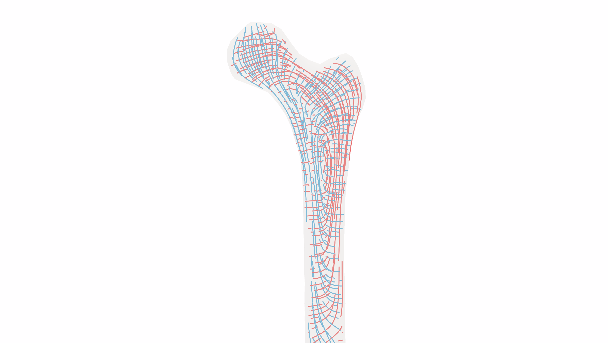
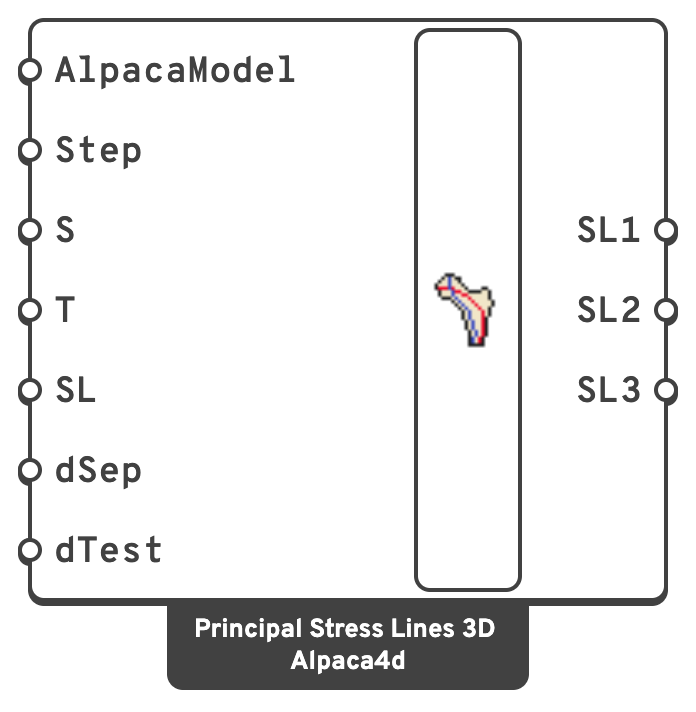
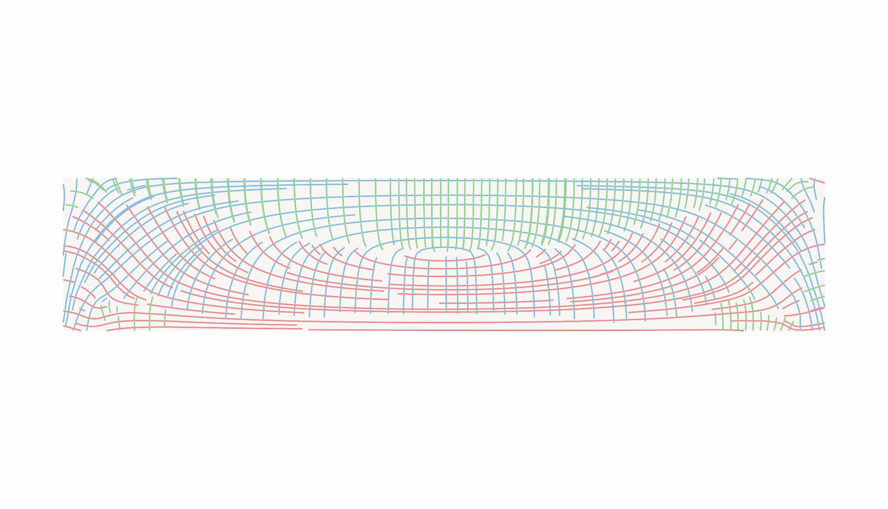
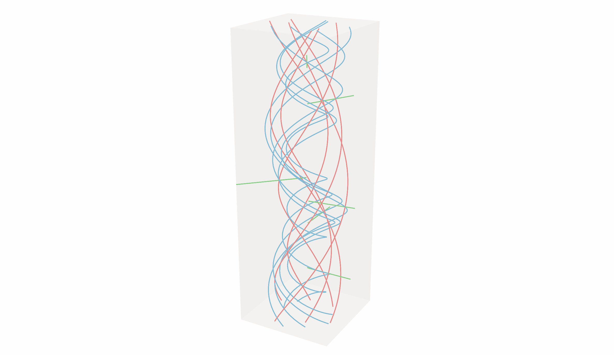

# Principal Stress Lines 3D

Traces streamlines through the **inside of a solid** — SSP Bricks and tetrahedra — along its three
principal stresses. Where [Principal Stress Lines](principal-stress-lines.md) shows the load paths
across a shell, these show them through a block, a bone or a node: where the compression runs and
where the tension wraps round it.

<figure><figcaption>
The Standardised Femur under the hip's force, in ten node tetrahedra: compression (SL3, blue) runs from the head down the inner side of the shaft, tension (SL1, red) arches over the neck and down the outer side. The lines of a slice 1 cm thick through the middle of the bone.
</figcaption></figure>

## 🔧 Grasshopper component

`Principal Stress Lines 3D (Alpaca4d)` — **Alpaca4d ▸ 09_Visualisation**

<figure><figcaption></figcaption></figure>

### Inputs

| Name | Nick | Type | Default | Description |
| --- | --- | --- | --- | --- |
| AlpacaModel | `AlpacaModel` | Model | — | An analysed model with solid elements: SSP Bricks or tetrahedra. |
| Step | `Step` | Integer | `0` | Analysis step. |
| Seed | `S` | Point (list) | — | Points inside the solid for the lines to go through. A seed outside it draws nothing, and a Remark says how many did. |
| Step Tolerance | `T` | Number | `0` | Length of one step along a line. `0` takes a third of the elements' mean edge length. |
| Single Line | `SL` | Boolean | `true` | `true` draws one line of each family through each seed; `false` grows a field of lines from the seeds. |
| Separation | `dSep` | Number | `0` | Distance between neighbouring lines in a field. `0` takes three times the elements' mean edge length. |
| Test Dist. | `dTest` | Number | `0` | In a field, a line stops when it comes closer than this to one already drawn. `0` lets lines run on. |

### Outputs

| Name | Nick | Type | Description |
| --- | --- | --- | --- |
| Stress Lines 1 | `SL1` | Curve (list) | Lines along the largest principal stress: the most tensile. |
| Stress Lines 2 | `SL2` | Curve (list) | Lines along the middle principal stress. |
| Stress Lines 3 | `SL3` | Curve (list) | Lines along the smallest principal stress: the most compressive. |

With **Single Line** on, each output has one line per seed, in the order of the seeds: an empty
one where the seed is outside the solid or the stress there gives no direction.

## 📈 When to use it

**Use it when**

- You want to see how a load travels through a solid: a footing, a corbel, a node, a bone.
- You are shaping a solid by its load paths — where to keep material, where a strut or a tie
  runs — before [Topology Optimisation](../optimisation/topology-optimisation.md) or instead of it.
- You are laying out reinforcement or fibres in a thick part.

**Do not use it when**

- You need a magnitude → [View Results](view-results.md) or
  [Brick Stresses](../results/brick-stresses.md).
- The model is made of shells → [Principal Stress Lines](principal-stress-lines.md).

## 🧮 How the lines are made

The stress comes from the solver, element by element: one value for an SSP Brick, which integrates
at a single point, and one at each node for a Ten Node Tetrahedron, whose stress is linear. Each
node takes the volume-weighted mean of what the elements round it give it, so the field runs on
smoothly from element to element.

Every element is then cut into tetrahedra on points it shares with its neighbours — a ten node
tetrahedron into eight, a brick into twenty-four round its centre and the centres of its faces —
and each tetrahedron knows the one across each of its faces. A line is traced in fourth-order
Runge-Kutta steps. At each step the stress is interpolated in the tetrahedron the point is in,
found by walking from the one it was in before, across the face it has crossed, and split into its
three principal stresses and their directions. A face no other tetrahedron shares is the solid's
surface.

- **Where a line ends.** At the surface of the solid, cut where it crosses. Also where its principal
  stress becomes equal to another — in a solid that happens along whole lines, such as an axis of
  symmetry — because there the stress gives no direction to follow.
- **Elements.** A Ten Node Tetrahedron gives its stress at its nodes and follows a smooth field
  closely. An SSP Brick gives one stress, at its centre: averaged into the nodes, it is half an
  element out at the surface of the solid, so a brick model wants a finer mesh near the surface for
  the same accuracy.
- **Material.** The lines follow the stress the solver reports, whatever the material.

Checked against closed-form solutions — a round bar twisted and pulled, whose lines are helices round
its axis and rays out from it, Boussinesq's point load on a half-space, and Timoshenko and Goodier's
cantilever and simply supported beam — on models OpenSees solved, the lines follow the exact
directions to within 0.1–0.6° on average, on Ten Node Tetrahedra and on SSP Bricks alike. A beam
held and loaded as it would be drawn, clamped or on its bottom edges, follows them as closely more
than a depth away from its supports and loads.

<figure><figcaption>
A simply supported beam of Ten Node Tetrahedra under a uniform load, seen from the front: tension (SL1, red) sags along the bottom and rises to the supports, compression (SL3, blue) arches between them. In the top, where both stresses in the beam's plane are compressions, the largest principal stress is the one across the width, nought, and the second family of the familiar two-dimensional picture is SL2 (green).
</figcaption></figure>

<figure><figcaption>
A bar twisted and pulled, in Ten Node Tetrahedra: the tension (red) and compression (blue) lines are helices winding opposite ways round the axis; the middle principal stress (green) points straight out from it.
</figcaption></figure>

## 💡 Tuning it

Start with a few seeds and **Single Line** on, to see the three families. Then:

- **Where two principal stresses are close**, their two families wander: the direction turns on a
  difference the mesh cannot resolve. Under a point load on a block, for example, the two
  horizontal stresses stay within a percent of each other below the load, and only the vertical
  compression gives clean lines. Look at the family whose stress stands well apart from the others.
- **A field** (**Single Line** off) fills the whole solid, and the lines hide one another. Seed it
  from points in one region, keep **Separation** generous, and set **Test Dist.** to about half of
  it. A field stops at 5000 lines.
- **Step Tolerance** smooths each line. Left at `0` it follows the mesh.
