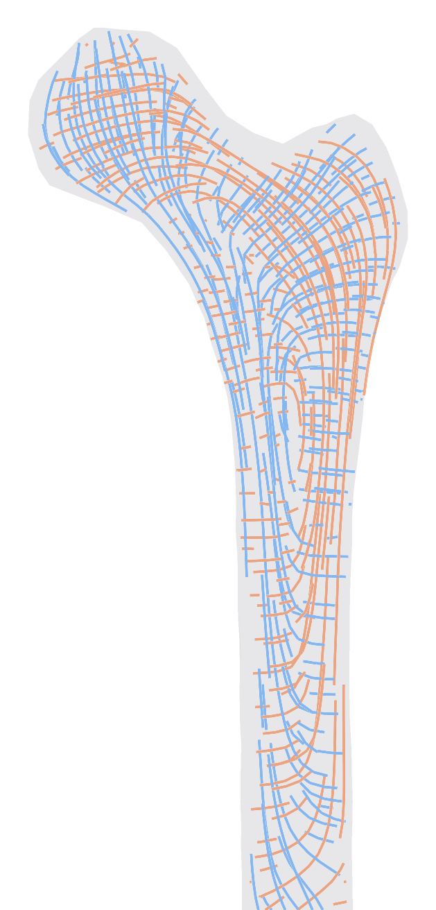
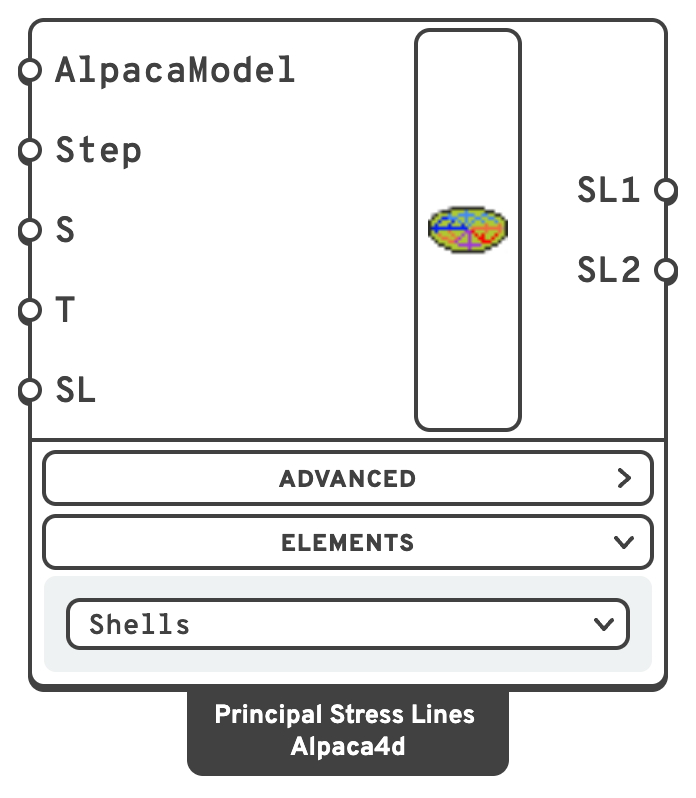
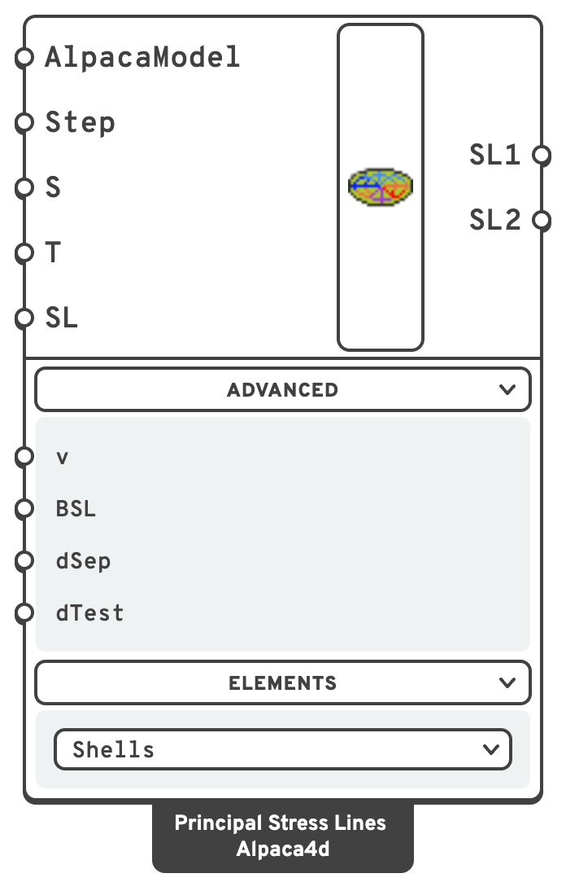
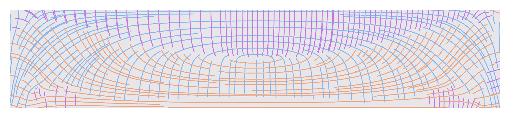
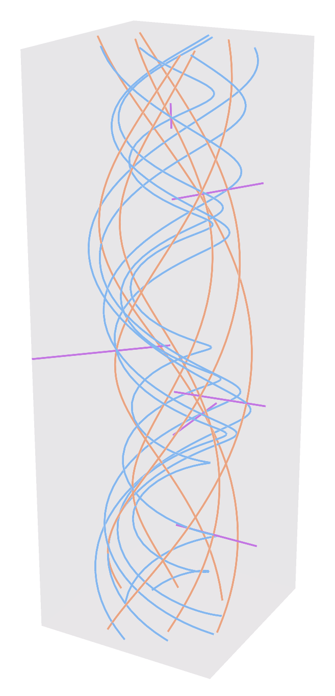

# Principal Stress Lines

Traces streamlines that follow the **principal stress directions**: across a shell, or through the
inside of a solid. Where a contour shows how much, these show which way — the load paths through a
plate, a block, a bone or a node.

<figure><figcaption>
The Standardised Femur under the hip's force, in ten node tetrahedra: compression (SL3, blue) runs from the head down the inner side of the shaft, tension (SL1, red) arches over the neck and down the outer side. The lines of a slice 1 cm thick through the middle of the bone.
</figcaption></figure>

## 🔧 Grasshopper component

`Principal Stress Lines (Alpaca4d)` — **Alpaca4d ▸ 09_Visualisation**

<figure><figcaption></figcaption></figure>

<figure><figcaption>
With every menu open
</figcaption></figure>

Pick what the lines run in from the **Elements** drop-down on the component:

- **Shells** draws lines over shell elements, along the two principal directions in each shell's
  plane — of the membrane stress, or of the bending moment. It is where the component starts, and
  where files from before Solids open.
- **Solids** draws lines through the inside of SSP Bricks and tetrahedra, along all three principal
  stresses.

Each has inputs of its own, below. They share the first two outputs, SL1 and SL2, and Solids adds a
third, SL3. Switching keeps the wires on SL1 and SL2.

### Inputs on Shells

| Name | Nick | Type | Default | Description |
| --- | --- | --- | --- | --- |
| AlpacaModel | `AlpacaModel` | Model | — | An analysed model with shell elements. |
| Step | `Step` | Integer | `0` | Analysis step. |
| Seed | `S` | Point (list) | — | Where the lines start. |
| Step Tolerance | `T` | Number | `0` | Integration step along a line. `0` takes a third of the shells' mean edge length, so the default suits the model's units. Smaller is smoother and slower. |
| Single Line | `SL` | Boolean | `false` | `true` traces one line through the seed; `false` grows a field of lines from it. |
| Poisson's ratio | `v` | Number | `0.0` | Not used. For an isotropic elastic material the principal directions do not depend on it; the input is kept so that older files still open. |
| Bending Stress Lines | `BSL` | Boolean | `false` | `true` uses rotations, giving the **bending** principal directions; `false` uses in-plane displacements, giving the **membrane** ones. In bending, direction 1 is the moment that stretches the face each shell's normal points to most. |
| Separation | `dSep` | Number | `0` | Target spacing between neighbouring lines, in field mode. `0` takes twice the shells' mean edge length. |
| Test Dist. | `dTest` | Number | `0.0` | A new line stops when it comes closer than this to an existing one. `0` disables the check. |

The last four — **Poisson's ratio**, **Bending Stress Lines**, **Separation** and **Test Dist.** — are in the
**Advanced** menu under the component, which starts folded; click it to show them. A wire to one of
them keeps working with the menu folded.

### Inputs on Solids

| Name | Nick | Type | Default | Description |
| --- | --- | --- | --- | --- |
| AlpacaModel | `AlpacaModel` | Model | — | An analysed model with solid elements: SSP Bricks or tetrahedra. |
| Step | `Step` | Integer | `0` | Analysis step. |
| Seed | `S` | Point (list) | — | Points inside the solid for the lines to go through. A seed outside it draws nothing, and a Remark says how many did. |
| Step Tolerance | `T` | Number | `0` | Length of one step along a line. `0` takes a third of the elements' mean edge length. |
| Single Line | `SL` | Boolean | `true` | `true` draws one line of each family through each seed; `false` grows a field of lines from the seeds. |
| Separation | `dSep` | Number | `0` | Distance between neighbouring lines in a field. `0` takes three times the elements' mean edge length. |
| Test Dist. | `dTest` | Number | `0` | In a field, a line stops when it comes closer than this to one already drawn. `0` lets lines run on. |

On Solids, the last two — **Separation** and **Test Dist.** — are in the **Advanced** menu.

### Outputs

| Name | Nick | Type | Description |
| --- | --- | --- | --- |
| Stress Lines Dir1 | `SL1` | Curve (list) | Lines along the largest principal stress: the larger of the two in a shell's plane, the largest in a solid. |
| Stress Lines Dir2 | `SL2` | Curve (list) | Lines along the second: the smaller of the two in a shell's plane, the middle one in a solid. |
| Stress Lines Dir3 | `SL3` | Curve (list) | Solids only. Lines along the smallest principal stress: the most compressive. |

With **Single Line** on, each output has one line per seed, in the order of the seeds: an empty
one where the seed is off the shells or outside the solid, or the stress there gives no direction.

## 📈 When to use it

**Use it when**

- You are laying out reinforcement in a slab or a wall and want the bars to follow the force.
- You are looking for the load path through a plate — where the arching, the fan, the strut
  actually goes.
- You are working out where to place ribs, stiffeners, or the members of a discrete structure
  that replaces the shell.
- You want to see how a load travels through a solid: a footing, a corbel, a node, a bone.
- You are shaping a solid by its load paths — where to keep material, where a strut or a tie
  runs — before [Topology Optimisation](../optimisation/topology-optimisation.md) or instead of it.

**Do not use it when**

- You need a magnitude → [Model View](model-view.md), [Shell Forces](../results/shell-forces.md)
  or [Brick Stresses](../results/brick-stresses.md).

## 🧮 How the lines are made

### On shells

Each shell's strain is taken at its centre: the membrane strain from the nodal translations, or
the bending curvature from the nodal rotations. The centre values are averaged into each node from
the shells round it that lie within 30° of each other, and interpolated across each shell, so the
directions run on smoothly from shell to shell. Shells are joined through the nodes they share,
exactly as [Assemble Model](../assemble.md) welded them.

- **Material.** For an isotropic elastic material the principal stresses lie along the principal
  strains, so the strain gives the directions. On a layered or nonlinear section the lines follow
  the strain, which is no longer the same as the stress.
- **Bending.** Each shell's bending is read against its normal. Shells that face the other way
  from their neighbours are read the other way up, so that the lines run on across them, and a
  Remark says how many there were.
- **Where a line ends.** At the edge of the shells, cut where it crosses. Also where the two
  principal values become equal, as at the centre of a square slab or the middle of a simply
  supported edge, because there the field gives no direction to follow.

The method follows [LilyPad](https://github.com/formateng/LilyPad), by Matthew Church and Format
Engineers: lines traced with fourth-order Runge-Kutta steps, and a field of them grown by
neighbour seeding. Checked against closed-form solutions (the Timoshenko cantilever, a plate with a
hole in tension, and a simply supported plate under uniform load), the lines follow the exact
directions to within half a degree on average, on meshes as coarse as eight shells across a beam's
depth.

### Through solids

The stress comes from the solver, element by element: one value for an SSP Brick, which integrates
at a single point, and one at each node for a Ten Node Tetrahedron, whose stress is linear. Each
node takes the volume-weighted mean of what the elements round it give it, so the field runs on
smoothly from element to element.

Every element is then cut into tetrahedra on points it shares with its neighbours — a ten node
tetrahedron into eight, a brick into twenty-four round its centre and the centres of its faces —
and each tetrahedron knows the one across each of its faces. A line is traced in fourth-order
Runge-Kutta steps. At each step the stress is interpolated in the tetrahedron the point is in,
found by walking from the one it was in before, across the face it has crossed, and split into its
three principal stresses and their directions. A face no other tetrahedron shares is the solid's
surface.

- **Where a line ends.** At the surface of the solid, cut where it crosses. Also where its principal
  stress becomes equal to another — in a solid that happens along whole lines, such as an axis of
  symmetry — because there the stress gives no direction to follow.
- **Elements.** A Ten Node Tetrahedron gives its stress at its nodes and follows a smooth field
  closely. An SSP Brick gives one stress, at its centre: averaged into the nodes, it is half an
  element out at the surface of the solid, so a brick model wants a finer mesh near the surface for
  the same accuracy.
- **Material.** The lines follow the stress the solver reports, whatever the material.

Checked against closed-form solutions — a round bar twisted and pulled, whose lines are helices round
its axis and rays out from it, Boussinesq's point load on a half-space, and Timoshenko and Goodier's
cantilever and simply supported beam — on models OpenSees solved, the lines follow the exact
directions to within 0.1–0.6° on average, on Ten Node Tetrahedra and on SSP Bricks alike. A beam
held and loaded as it would be drawn, clamped or on its bottom edges, follows them as closely more
than a depth away from its supports and loads.

<figure><figcaption>
A simply supported beam of Ten Node Tetrahedra under a uniform load, seen from the front: tension (SL1, red) sags along the bottom and rises to the supports, compression (SL3, blue) arches between them. In the top, where both stresses in the beam's plane are compressions, the largest principal stress is the one across the width, nought, and the second family of the familiar two-dimensional picture is SL2 (green).
</figcaption></figure>

<figure><figcaption>
A bar twisted and pulled, in Ten Node Tetrahedra: the tension (red) and compression (blue) lines are helices winding opposite ways round the axis; the middle principal stress (green) points straight out from it.
</figcaption></figure>

## 💡 Tuning it

Start with one seed and **Single Line** on, to check the direction field is sensible. Then
turn it off and adjust:

- **Separation** controls how dense the field is.
- **Test Dist.**, once non-zero, stops lines crowding — set it a little below **Separation**.
- **Step Tolerance** smooths each line. Left at `0` it follows the mesh; reduce it if the
  curves look faceted, at some cost in time.

Set **Bending Stress Lines** to match the problem: membrane directions for a wall in its own
plane, bending directions for a slab in flexure. They are generally not the same field.

On **Solids**, start with a few seeds and **Single Line** on, to see the three families. Then:

- **Where two principal stresses are close**, their two families wander: the direction turns on a
  difference the mesh cannot resolve. Under a point load on a block, for example, the two
  horizontal stresses stay within a percent of each other below the load, and only the vertical
  compression gives clean lines. Look at the family whose stress stands well apart from the others.
- **A field** (**Single Line** off) fills the whole solid, and the lines hide one another. Seed it
  from points in one region, keep **Separation** generous, and set **Test Dist.** to about half of
  it. A field stops at 5000 lines.
- **Step Tolerance** smooths each line. Left at `0` it follows the mesh.
