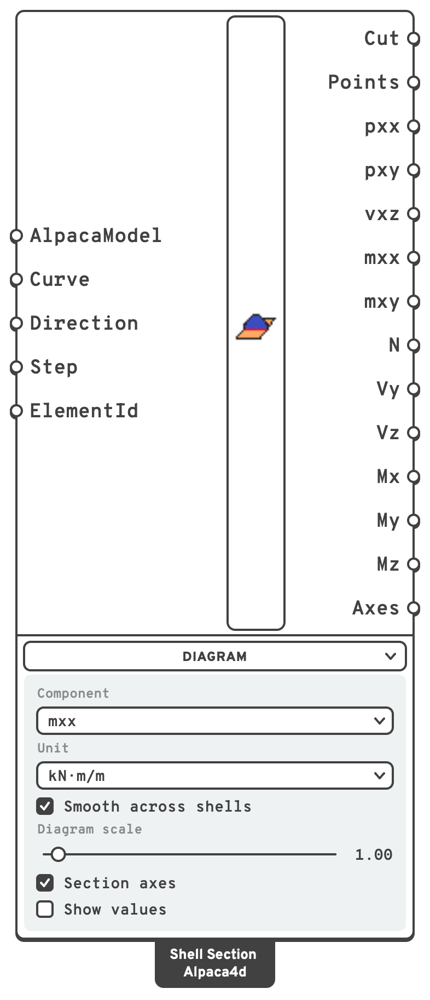

# Shell Section

Draws a section across shells and reads the forces carried through it: a diagram along the cut
of the bending moment, the shear or the membrane force, and their totals, the way a beam's
section carries N, V and M.

## 🔧 Grasshopper component

`Shell Section (Alpaca4d)` — **Alpaca4d ▸ 09_Visualisation**

<figure><figcaption></figcaption></figure>

### Inputs

| Name | Nick | Type | Default | Description |
| --- | --- | --- | --- | --- |
| AlpacaModel | `AlpacaModel` | Model | — | The analysed model, from [Run Analysis](../analysis/run-analysis.md). The results are read from the recorder file it points at. |
| Curve | `Curve` | Curve | — | Where to cut: a line or polyline drawn on the shells, or beside them to be swept onto them along **Direction**. Any other curve is followed by a polyline close to it. Its direction sets which way *y* runs. Give several to cut several sections at once. |
| Direction | `Direction` | Vector | *(empty)* | Which way to sweep the curve to meet the shells. It also sets which side is positive: *z* is the shell's normal on the side this points to. Empty sweeps it square to the shell nearest the curve's start, on the side that shell's local *z* points to. |
| Step | `Step` | Integer | `0` | Which recorded step to read. |
| ElementId | `ElementId` | Text (list) | *(empty)* | Cut only some shells: an ElementId (`Slab_3`), a wildcard over them (`Slab*`), an element tag (`47`) or a regular expression (`regex:^Wall`). Empty cuts them all. |

### Outputs

The totals have one value per curve, in the branch the curves come from: two curves in `{0}`
give two values of `N` in `{0}`. The per-length outputs have a branch per unbroken stretch of each
curve, under it: the stretches of the second curve go in `{0;1;0}`, `{0;1;1}` and so on.

| Name | Nick | Type | Description |
| --- | --- | --- | --- |
| Cut | `Cut` | Curve (tree) | Where the shells are cut: a polyline per stretch. |
| Points | `Points` | Point (tree) | Where the forces are read: both ends and the middle of the cut through each shell. Unsmoothed, a point where two shells meet is listed twice, once with each one's forces. |
| pxx | `pxx` | Number (tree) | Membrane force across the cut, along *x*, in `kN/m`. Positive is tension. |
| pxy | `pxy` | Number (tree) | In-plane shear along the cut, along *y*, in `kN/m`. |
| vxz | `vxz` | Number (tree) | Transverse shear on the cut, along *z*, in `kN/m`. |
| mxx | `mxx` | Number (tree) | Bending moment whose stresses run across the cut, in `kN·m/m`. Positive puts the +*z* face in tension. |
| mxy | `mxy` | Number (tree) | Twisting moment on the cut, in `kN·m/m`. |
| N | `N` | Number | Total force across the cut, along *x*, in `kN`. Positive is tension. |
| Vy | `Vy` | Number | Total in-plane shear, along *y*, in `kN`. |
| Vz | `Vz` | Number | Total shear square to the shells, along *z*, in `kN`. |
| Mx | `Mx` | Number | Torsion about *x*, right-hand rule, in `kN·m`. |
| My | `My` | Number | Bending about *y*, the shells bent out of their plane, as a slab is, in `kN·m`. Positive puts the +*z* side in tension. |
| Mz | `Mz` | Number | Bending about *z*, the shells bent in their plane, as a wall is, in `kN·m`. Positive puts the +*y* end in compression. |
| Axes | `Axes` | Plane | The axes of the totals, at the centre of the cut, which the moments are taken about. |

The outputs are in the units the model is solved in. The **Unit** of the menu sets only the
values written in the viewport.

### Diagram menu

What to draw. The menu starts open.

| Control | Default | Does | Shown |
| --- | --- | --- | --- |
| Component | `mxx` | The component the diagram shows: pxx, pxy, vxz, mxx or mxy. | Always |
| Unit | **kN/m**, **kN·m/m** | The unit the values are written in: N/m, kN/m, MN/m for the forces, N·m/m, kN·m/m, MN·m/m for the moments. | The one of the component |
| Smooth across shells | on | Reads the forces from a field smoothed across the shells. See [Smoothing](#smoothing). | Always |
| Diagram scale | `1`, from 0 to 20 | Stretches the diagram. At 1 the largest value stands off the cut 8 % of the model's diagonal, as View Results' beam diagrams do. One scale serves every curve. | Always |
| Section axes | on | Draws *x*, *y* and *z* at the centre of each cut, in red, green and blue. | Always |
| Show values | off | Writes the largest and the smallest value of each stretch at the tip of the diagram. | Always |
| Value text size | `0.5`, from 0.05 to 5 | The height of those values, in model units. | With **Show values** on |

The diagram stands off the cut along the shells' normal, coloured by its sign in the colours of
the beam force diagrams: a moment in those of My, a membrane force in those of N. A bending
moment is drawn on the side it puts in tension.

## ✂️ How the cut is made

The curve is swept both ways along **Direction**, and the shells are cut where the swept
surface crosses them.

- **On the shells.** Draw the curve on a slab or a wall and leave **Direction** empty: it is
  swept square to the shell, and the cut is the curve itself.
- **In plan.** Draw a line above a building and sweep it down (`0,0,-1`): every wall it crosses
  is cut from top to bottom, and every slab along the line.
- **Some shells only.** A line swept through a stack of floors cuts them all. Give **ElementId**
  to cut only the ones you mean.

A cut can cross shells in several places, through a slab with an opening or across two floors.
Each unbroken stretch has a branch of its own, and the totals add up all of them.

## 💡 Sign convention

The cut has axes of its own, drawn when **Section axes** is on:

- *x* is square to the cut, in the shells' plane, to the **left** of the curve looking along
  **Direction**;
- *y* runs along the curve;
- *z* is the shells' normal, on the side **Direction** points to.

The forces are those the side *x* points to puts on the other side. Reverse the curve, or
**Direction**, to read them from the other side.

The per-length outputs are those of [Shell Forces](../results/shell-forces.md), read in axes
turned so that *x* is square to the cut: `pxx`, `pxy`, `vxz`, `mxx` and `mxy` are the ones that
act on the cut's face. The totals are read like [Beam Forces](../results/beam-forces.md) for a
beam whose axis is *x*, and whose section is the cut: `N` along it, `Vy` along the cut, `Vz`
square to the shells, and the moments about the centre of the cut.

Which way *z* points comes from **Direction**, not from the elements, so a mesh whose faces do
not all face one way gives the same answer. With **Direction** empty it is the nearest shell's
own local *z*, so `mxx` has the sign it has in Shell Forces there.

For example:

- **A cantilever slab** of mesh faces facing up, cut across with no **Direction**: *z* is up and
  *x* points to the tip. The tip pulls down and the slab hogs, so `Vz` is minus the load on the
  tip and `My` is plus its moment, top in tension. Swept down instead, `My` is negative, still
  top in tension, because +*z* is now the bottom.
- **A wall** cut along its length, swept square to it: *x* points up, so `N` is minus the weight
  above the cut, `Vy` the horizontal load above it, and `Mz` that load's moment about the
  centre of the cut.

## Smoothing

An ASD Shell quad gives a single bending moment over the whole element, the value at its centre.
Read unsmoothed, a moment that varies along the cut is drawn as steps, one per element, and
where two elements meet the point is listed twice, once with each one's value.

With **Smooth across shells** on, the default, each corner of a shell takes the mean of the
shells that meet there and lie within 30° of its plane, and the forces vary smoothly between the
corners. A moment that varies linearly is then read exactly in the middle of a slab. At a
support or a free edge there is only one side to take the mean of, so the value there is the
element's own.

Along a line of the mesh, unsmoothed, the cut reads the elements on the side *x* points to.


**The totals are as good as the mesh.** A displacement model is not in equilibrium point by
point, so the totals of a cut add up to the loads only as closely as the mesh allows: exactly
for a field the elements hold exactly, to a few per cent on a coarse mesh with the edge effects
of a plate.

Triangles are as good as quads for the moments, and rough for the transverse shears. The shears
an ASD Shell triangle records are scaled back by Shell Section to the ones it is in equilibrium
with. They still differ by about a quarter from one point of an element to the next. Use quads
where `Vz` matters.


## 📈 When to use it

**Use it when**

- You want the moment across a design strip of a slab: cut across the strip and read `My`.
- You want the forces at the base of a shear wall, or of a core: `N`, `Vy` and `Mz`.
- You want the shear along a support line, or the forces through a joint between two parts.
- You want to check equilibrium: a cut around a free part carries what is on it.

**Do not use it when**

- You want the forces of every element → [Shell Forces](../results/shell-forces.md).
- You want a contour over the shells → [View Results](view-results.md), with *Shell forces*
  picked as the result.
