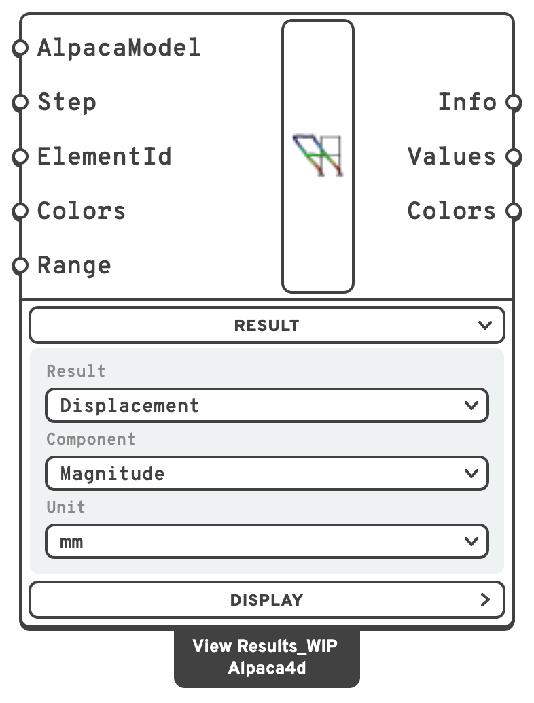
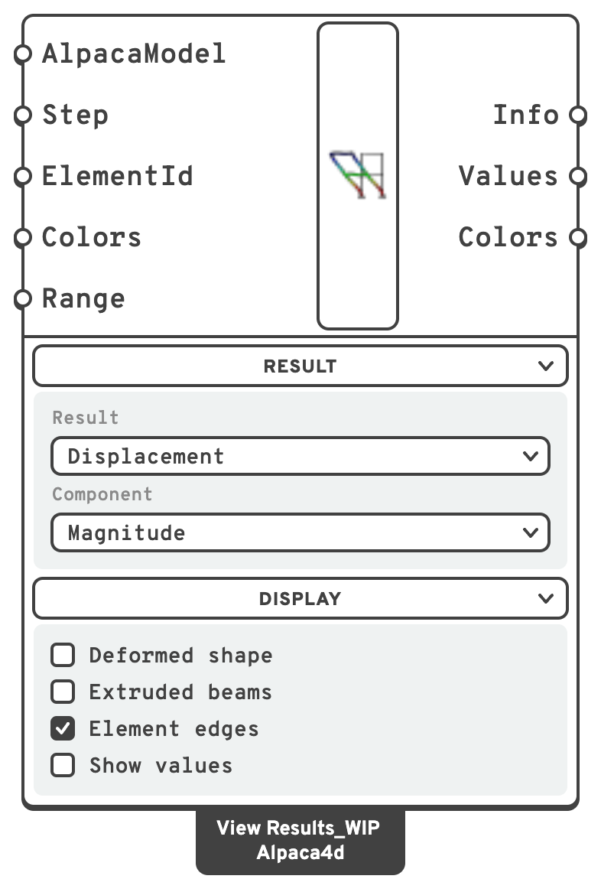

# View Results

Draws any result of an analysed model in the viewport: displacements, beam force diagrams,
beam stresses, shell forces, shell stresses, solid stresses and reactions. It shows one result at a time, on
the undeformed shape or the deformed one.

## 🔧 Grasshopper component

`View Results_WIP (Alpaca4d)` — **Alpaca4d ▸ 09_Visualisation**

<figure><figcaption></figcaption></figure>

<figure><figcaption>
With every menu open
</figcaption></figure>

### Inputs

| Name | Nick | Type | Default | Description |
| --- | --- | --- | --- | --- |
| AlpacaModel | `AlpacaModel` | Model | — | The analysed model, from [Run Analysis](../analysis/run-analysis.md), [Natural Vibration](../analysis/natural-vibration.md) or [Linear Buckling](../analysis/linear-buckling.md). The results are read from the recorder file it points at. |
| Step | `Step` | Integer | `0` | Which recorded step to draw, or which mode after a natural vibration or buckling analysis. |
| ElementId | `ElementId` | Text (list) | *(empty)* | Draw only some elements' results: an ElementId (`MyBeam_3`), a wildcard over them (`MyBeam*`, `Col_?`), an element tag (`47`) or a regular expression (`regex:^Col`), mixed freely. What is left out is greyed rather than hidden. Empty draws them all. |
| Colors | `Colors` | Colour (list) | Turbo | The gradient to colour with, from the low end to the high. Connect [Colors](colors.md) for a ready-made one. With **Iso-surfaces** on, each colour is one band of values. Beam force diagrams ignore it and use the colour that belongs to the force. |
| Range | `Range` | Domain | *(empty)* | The range the gradient is stretched over, in the unit picked under **Unit**. Left empty it fits what is drawn, which makes two steps impossible to compare: set it to compare them. |

### Outputs

| Name | Nick | Type | Description |
| --- | --- | --- | --- |
| Info | `Info` | Text | What is drawn, the unit it is in, and the range it spans — `Displacement - Uz [mm], step 0, min -12.3, max 0`. |
| Values | `Values` | Number (list) | The value each colour stands for, one per colour of **Colors**, from the low end to the high — over **Range** when it is set — in the unit picked under **Unit**. With **Iso-surfaces** on, the edges of the bands instead, one more than there are colours. Feed it to the **Values** input of [Legend](legend.md). |
| Colors | `Colors` | Colour (list) | The gradient used. Feed it to the **Colors** input of Legend, so the legend and the model agree. |

### Result menu

What to draw. The menu starts open.

| Control | Options | Shown |
| --- | --- | --- |
| Result | Displacement, Beam forces, Beam stresses, Shell forces, Shell stresses, Brick stresses, Reactions | Always |
| Component | Those of the result, below | Always |
| Unit | Those of the component, below | Always |
| Layer through the thickness | Top, Middle, Bottom | For *Shell stresses* |
| Reactions drawn as | Selected component, Resultant, All three | For *Reactions* |
| Read in which axes | Global, Local — the element's own axes, from its node numbering | For *Brick stresses* |

| Result | Components |
| --- | --- |
| Displacement | Magnitude, Ux, Uy, Uz |
| Beam forces | N, Vy, Vz, Torsion, My, Mz |
| Beam stresses | σN, σMy, σMz, σx, σmax, σmin, τV, τT, VonMises |
| Shell forces | fxx, fyy, fxy, mxx, myy, mxy, vxz, vyz |
| Shell stresses | σ11, σ22, σ12, σ23, σ31, VonMises |
| Brick stresses | σ11, σ22, σ33, σ12, σ23, σ13, VonMises |
| Reactions | Force, Fx, Fy, Fz, Moment, Mx, My, Mz |

**Unit** offers the units of the component picked. A new View Results starts in the unit in bold.
**Info**, **Values**, the values written on the model and **Range** are all in the unit picked, so
a legend fed from **Values** reads in it too, and a **Range** is typed in it.

| Component | Units |
| --- | --- |
| Displacement | **mm**, cm, m |
| N, Vy, Vz of *Beam forces*; Force, Fx, Fy, Fz of *Reactions* | N, **kN**, MN |
| Torsion, My, Mz of *Beam forces*; Moment, Mx, My, Mz of *Reactions* | N·mm, N·m, kN·cm, **kN·m**, MN·m |
| Every stress — *Beam*, *Shell* and *Brick stresses* | kPa (= kN/m²), **MPa** (= N/mm²), kN/cm² |
| fxx, fyy, fxy, vxz, vyz of *Shell forces* | N/m, **kN/m** (= N/mm), MN/m |
| mxx, myy, mxy of *Shell forces* | N·m/m, **kN·m/m**, MN·m/m |

Each kind of quantity keeps its own unit: pick mm for a displacement and MPa for a stress, and
switching between the two finds each where you left it. A definition saved before **Unit** existed
opens in the units the solver works in — m, kN, kN·m, kPa, kN/m, kN·m/m, and MPa for beam
stresses — which is what it drew then, so a **Range** wired into it keeps its meaning.

### Display menu

How to draw it. The menu starts folded; click its header to unfold it.

| Control | Default | Does | Shown |
| --- | --- | --- | --- |
| Deformed shape | off | Draws the result on the deformed shape. | Always |
| Deformation scale | `1`, from 0 to 200; from −2 to 2 on a natural vibration or buckling model | How much the deformation is magnified. A natural vibration or buckling mode has no size of its own, so at 1 it is drawn with its largest movement 8 % of the model's diagonal, as far off the model as the force diagrams; any other displacement at true size. A mode goes either way, so a natural vibration or buckling model switches the slider to −2 to 2, and another model switches it back. A range of your own, set by double-clicking the slider, is kept whatever the model. | With **Deformed shape** on |
| Animate | off | Sweeps the deformation scale from the slider's least value to its greatest and back, moving the slider with it. It reads *Stop animation* while it runs. | With **Deformed shape** on |
| Extruded beams | off | Draws each beam as its cross-section, coloured by the result. Beam stresses that differ across the section are painted point by point over it — see [Beam stresses over the section](#beam-stresses-over-the-section). | Always |
| Diagram and arrow scale | `1`, from 0 to 20 | Stretches the beam force diagrams and the reaction arrows. | For *Beam forces* and *Reactions* |
| Iso-surfaces | off | Colours in bands — one flat colour per range of values — instead of a smooth gradient. See [Iso-surfaces](#iso-surfaces). | For every result but *Beam forces* |
| Element edges | on | Draws the edges of the shell, solid and extruded beam elements. | Always |
| Show values | off | Writes values on the model, in the unit picked, to four significant figures: each beam's largest, at the tip of its diagram for beam forces; each shell or solid element's at its centre; each reaction at its arrow. | Always |
| Value text size | `0.5`, from 0.05 to 5 | The height of those values, in model units. | With **Show values** on |

Connect the analysed model from [Run Analysis](../analysis/run-analysis.md) or
[Natural Vibration](../analysis/natural-vibration.md), then pick what to draw from the
**Result** menu on the component body. After a natural vibration analysis, **Step** selects
the mode.

Feed its **Values** and **Colors** outputs to [Legend](legend.md), so the scale matches what is
drawn. **Values** follows **Range**, so the legend matches with or without one.

*Beam stresses* colours each beam along its length by any output of
[Beam Stresses](../results/beam-stresses.md) — σN, σMy, σMz, σmax, σmin, τV, τT or Von Mises —
or by σx, in MPa unless another **Unit** is picked, with each integration point's colour placed
where the point sits on the beam. It is the third entry of the **Result** menu, after *Beam
forces*. Drawn as lines, each integration section shows its worst; with **Extruded beams** on, the
stress is painted over the section itself — see below.

*Beam forces* draws each force as a diagram in the plane it acts in, in the beam's local axes
(turn on **Local Axes** in [Model View](model-view.md) to see them): Vy and Mz across local *y*,
Vz and My across local *z*, N and torsion across local *y*. **Moments are drawn on the tension
side** — on a beam with local *y* up, sagging hangs below it; the other forces are drawn
towards the positive axis. One scale serves the whole model, so the heights compare from one
beam to the next; **Diagram and arrow scale** stretches it. With **Show values** on, each beam's
largest value is written at the tip of its diagram. The signs of the numbers are those
of [Beam Forces](../results/beam-forces.md).

**Extruded beams** draws each beam as its cross-section, on the deformed shape too, coloured by
whatever result is picked.

### Beam stresses over the section

A beam pushed and bent both ways is not stressed alike across its section: one corner works hardest,
the opposite one least. With **Extruded beams** on, *Beam stresses* paints the stress at every
point of the section's surface, so that shows — the gradient from the top of the beam to the
bottom, and from one side to the other.

| Component | Drawn as lines | With **Extruded beams** |
| --- | --- | --- |
| σN | N/A | the same: N/A is the same all over the section |
| σMy, σMz | the largest bending stress each moment causes, in size | My·z/Iy and −Mz·y/Iz at each point, with their signs |
| σx | σmax or σmin, whichever is larger in size, with its sign | the direct stress at each point, N, My and Mz together: positive in tension |
| σmax, σmin | the largest and the smallest direct stress on the section | the same, one colour round the section |
| τV, τT | the peak shear from Vy and Vz, and from torsion | the size of the shear at each point, running along the surface |
| VonMises | the worst σ with the worst τ | √(σ² + 3τ²) at each point, of the σ and τ that meet there |

σx is the one to look at for an axial force with bending: tension along one edge, compression
along the other, and the neutral axis where the colour passes zero.

How the shear is spread over the section depends on its shape — Jourawski's parabola on a
rectangle, thin-walled shear flow on an I, a pair of angles or a box, round the circle on a round
bar or tube — and torsion's too: Saint-Venant on a rectangle, T·r/Ip on a round section, T·t/J on
each wall of an I or a pair of angles, Bredt on a box. Within Von Mises, shear and torsion are
signed along the surface, so on one face of a wall they add and on the other they take away, and
Von Mises shows the face that is worse. Its largest value at a point is usually below the one the
line view and [Beam Stresses](../results/beam-stresses.md) give, since the worst σ and the worst τ
rarely meet at one point: bending peaks at a section's edges and shear on its neutral axis. It is
not always below it: where Vy and Vz act together, their shear flows add along one wall of an I or
a box, and the stress there can be higher — by about a fifth on a box sheared equally both ways.

The range fits every point drawn, so turning **Extruded beams** on or off can change the range of
the same component: σMy, for one, runs from minus its largest to plus it, where as lines it is never
below zero.
**Iso-surfaces** bands the field over the section as well. A
[Generic Section](../sections/parametric-cross-section.md) has no shape to work the stress out
over, so its beams are coloured by σN only — one colour round the section when extruded — and
drawn plain grey for every other component.

A definition saved before σx was offered opens on the component it was saved with: σx went into the
list after σMz, and the rest are moved one place along when such a file is opened.

### Iso-surfaces

With **Iso-surfaces** ticked, the range is cut into as many equal bands as there are colours in
**Colors**, and everything in a band is drawn in that band's colour, flat. Where the value
crosses from one band into the next, the element is cut along the line where it does, so the
bands meet in a sharp edge across the elements rather than blending into each other. It reads
like a contour map: which parts are over a value, and where the boundary runs, is plain at a
glance.

- **The number of bands is the number of colours.** [Colors](colors.md) gives ten; give
  **Colors** a list of your own for more or fewer.
- **Range** sets the bands as it sets the gradient: give it `0 to 10` with ten colours and each
  band is one unit wide.
- Anything below the range is in the first band, and anything above it in the last.
- Shells, solids, beams — lines or extruded — and reaction arrows are all banded. *Beam forces*
  is not: its diagrams take the colour of the force, not the gradient.
- **Element edges** still draws the elements' own edges, not the cuts between bands.

**Values** then holds the edges of the bands, one more than there are colours, and
[Legend](legend.md) wired to it writes them on the lines between its swatches, so each swatch
reads as the band from one label to the next.

## 🔁 Instead of the old view components

View Results replaces the separate view components. They are hidden from the ribbon, but
definitions that already use them still open.

| You used | In View Results |
| --- | --- |
| Deformed Model View | *Displacement*, with **Deformed shape** ticked |
| Beam Forces View | *Beam forces* |
| Shell Forces View | *Shell forces* |
| Shell Stresses View | *Shell stresses* |
| Brick Stresses View | *Brick stresses* |
