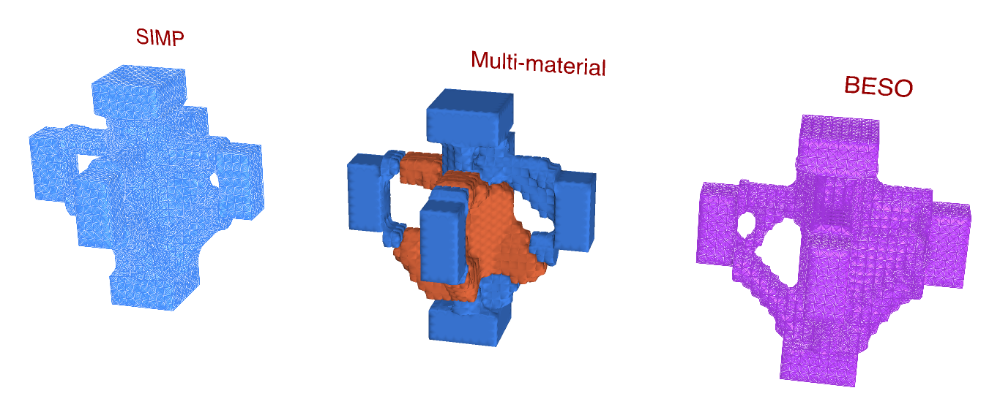
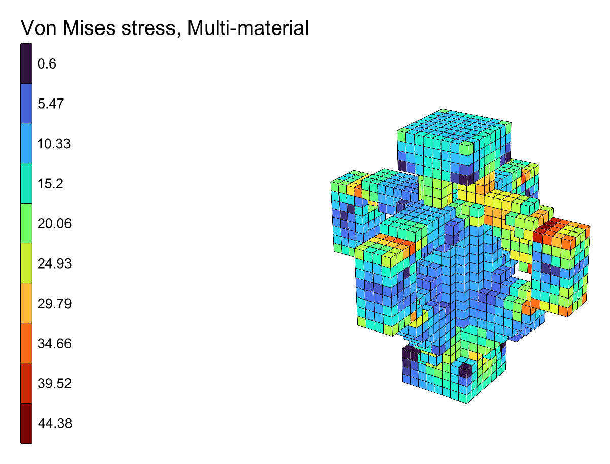

# 🏗️ Beam-Column Joint

<figure><figcaption></figcaption></figure>

[beam-column-joint](https://raw.githubusercontent.com/Alpaca4d/alpaca4d.github.io/main/doc/examples/beam-column-joint/beam-column-joint.gh)

Where an interior beam-column joint needs its material, found three ways side by side: by
[Topology Optimisation](../../basics/optimisation/topology-optimisation.md),
[BESO Topology](../../basics/optimisation/beso-topology.md) and
[Multi-Material Topology](../../basics/optimisation/multi-material-topology.md). A column and four
beams meet at a cube of steel bricks, 1 m a side:

- the column, 0.4 m square, held at its foot below the cube and bringing 1 500 kN down at its
  head above it;
- four beams, 0.2 m wide and 0.4 m deep, from 0.4 to 0.8 m up, each bringing its shear and a
  hogging moment: 150 kN and 150 kNm from +x, 150 kN and 80 kNm from -x, 100 kN and 100 kNm from
  +y and from -y.

The moments along x do not balance, so the joint has to take 70 kNm into the column, and it works
in three dimensions. Each member is a stub of bricks 0.2 m long, kept solid whatever the
optimisation finds. A beam's hogging moment reaches its end as a couple: the top half of the end
pulled out and the bottom half pushed in, each by 2M/d.


Without a license, the three components run on models of up to 500 elements. At 2 bricks per
10 cm this one has 9 024, so it needs one; at 1, 1 128 bricks, it still does.


## The model

| Group | What it does |
| --- | --- |
| 1 - How fine | **Bricks per 10 cm**, 1 to 3, the same every way, so that every member's edges fall on the grid: 1 000, 8 000 or 27 000 bricks in the cube. |
| 2 - The node | The cube, 1 m a side: its plan meshed once with **Mesh Plane**, copied up level by level and made into bricks by [Mesh Series to Brick](../../basics/utility/mesh-series-to-brick.md), as [SSP Bricks](../../basics/elements/brick.md) named **Node**. |
| 3 - The members | The column above and below and the four beams, each a box of bricks, all through one chain of components, each in a branch of its own. The bricks are named **Member**. |
| Materials | Steel, E = 210 GPa, for every brick, and concrete C30/37, E = 33 GPa, for Multi-Material Topology to choose. |
| 4 - Supports and loads | The column's foot held by a [Support](../../basics/elements/support.md). The column's head, and each beam end's shear, top half and bottom half, each meshed with **Mesh Plane** to find its nodes, its force divided among them as [Point Loads](../../basics/loads/point-load.md). |
| 5 - Assemble Model | [Assemble](../../basics/assemble.md). [Model View](../../basics/visualisation/model-view.md) is disabled: enable it to see the supports and loads. |
| 6 - Three ways | **Keep** names the members. Topology Optimisation and BESO Topology keep 20% of the cube (**VolumeFraction**); Multi-Material Topology up to 6% in steel and 14% in concrete. Each has its **Run**, **Iterations** and **Step**, and a panel of its compliance. |
| 7 - Side by side | Topology Optimisation's design moved 2 m to the left, BESO's 2 m to the right; Multi-Material Topology draws its own, in its materials' colours, where the model is. |
| 8 - Each design analysed | For each method, [Run Analysis](../../basics/analysis/run-analysis.md) on its **AlpacaModel** and View Results in Von Mises stress, with a Legend; locked to start with. |

## Running it

1. Set one **Run** to `true` at a time. The run goes on its own thread and its design draws in its
   place in group 7. At 2 bricks per 10 cm, on an Apple M2 Pro, Topology Optimisation takes about
   a minute and a half, BESO Topology under a minute and Multi-Material Topology four to five
   minutes.
2. Drag a **Step** slider back to watch that run again.
3. Once a run has stopped, enable its **Run Analysis** and **Legend** in group 8 to see its design
   in Von Mises stress, where the model is. Lock them again before enabling another's.

<figure><figcaption></figcaption></figure>

## What it shows

All three find the joint a structural engineer would draw: ties across the top of the joint, from
each beam's top - in tension under the hogging moments - to the one opposite; struts under them, from
each beam's bottom into the column; and the column carried through the middle. The unbalanced
moment along x shows: each method puts a fifth to a third more material on the +x side, where the
beam brings 150 kNm, than on the -x side, where it brings 80; along y, where the beams balance, the
joint comes out exactly symmetric.

| | Iterations | Compliance |
| --- | --- | --- |
| Topology Optimisation | 160 | 0.358 |
| BESO Topology | 94 | 0.280 |
| Multi-Material Topology, 6% steel and 14% concrete | 265 | 0.675 |

Multi-Material Topology puts the concrete into the column's core and the struts, and the steel into
the ties across the top. It chooses only by stiffness - it knows nothing of concrete cracking - but
the ties are where a thin member does most, and the core where there is room for a thick one.
