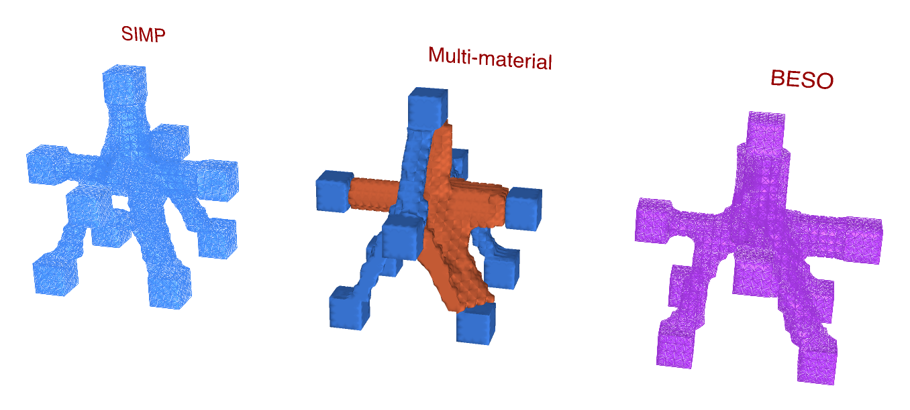
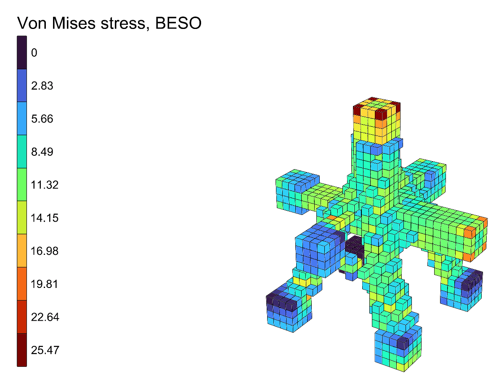

# 🕸️ Truss Node

<figure><figcaption></figcaption></figure>

[truss-node](https://raw.githubusercontent.com/Alpaca4d/alpaca4d.github.io/main/doc/examples/truss-node/truss-node.gh)

Where a node of a space truss needs its steel, found three ways side by side: by
[Topology Optimisation](../../basics/optimisation/topology-optimisation.md),
[BESO Topology](../../basics/optimisation/beso-topology.md) and
[Multi-Material Topology](../../basics/optimisation/multi-material-topology.md). Nine members meet at a
cube of steel bricks, 1 m a side, coming at it from every side, so the node is shaped in three
dimensions, not in a plane:

- two chords along x, in tension: 450 kN on one side, 250 kN on the other;
- two chords along y, in compression: 300 kN on one side, 150 kN on the other;
- a post on top, bringing 600 kN down;
- four diagonals leaving from the bottom corners, held at their feet: the supports.

As in a real space truss, the chord forces differ on either side of the node, and the diagonals
take the difference as well as the post's load. (With equal chord forces the chords would only need
a bar between them, joined to nothing else.)

Each member is a stub of bricks, 0.2 m square and 0.2 m long, kept solid whatever the
optimisation finds; its force is shared evenly over the nodes of its end.


Without a license, the three components run on models of up to 500 elements. At 2 bricks per
10 cm this one has 8 576, so it needs one; at 1, 1 072 bricks, it still does.


## The model

| Group | What it does |
| --- | --- |
| 1 - How fine | **Bricks per 10 cm**, 1 to 3, the same every way, so that every member's edges fall on the grid: 1 000, 8 000 or 27 000 bricks in the cube. |
| 2 - The node | The cube, 1 m a side: its plan meshed once with **Mesh Plane**, copied up level by level and made into bricks by [Mesh Series to Brick](../../basics/utility/mesh-series-to-brick.md), as [SSP Bricks](../../basics/elements/brick.md) named **Node**. |
| 3 - The members | The nine stubs, each a box of bricks, all through one chain of components, each in a branch of its own: their sizes in the panels, their plans in **Rectangle 3Pt**. The bricks are named **Member**. |
| Materials | Steel, E = 210 GPa, for every brick, and aluminium, E = 70 GPa, for Multi-Material Topology to choose. |
| 4 - Supports and loads | The ends of the members, each meshed with **Mesh Plane** to find its nodes: the diagonals' feet held by a [Support](../../basics/elements/support.md); each loaded end's force divided among its nodes as [Point Loads](../../basics/loads/point-load.md). |
| 5 - Assemble Model | [Assemble](../../basics/assemble.md). [Model View](../../basics/visualisation/model-view.md) is disabled: enable it to see the supports and loads. |
| 6 - Three ways | **Keep** names the members. Topology Optimisation and BESO Topology keep 12% of the cube (**VolumeFraction**); Multi-Material Topology up to 4% in steel and 8% in aluminium. Each has its **Run**, **Iterations** and **Step**, and a panel of its compliance. |
| 7 - Side by side | Topology Optimisation's design moved 2 m to the left, BESO's 2 m to the right; Multi-Material Topology draws its own, in its materials' colours, where the model is. Each is named with a **Text Tag 3D**. |
| 8 - Each design analysed | For each method, [Run Analysis](../../basics/analysis/run-analysis.md) on its **AlpacaModel** and View Results in Von Mises stress, with a Legend; locked to start with. |

## Running it

1. Set one **Run** to `true` at a time. The run goes on its own thread and its design draws in its
   place in group 7. At 2 bricks per 10 cm, on an Apple M2 Pro, Topology Optimisation takes about
   two minutes - it runs to its 200 iterations, its densities still moving a little - BESO Topology
   about a minute and Multi-Material Topology about four minutes.
2. Drag a **Step** slider back to watch that run again; BESO's goes through the node at every
   volume, from the whole cube down.
3. Once a run has stopped, enable its **Run Analysis** and **Legend** in group 8 to see its design
   in Von Mises stress, where the model is. Lock them again before enabling another's.


**BESO at 1 brick per 10 cm.** At the coarsest fineness the legs are two bricks thick by the time
the cube is down to 12%, and BESO Topology cuts one through after 76 iterations and never mends
it: it says so in a warning, and **Converged** stays `false`. Use 2 bricks per 10 cm, the default,
or 3. Topology Optimisation and Multi-Material Topology find the whole node at all three.


<figure><figcaption></figcaption></figure>

## What it shows

All three find a node every member is joined to: a body in the middle where the chords meet, the
post's load coming down through it, and four legs from it into the diagonals, which carry the post's
600 kN and what the chords leave over - 200 kN along x, 150 kN along y. The chord pulling with
450 kN is joined most strongly. Seen from any side the node is different: no plane through it would
show the whole of it.

| | Iterations | Compliance |
| --- | --- | --- |
| Topology Optimisation | 200 | 0.134 |
| BESO Topology | 115 | 0.091 |
| Multi-Material Topology, 4% steel and 8% aluminium | 260 | 0.158 |

BESO's node is the stiffest: every brick of it is solid, where Topology Optimisation's design still
has densities between 0 and 1 counting for less than they would solid. Multi-Material Topology's is
softer because two thirds of its volume is aluminium, a third as stiff as steel. It puts the
aluminium into the body and the chords, where there is room for thickness, and the steel into the
four legs, which have to be slender.
