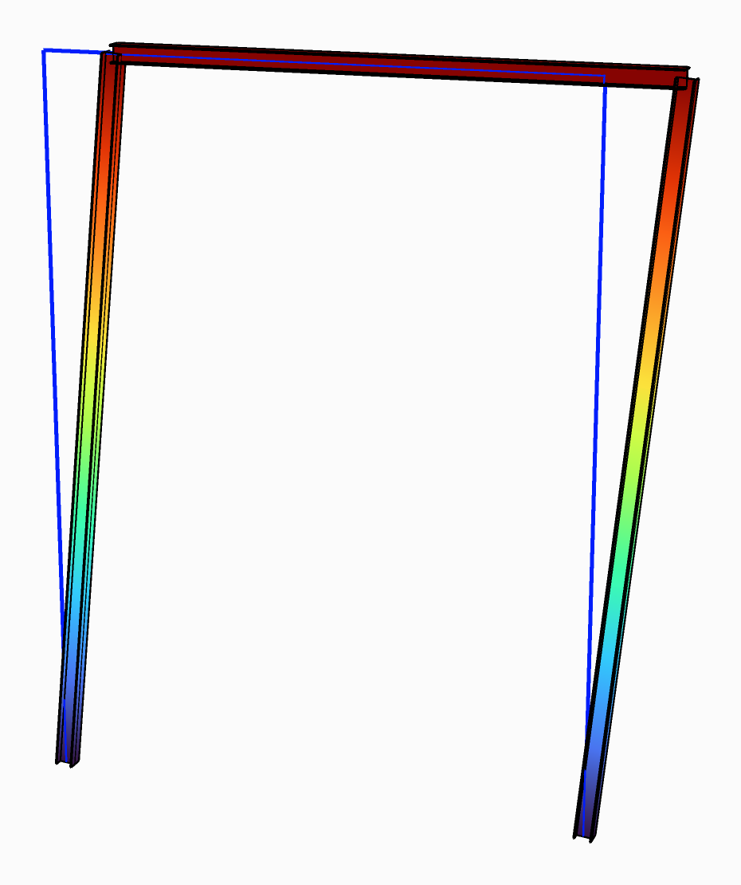

# Find the load factor a model buckles at

Linear Buckling Analysis finds what the loads must be multiplied by for the model to buckle, lowest
first, and the shape it buckles into for each. The first factor is the critical load factor
$$\alpha_{cr}$$: use it to decide whether a frame needs a second-order analysis, or to find a
member's buckling length.

<figure><figcaption>
The frame's first buckling mode, at a load factor of 1.24, over the frame at rest.
</figcaption></figure>

## You need

- An assembled model from [Assemble](../../basics/assemble.md), with the loads to buckle it under in
  its [load patterns](../../basics/loads/load-pattern.md).
- Beams or shells. Solids stiffen the model, but never soften under load.

## Steps

1. Wire the model from Assemble into the **AlpacaModel** input of Linear Buckling Analysis
   (**Alpaca4d ▸ 07_Analysis**). It needs no Analysis Settings.
2. Set **Buckling Modes** to the number of modes you want. The default is `1`.
3. Set **Divisions**. `1` leaves the beams whole, which is enough for the sway of a frame. A member
   that buckles on its own, between its ends, needs `4` or more.
4. Plug **Load Factors** into a panel. The first is $$\alpha_{cr}$$: the loads times
   $$\alpha_{cr}$$ are the loads at which the model first becomes unstable.
5. Wire its **AlpacaModel** output into [Model View](../../basics/visualisation/model-view.md), with a
   slider on **Step**, `0` the first mode. In the **Results** menu tick **Deformed shape**, and
   **Animate** to see the mode move.

## Check

- A first factor below 1 gives a warning: *The first load factor is …: the model buckles before its
  loads are reached.*
- *Nothing buckles under these loads* means that no member is compressed by them. Look at the loads
  with **Show Loads** in Model View.
- Double **Divisions**. Once the first factor changes little, the beams are split finely enough:
  with 4 elements to a half wave of the buckled shape it is about 5 % too high, with 8 about 1.3 %.

## Good to know

- EN 1993-1-1 5.2.1 lets a first-order analysis stand when $$\alpha_{cr} \geq 10$$ for an elastic
  analysis, 15 for a plastic one.
- A member buckles at $$N_{cr} = \alpha_{cr}\,N_{Ed}$$, so its buckling length is
  $$L_{cr} = \pi\sqrt{EI/N_{cr}}$$. Give it to **LengthY** or **LengthZ** of
  [Utilisation](../design-checks/steel-check.md).
- The analysis is linear and elastic, and beams buckle in bending only. $$\alpha_{cr}$$ is not the
  load the structure can carry, and lateral-torsional buckling is Utilisation's to check.
- On OpenSees 3.8.0 a model can have at most 4000 equations, about 650 beam or shell nodes. A newer
  build has no such limit.

## See also

- [Linear Buckling Analysis](../../basics/analysis/linear-buckling.md) — what it solves, Divisions, limits and messages
- [Model View](../../basics/visualisation/model-view.md#results-menu) — drawing a mode, and Animate
- [Check steel members to EN 1993-1-1](../design-checks/steel-check.md) — buckling lengths in a member check
