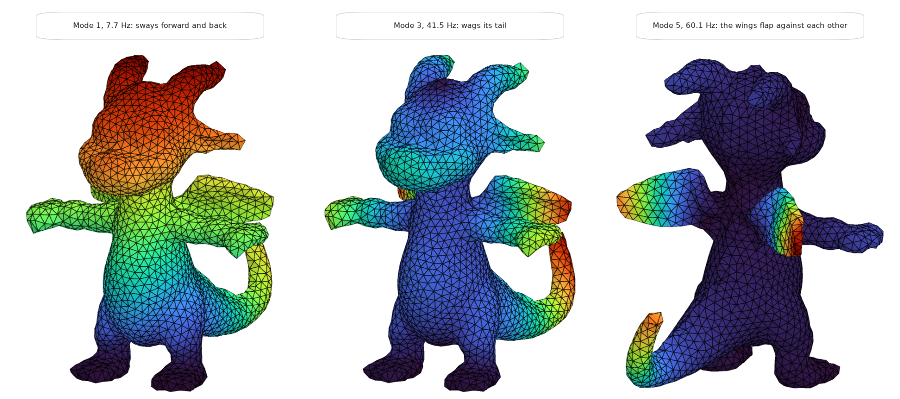

# Find natural frequencies and mode shapes

Natural Vibration finds the modes of a structure, with their periods and frequencies, and Model View
shows each mode move. Run it first on a new model: a first period far from what you expect means the
mass or the stiffness is wrong.

<figure><figcaption>
Three of a dragon's modes, each coloured by how far it moves.
</figcaption></figure>

## You need

- An assembled model from [Assemble](../../basics/assemble.md), with its supports.
- Mass: from the material's density, through the section, or from
  [Mass Point](../../basics/loads/mass-point.md). A [Gravity Load](../../basics/loads/gravity.md) gives
  force, not mass.
- The Grasshopper file saved: the component writes its files beside it.

## Steps

1. Wire the model from Assemble into the **AlpacaModel** input of Natural Vibration Analysis
   (**Alpaca4d ▸ 07_Analysis**). It needs no Analysis Settings.
2. Set **Vibration Modes** to the number of modes you want. The default is `1`.
3. Plug **Frequencies**, in `Hz`, and **Period**, in `s`, into panels: one value per mode.
4. Wire its **AlpacaModel** output into [Model View](../../basics/visualisation/model-view.md), with a
   slider on **Step**. Step `0` is the first mode.
5. In Model View's **Results** menu, tick **Deformed shape**, then **Animate** to swing the mode
   through its rest and out the other side. Tick *Displacement* as well to colour it.
6. Open the **Modal Report** menu under Natural Vibration, and plug
   **ModalParticipationMassesRatio(%)_Cumulative** into a panel.

## Check

- **TotalMassOfStructure**, in the Modal Report menu, should match a hand calculation of the mass.
  It catches a missing density or a mis-scaled Mass Point.
- Most codes ask for 90 % of the mass in each direction in the cumulative ratios. Raise
  **Vibration Modes** until you get there.

## Good to know

- A mode has no size of its own. Alpaca4d reads each mode with its largest translation 1, and Model
  View draws it at **Deformation scale** 1 with its largest movement 8 % of the model's diagonal.
  Its displacements and colours are relative only.
- An analysed model, from Run Analysis or Section Optimiser, can be connected too. Its modes are
  those of the model unloaded.
- The default **Solver**, `-genBandArpack`, suits a few modes of a large model. `-fullGenLapack`
  extracts all of them, but only on a small model.
- Unsaved, the component stops with *"Have you saved the Grasshopper script?"*.

## See also

- [Natural Vibration](../../basics/analysis/natural-vibration.md) — the inputs, the Modal Report and the solvers
- [Model View](../../basics/visualisation/model-view.md#results-menu) — Deformed shape, Deformation scale and Animate
- [Nodal Displacements](../../basics/results/nodal-displacements.md) — a mode shape as numbers
- [Natural Vibration example](https://alpaca4d.github.io/examples/natural-vibration/) — the main modes of a structure
- [Inigo the Dragon](../../basics/elements/ten-node-tetrahedron.md#inigo-the-dragon) — twelve modes of a solid, stepped through in Model View
