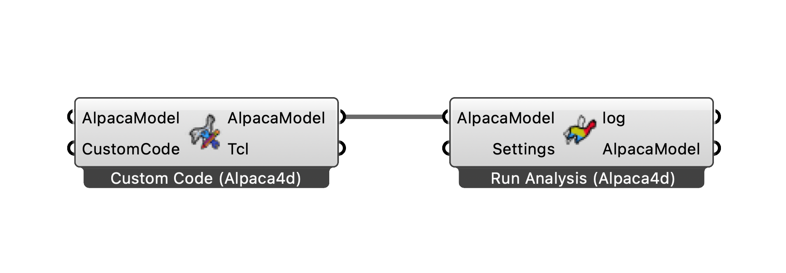

# Run your own OpenSees script

Run an OpenSees Tcl script of your own from Grasshopper, or add commands that Alpaca4d has no
component for to a model built with it.

<figure><figcaption>
Custom Code adds your lines to the model before Run Analysis.
</figcaption></figure>

## You need

- The Tcl lines, in a Panel or read from a `.tcl` file with Grasshopper's **Read File**.
- [Run Analysis](../../basics/analysis/run-analysis.md), and the Grasshopper file saved.

## Steps

**A script of your own**

1. Place [Custom Code](../../basics/utility/custom-code.md) and wire the lines into **CustomCode**.
   Leave **AlpacaModel** empty: the component starts an empty deck.
2. Wire its **AlpacaModel** output into Run Analysis. Right-click Run Analysis, tick
   **Do not use settings**, and leave **Settings** empty. The script then runs as it stands, so it
   needs its own `analyze` and recorders.
3. Run Analysis writes the deck into the `AlpacaResults` folder beside the Grasshopper file and
   runs OpenSees in the Grasshopper file's folder, so a recorder your script names without a
   folder writes there. Read it with **Read File**.

**Commands added to an Alpaca4d model**

1. Wire the model from [Assemble](../../basics/assemble.md) into **AlpacaModel** of Custom Code, and
   your lines into **CustomCode**.
2. Wire Custom Code's **AlpacaModel** into Run Analysis, with **Settings** from
   [Analysis Settings](../../basics/analysis/analysis-settings.md) as usual. Your lines land after
   the model, before the recorder and the analysis that Run Analysis adds.
3. Give anything you define a tag well above the ones in the deck: Custom Code's **Tcl** output
   shows the whole deck.

## Check

- Run Analysis's **log** has everything OpenSees printed. *Analysis Failed: OpenSees exited with
  an error* means a command failed, and the log names the line.
- Custom Code's **Tcl** output shows where your lines landed.

## Good to know

- Nothing in your lines is checked. A mistake shows as an OpenSees error in the log, not as a red
  component.
- With **Do not use settings**, the recorders from Assemble are not written into the script, and
  Run Analysis warns if there are any.
- Custom Code does not show in [Model View](../../basics/visualisation/model-view.md). To see an
  OpenSees model in Grasshopper, read its deck with
  [Deserialise](../../basics/utility/deserialise.md), which skips what Alpaca4d does not model.

## See also

- [Custom Code](../../basics/utility/custom-code.md) — the component
- [Run Analysis](../../basics/analysis/run-analysis.md) — the log, and where the files go
- [Serialize](../../basics/utility/serialize.md) — the deck of a model, as text or a file
- [Custom Script](https://alpaca4d.github.io/examples/custom-script/) — an OpenSees portal frame
  example run from Grasshopper, its output read back
