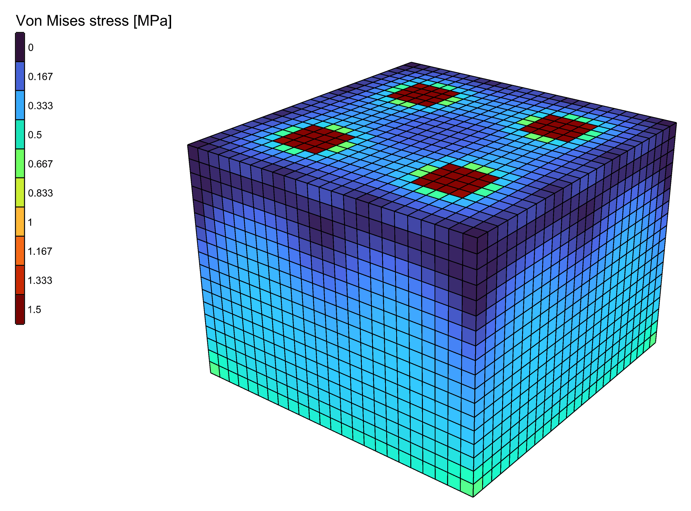

# Solve large models on every core

An OpenSees built with **Mumps** factorises the stiffness matrix on every core of the machine. On a
large model that makes an analysis 2 to 18 times quicker, and it needs less memory. On a small one
it makes no difference.

<figure><figcaption><p>The solver speed test: a block of bricks, solved with Mumps on every core.</p></figcaption></figure>

## You need

- An OpenSees executable built with Mumps. The OpenSees downloaded from UC Berkeley solves on one
  core. See [Setup](../../setup.md#solving-on-several-cores).
- A model solved by [Run Analysis](../../basics/analysis/run-analysis.md), with
  [Analysis Settings](../../basics/analysis/analysis-settings.md), or by
  [Natural Vibration](../../basics/analysis/natural-vibration.md).

## Steps

1. In the Grasshopper menu bar, pick **Alpaca4d → Settings → Set OpenSees Executable...** and select
   the OpenSees built with Mumps. The path is kept for the next sessions.
2. Leave **System** on Analysis Settings at its default, `Auto`. It solves with `Mumps` when the
   OpenSees has it, and with `BandSPD` on one core when it does not. Nothing else in the definition
   has to change.
3. To solve on fewer cores than all of them, right-click Analysis Settings and pick a number under
   **Cores for Mumps**. **All** is the default. The choice is saved with the component.
4. Run the analysis as before.

## Check

Read the **log** output of Run Analysis. When the OpenSees in use has no Mumps, `Auto` writes this
line in it, and the analysis solved on one core:

```
Alpaca4d: this OpenSees has no Mumps solver, so BandSPD solves, on one core
```

Without that line, Mumps solved.

## Good to know

- Set **System** to `Mumps` rather than `Auto` to be warned: on an OpenSees without Mumps the log
  then carries a warning, and `BandSPD` solves.
- **Cores for Mumps** applies to `Mumps`, and to `Auto` on an OpenSees that has Mumps. Every other
  System solves on one core.
- Natural Vibration needs no Analysis Settings. With its default solver, `-genBandArpack`, it uses
  Mumps on every core when the OpenSees has it.
- Most of the gain comes from Mumps itself, not from the extra cores. Going from one core to all of
  them takes off up to a further quarter.

## See also

- [Analysis Settings](../../basics/analysis/analysis-settings.md#solving-on-several-cores) — the timings, and the other solvers
- [Setup](../../setup.md#solving-on-several-cores) — choosing the OpenSees that Alpaca4d runs
- [Natural Vibration](../../basics/analysis/natural-vibration.md#the-solvers) — its eigen solvers, with and without Mumps
