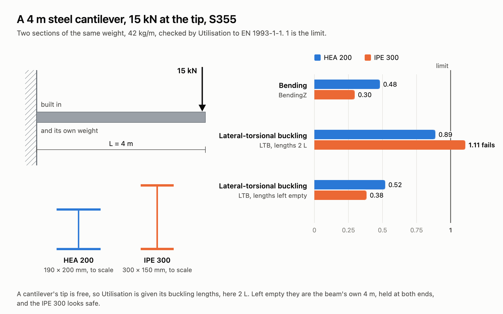

# Check steel members to EN 1993-1-1

Utilisation checks every steel beam of an analysed model to EN 1993-1-1 and reports how much of
each resistance it uses: 1 is exactly at the limit. Use it to see whether the members are big
enough, and which check governs.

<figure><figcaption>
From the Steel Cantilever example: two sections of the same weight, one passes, one fails.
</figcaption></figure>

## You need

- A steel material with a grade, from
  [Material Library Elastic](../../basics/materials/MaterialDatabase.md), with **Model** `Uniaxial`.
- A section with a shape: a profile of the [Steel Section Library](../../basics/sections/library.md),
  or an I, hollow, circular, rectangular or double angle section. A
  [Generic Section](../../basics/sections/parametric-cross-section.md) has no plates to check.
- [Force Beam Column](../../basics/elements/force-beam-column.md) beams, assembled and analysed by
  [Run Analysis](../../basics/analysis/run-analysis.md).

## Steps

1. On Material Library Elastic, set **Type** to `Steel` and **Grade** to your grade, or type it into
   **Material Name**: `S355`. The grade goes with the material, and that is how Utilisation knows
   the beam is steel, and its fy.
2. Wire the material into the **Material** input of the Steel Section Library, and pick the profile
   with **Family** and **Section**, or type it into **Section Name**: `HEA200`. Left empty,
   **Material** is an elastic steel with no grade, which Utilisation does not check.
3. Make the beams with that section, assemble the model and run it with Run Analysis.
4. Wire the **AlpacaModel** output of Run Analysis, not of Assemble, into Utilisation. Leave
   **Step** at `0` for an analysis of one step.
5. Give the buckling lengths, in `m`: **LengthY** about the minor axis of an I, **LengthZ** about the
   major, **LengthLT** between lateral restraints. Give one value for every beam, or one per beam
   in the order of the **Element** output.
6. Set **Load** to `Destabilising` where the load acts on the top flange, and **Sway** to `true` for
   members of a frame that buckles by swaying.
7. Open the **Design** menu below the component. Set **γM0** and **γM1** if your National Annex
   gives other values than `1.0`, set **Fabrication** to `Welded` for welded sections, and turn
   **Report** on.
8. Plug **Max**, and **Governing** and **Report** from the Design menu, into panels.

## Check

- **Type**, in the Design menu, reads `Steel` for every beam. `Unknown` means the material has no
  grade: the beam is not checked, and the component warns.
- **Max** is 1 or less for a member that passes, and **Governing** names the check that gives it.
- An empty **Max** means a check that applies could not be made. **Governing** says which, and
  **Report** why.

## Good to know

- **Lengths left empty are each beam's own length, held at both ends.** A cantilever, a sway column
  and a member drawn as several beams need their lengths given. The component says so in a remark.
- For an I, local *z* is the major axis: **BendingZ** and **BucklingZ** are about it. Leave the
  beam's **ZAxis** empty and the depth of the I points as near straight up as the beam allows.
- Not checked yet: torsional and torsional-flexural buckling, warping torsion, shear buckling of
  slender webs and Class 4 sections. Bending with compression (6.3.3) is checked on doubly
  symmetric sections only.
- The forces are the analysis's. [Linear Buckling](../analysis/buckling.md) tells you whether second-order
  effects matter, and gives a buckling length for **LengthY** or **LengthZ**.

## See also

- [Utilisation](../../basics/results/utilisation.md) — every check, its clause and the messages
- [Material Library Elastic](../../basics/materials/MaterialDatabase.md) — the grades, and a database of your own
- [Steel Section Library](../../basics/sections/library.md) — the 628 profiles
- [Steel Cantilever](https://alpaca4d.github.io/examples/steel-cantilever/) — a cantilever checked, and why its lengths are 2 L
- [Footbridge Study](https://alpaca4d.github.io/examples/footbridge-study/) — 108 truss designs, each checked with Utilisation
