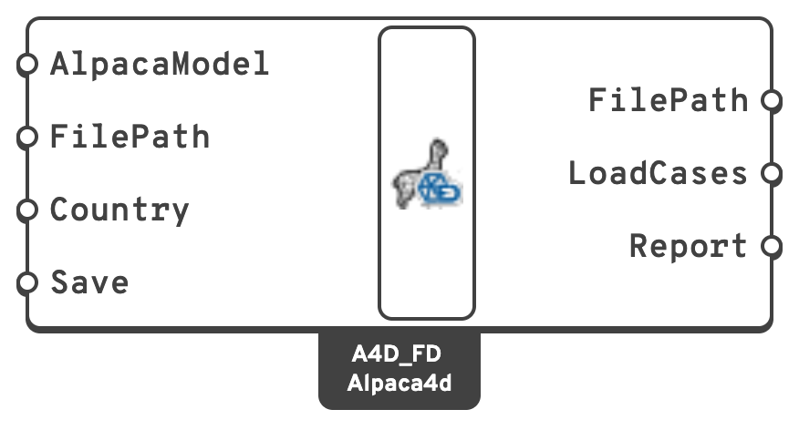

# Send a model to FEM-Design

Write an Alpaca4d model to a `.struxml` file that StruSoft's FEM-Design opens, to design it
there: its bars, plates and walls, supports, load cases and masses.

<figure><figcaption></figcaption></figure>

## You need

- An assembled model from [Assemble](../../basics/assemble.md), or an analysed one from
  [Run Analysis](../../basics/analysis/run-analysis.md).

## Steps

1. Place [Alpaca4DToFEM-Design](../../basics/utility/alpaca4d-to-femdesign.md), in
   **Alpaca4d ▸ 06_Assemble**, and wire the model into **AlpacaModel**.
2. Set **Country** to the national annex whose material library the materials are looked up in:
   `common`, the Eurocode's recommended values, to start with, or `S`, `N`, `DK`, `FIN`, `H` or
   `LV`. The countries' names work too.
3. Read **Report** before saving. The model is converted and the report shown, but nothing is
   written yet.
4. Give **FilePath**, or leave it empty to write the file next to the Grasshopper definition,
   with its name. That needs the definition saved.
5. Set **Save** to `true`.
6. Open the file in FEM-Design. Set the load cases' types and durations, and the combinations
   you need, there.

## Check

- **FilePath** gives the file written, once **Save** is `true`. Saving checks the file against
  FEM-Design's schema, and anything that fails is an error.
- **LoadCases** lists FEM-Design's load cases: one per load pattern with loads, in order, then
  the self-weight.
- In FEM-Design, a linear analysis of the combination `Alpaca`, which adds every load case with
  its factor, is the analysis Alpaca4d runs. Compare the two.

## Good to know

- The **Report** has errors first: what is left out and changes the structure or its loads,
  such as bricks and tetrahedra, which are not exported. Warnings are approximations, remarks
  things worth knowing.
- Grades from the [Material Database](../../basics/materials/MaterialDatabase.md) and profiles from
  the [Steel Section Library](../../basics/sections/library.md) become FEM-Design's own, which it
  can design with. Any other material is analysed but not designed.
- A beam's **ElementId** becomes its name in FEM-Design, numbered: `Column.1`, `Column.2`...
- The export goes one way: FEM-Design's results do not come back. The file can be written on
  Rhino for Mac too, and opened in FEM-Design on Windows afterwards.

## See also

- [Alpaca4D to FEM-Design](../../basics/utility/alpaca4d-to-femdesign.md) — what becomes what,
  element by element
- [Load elements by name](../loading/load-by-name.md) — give beams an **ElementId**
- [Release the end of a beam](../supports-and-releases/hinges.md) — a beam pinned at both ends, with no beam load on it,
  becomes a truss
