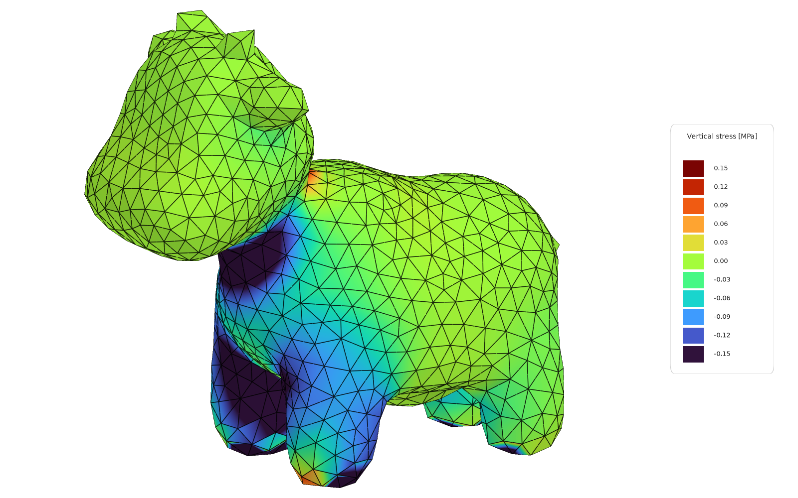

# Turn geometry into solid elements

Make bricks from a solid that can be built in layers, or ten node tetrahedra from a tetrahedral
mesh for any other shape.

<figure><figcaption>
Spot the cow: a closed mesh, filled with Ten Node Tetrahedra.
</figcaption></figure>

## You need

- The geometry: section polylines or a quad mesh for bricks, the output of a tetrahedral mesher
  for tetrahedra.
- An [nD material](../../basics/materials/ND.md), and [Assemble](../../basics/assemble.md).

## Steps

**Bricks, for a solid in layers**

1. Make a series of meshes, one per layer, each with the same quad faces in the same order:
   loft each layer's polylines with [Mesh Loft](../../basics/utility/mesh-loft.md), or move or
   orient copies of one quad mesh.
2. Wire the series, in order, into **Meshes** of
   [Mesh Series to Brick](../../basics/utility/mesh-series-to-brick.md). Set **Closed** to `true`
   for a ring that joins the last mesh back to the first.
3. Wire its **Mesh** output into **Mesh** of [SSP Brick](../../basics/elements/brick.md), and the
   material into **Material**. It makes one brick per 8-vertex mesh.

**Tetrahedra, for any shape**

1. Bring in what a mesher such as gmsh or TetGen writes: the corner points, and four point numbers
   per tetrahedron, counted from 0. **List Item** picks each one's corners, and **Construct Mesh**
   makes them a four-vertex mesh.
2. Wire the meshes into **Mesh** of
   [Ten Node Tetrahedron](../../basics/elements/ten-node-tetrahedron.md), and the material into
   **Material**. It adds the six edge nodes itself.
3. Hold a face at every node on it, edge nodes included: take the element's **Points**, keep the
   ones on the face, and remove duplicates with **Cull Duplicates** before the
   [Support](../../basics/elements/support.md).

Then wire the elements into **Elements** of Assemble.

## Check

- [Model View](../../basics/visualisation/model-view.md) draws the solid and, with **Element edges**
  on, as it is to start with, each element's edges.
- Assemble's **Mass**, in `kg`, should be the solid's volume times the material's density.
- Assemble warns when an edge node between two supported corners has no support of its own.

## Good to know

- Mesh Series to Brick stops with an error on a triangle, and on a brick that folds through
  itself: every mesh of the series has to carry its faces and vertices in the same order.
- The number of bricks is `(layers − 1) × faces`, with one more layer when **Closed** is on.
  Check it before assembling.
- **Tolerance** on Assemble, `0.01` m by default, has to be well below the size of the elements,
  or it welds their nodes together. The [Femur](../../basics/elements/ten-node-tetrahedron.md#femur)
  uses `0.0001`.
- Ten Node Tetrahedra need an OpenSees newer than 3.8.0. **Mesh Brep** in 10_Utility makes a quad
  mesh of surfaces for [ASD Shell](../../basics/elements/shell.md), not solids.

## See also

- [SSP Brick](../../basics/elements/brick.md) — the eight-node brick
- [Ten Node Tetrahedron](../../basics/elements/ten-node-tetrahedron.md) — the quadratic tetrahedron,
  and supports on its edge nodes
- [Mesh Loft - Mesh Series to Bricks](https://alpaca4d.github.io/examples/meshloft-meshbrick/) —
  volumes of bricks from lofts and moved meshes
- [Spot the Cow](../../basics/elements/ten-node-tetrahedron.md#spot-the-cow) — tetrahedra from a
  mesher, held on the ground
