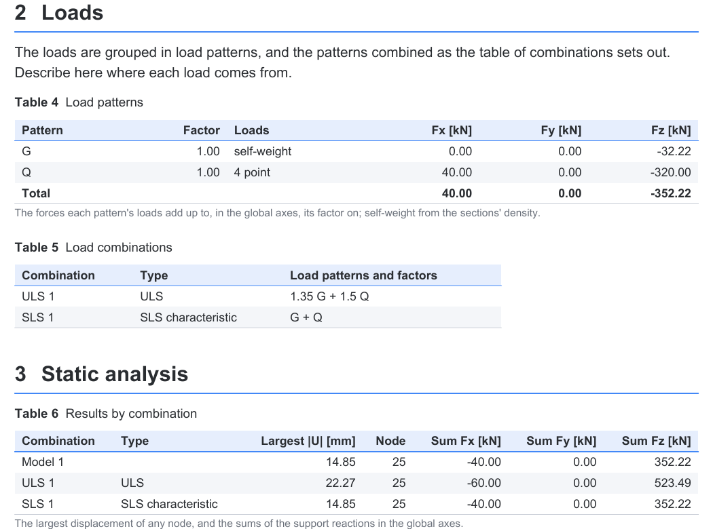

# Combine loads for ULS and SLS

Analyse a structure under each load combination a code asks for, `1.35 G + 1.5 Q` and `G + Q`,
and get a report that lists the combinations, gives the results of each and checks the steel
members over the ultimate ones.

<figure><figcaption>
The loads add up to the reactions: G + Q is 352 kN, and so are the SLS reactions; ULS 1 carries 1.35 G + 1.5 Q.
</figcaption></figure>

## You need

- A model with its loads in [Load Patterns](../../basics/loads/load-pattern.md), one per load
  case: the self-weight's [Gravity Load](../../basics/loads/gravity.md) in one, each imposed load in
  another.
- [Assemble](../../basics/assemble.md), [Run Analysis](../../basics/analysis/run-analysis.md) and
  [Analysis Settings](../../basics/analysis/analysis-settings.md).

## Steps

1. Type a **Name** into each Load Pattern: `G` for the permanent loads, `Q` for the imposed ones.
2. Give the patterns to Assemble as usual.
3. Place a [Load Combination](../../basics/loads/load-combination.md) and wire Assemble's model into
   its **AlpacaModel**. Wire three panels into it, a line per combination:
   - **Name**: `ULS 1` and `SLS 1`.
   - **Type**: `ULS` and `SLS characteristic`.
   - **Combination**: `1.35 G + 1.5 Q` and `G + Q`.
4. Wire its model into Run Analysis, with its Settings on Static. It solves each combination and
   hands on one model that holds them both.
5. Wire that model into [Model View](../../basics/visualisation/model-view.md). Type `SLS 1` into its
   **Combination** to see that one.
6. Wire it into a [Report](../../basics/report/report.md) as well, and click
   **Templates ▸ For the models given**. Set Run to True.

## Check

- The Report's **Load patterns** table adds up each pattern's force. Under each combination,
  **Results by combination** gives the sum of the reactions: `G + Q` should carry G + Q, and
  `1.35 G + 1.5 Q` 1.35 G + 1.5 Q.
- The largest displacement of the SLS combination is the one to compare with your deflection limit.

## Good to know

- **The steel check runs over the ULS combinations only**, and over the accidental and seismic ones.
  It takes each member as held at its ends. For other buckling lengths use
  [Utilisation](../../basics/results/utilisation.md) on the model Run Analysis hands on: it reads
  the model's first combination, so list the ULS one to check first.
- **What a combination does not name does not act**, self-weight included.
- **Each combination is solved again**, in an OpenSees run of its own, so it is right for a
  nonlinear model too, whose results are not the sum of its patterns' own.
- **Natural vibration ignores the combinations**: its mass is the model's own, with what
  [Mass from Loads](../../basics/loads/mass-from-loads.md) adds. Linear Buckling and Pushover take
  the combination their Combination input names: with combinations on the model, name one, or they
  stop with an error listing them.
- **Rather one component per type?** A second Load Combination after the first adds its combinations
  to the model's: one for the ULS ones, one for the SLS ones, with no lists to keep in step.

## See also

- [Load Combination](../../basics/loads/load-combination.md): the inputs, and how a combination is written
- [Report Result Table](../../basics/report/report-result-table.md#the-steel-check): the steel check's assumptions
- [Check a steel member](../design-checks/steel-check.md): Utilisation with your own buckling lengths
