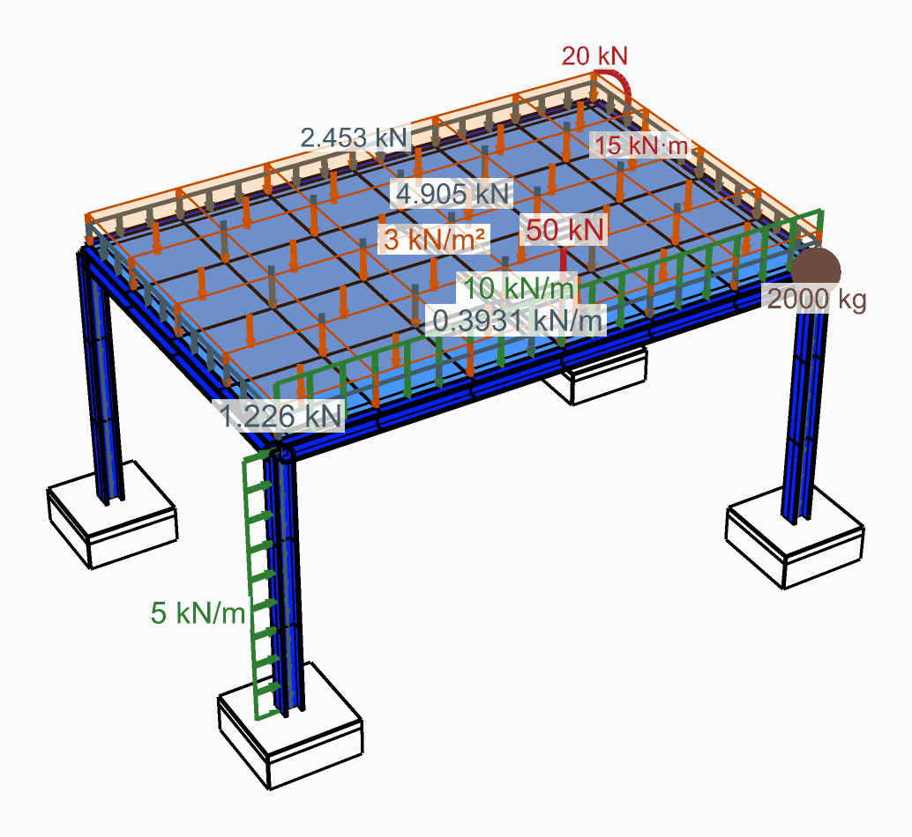

# Load elements by name

Give a group of beams or shells one name, and load the whole group by typing that name, with no
wire from the element component. The same name pulls the group's results out later.

<figure><figcaption>
Loads on the elements they name, as Model View draws them.
</figcaption></figure>

## You need

- Beams from [Force Beam Column](../../basics/elements/force-beam-column.md), or shells from
  [ASD Shell](../../basics/elements/shell.md).
- A [Load Pattern](../../basics/loads/load-pattern.md) and [Assemble](../../basics/assemble.md).

## Steps

1. Type a name into **ElementId** on the element component, such as `Col` or `Slab_1`. One name
   over twenty curves labels all twenty; give a list to name them apart. ASD Shell makes one
   element per mesh face, and one name on the mesh names every face of it.
2. Place a [Linear Load](../../basics/loads/beam-load.md) for beams, or a
   [Mesh Load](../../basics/loads/shell-load.md) for shells.
3. Type the name into its first input, **Beam|Id** or **Shell|Id**, from a Panel. It also takes a
   wildcard (`Col*`), an element tag (`47`) or a regular expression (`regex:^Col`).
4. Give the **Force**, in global axes: `kN/m` on a Linear Load, `kN/m²` on a Mesh Load.
5. Wire the load into **Loads** of the Load Pattern, and the pattern into **LoadPatterns** of
   Assemble.

## Check

- Assemble warns when a name loads nothing: it matches no element, or only elements of the other
  kind, such as shells on a Linear Load. When it matches nothing, the warning says which
  ElementIds the model does have.
- In [Model View](../../basics/visualisation/model-view.md), type the same name into **ElementId**:
  the elements it names are drawn, the rest greyed. Tick **Show Loads** and **Show Values** in
  the **Loads** menu to see the load on them.

## Good to know

- Left empty, **Beam|Id** loads every beam in the model and **Shell|Id** every shell.
- Each item makes one load, so two names that match the same element (`Col*` and `Col_3`) load it
  twice.
- A name is matched whole, in upper or lower case alike: `slab` finds `Slab`, but `Slab` does not
  find `Slab_1`. Use `Slab*` for that.
- The **ElementId** input of [Beam Forces](../../basics/results/beam-forces.md),
  [Shell Forces](../../basics/results/shell-forces.md) and the other result components takes the
  same names, and reads only those elements: see
  [Read the results of chosen elements and nodes](../results/named-results.md).

## See also

- [Linear Load](../../basics/loads/beam-load.md) — a uniform line load on beams
- [Mesh Load](../../basics/loads/shell-load.md) — a uniform pressure on shells
- [Force Beam Column](../../basics/elements/force-beam-column.md) — the **ElementId** input
- [Model View](../../basics/visualisation/model-view.md) — draw only the elements a name picks
- [Read the results of chosen elements and nodes](../results/named-results.md) — results by the same names
