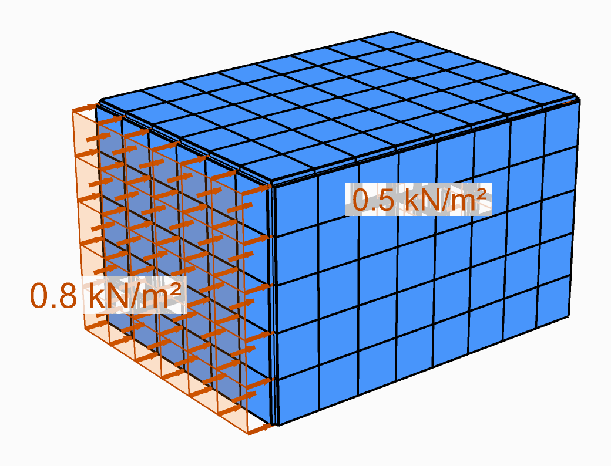

# Put wind on a building

Load the walls of a building with a wind pressure, and its frame with a wind load per metre, as a
load case of their own.

<figure><figcaption>
Pressure on the windward wall, suction on the leeward one, both along the wind.
</figcaption></figure>

## You need

- The walls as [ASD Shell](../../basics/elements/shell.md) elements, each wall's mesh with an
  **ElementId** of its own: `Wall_West`, `Wall_East`.
- For a frame, its columns as beam elements with an **ElementId**: `Col_West`.
- The wind pressure on each face, in `kN/m²`, worked out to your code of practice: Alpaca4d does
  not compute it.

## Steps

1. Place a [Mesh Load](../../basics/loads/shell-load.md) for each face that takes a different
   pressure. Type the wall's name into **Shell|Id**: every face of its mesh is loaded.
2. Give **Force** as a vector in **global** axes, in `kN/m²`. Wind blowing along +X pushes the
   windward wall with `q, 0, 0` and pulls the leeward one, in suction, also along +X.
3. For columns or beams in the wind, place a [Linear Load](../../basics/loads/beam-load.md) with
   their name in **Beam|Id** and **Force** in `kN/m`, also in global axes: the pressure times the
   width each one catches.
4. Wire all of them into one [Load Pattern](../../basics/loads/load-pattern.md) of its own, the
   wind case, and the pattern into [Assemble](../../basics/assemble.md)'s **LoadPatterns**.
5. Set the pattern's **Factor** for a combination: `1.5` for wind as the leading action at the
   ultimate limit state, say, under the factors your code gives.

## Check

- In [Model View](../../basics/visualisation/model-view.md), tick **Show Loads** in its **Loads**
  menu, and give **LoadPattern** the wind pattern's Id to draw it alone: the arrows on each wall
  should point the way the wind pushes or pulls it, and **Show Values** writes what each is worth.
- [Reaction Forces](../../basics/results/reaction-forces.md): with the wind case alone, the
  reactions along X add up to the pressure times the area of the walls, plus the line loads times
  their lengths.

## Good to know

- The pressure is uniform over each Mesh Load and **not** along each face's normal: it acts in the
  global direction you give. A sloping roof or a curved wall needs its faces grouped by direction,
  with a Mesh Load each.
- A name that matches no shell or beam loads nothing, and Assemble warns about it. Two names that
  match the same element load it twice.
- Every pattern wired into Assemble acts in the same analysis. To see the wind alone, assemble a
  second model with only the wind pattern.
- The pressure becomes loads on the nodes of each face, its area shared among them, so a coarse
  mesh carries the same total load as a fine one.

## See also

- [Load elements by name](load-by-name.md) — naming the elements a load goes on
- [Mesh Load](../../basics/loads/shell-load.md) — the surface pressure
- [Linear Load](../../basics/loads/beam-load.md) — loads per metre on beams
- [Load Pattern](../../basics/loads/load-pattern.md) — a load case and its factor
- [Barrel Vault](https://alpaca4d.github.io/examples/barrel-vault/), [Vertical Truss Facade](https://alpaca4d.github.io/examples/vertical-truss-facade/) and
  [Horizontal Truss Facade](https://alpaca4d.github.io/examples/horizontal-truss-facade/) — examples of wind on a vault and on facades
