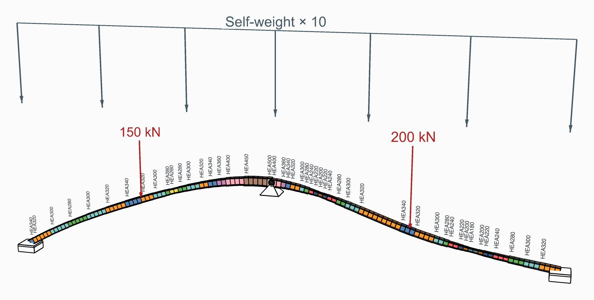

# Size steel beams automatically

Let Alpaca4d pick the lightest section for every steel beam that passes EN 1993-1-1, analysing the
model again as the sections change.

<figure><figcaption>
From the Two-Span Beam example: each element on the first HEA it can have.
</figcaption></figure>

## You need

- An assembled model, from [Assemble](../../basics/assemble.md), whose beams are steel: their
  material from [Material Library Elastic](../../basics/materials/MaterialDatabase.md), so that
  each carries its grade.
- Beam sections from [Steel Section Library](../../basics/sections/library.md), or lists of
  sections of your own.
- For groups, beams with an **ElementId**: see [Load elements by name](../loading/load-by-name.md).

## Steps

1. Place a [Section Optimiser](../../basics/optimisation/section-optimiser.md) and wire the
   assembled model into **AlpacaModel**. It analyses the model itself: it needs no Run Analysis.
2. Leave **DesignGroups** empty to size each beam within the family of the section it starts
   with, smallest area first: an HEA200 among the HEAs.
3. Or give it [Design Groups](../../basics/optimisation/design-group.md): a list of sections per
   group, in the order to try them, and the beams that belong to it by **ElementId**. With
   **Uniform** on, the whole group takes one section: give each member drawn as several beams a
   group of its own, so that it is built as one.
4. Set **MaxUtilisation**: `1` is at the limit, `0.8` keeps a fifth in hand.
5. In the **Design** menu, give the buckling lengths a member needs: **LengthY**, **LengthZ** and
   **LengthLT**. Left empty, each is the beam's own length, held at both ends: not safe for a
   cantilever.
6. Read **Section**, **Utilisation** and **Mass**; wire **AlpacaModel**, the last design analysed,
   into [Model View](../../basics/visualisation/model-view.md) or the result components.

## Check

- **Converged** is `true`: the last iteration changed no section. If it is `false`, raise
  **Iterations**.
- Every **Utilisation** is at or below **MaxUtilisation**. **Governing**, in the **Design** menu,
  says which check gives each one, or why a beam could not be checked.
- **Mass** has one value per iteration, the last design's last; **History**, in the **Design**
  menu, adds the largest utilisation and how many sections changed in each.

## Good to know

- The check is steel only, as [Utilisation](../../basics/results/utilisation.md)'s is. A section
  with no steel grade, or an Elastic Section with no shape, is never picked.
- **ElementId** on the optimiser sizes only some beams; the others keep their sections but are
  still analysed and checked.
- Each analysis is static, in one step. Press **Escape** to stop after the iteration under way.
- Torsional and torsional-flexural buckling (6.3.1.4) are not checked yet.

## See also

- [Section Optimiser](../../basics/optimisation/section-optimiser.md) — every input and output
- [Design Group](../../basics/optimisation/design-group.md) — beams sized from one list
- [Check steel members to EN 1993-1-1](../design-checks/steel-check.md) — the check it repeats
- [Two-Span Beam](https://alpaca4d.github.io/examples/two-span-beam/) — a curved beam sized from a
  list of HEAs, element by element or as one section
