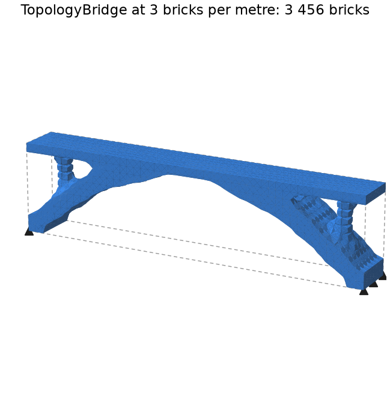

# Find a structure with topology optimisation

Start from a block of material, supported and loaded, and let Alpaca4d keep only the material
the loads need: the stiffest structure for the share of the volume you allow.

<figure><figcaption></figcaption></figure>

## You need

- The design domain as solids: [SSP Bricks](../../basics/elements/brick.md), which
  [Mesh Series to Brick](../../basics/utility/mesh-series-to-brick.md) makes from a series of
  meshes, or [Ten Node Tetrahedra](../../basics/elements/ten-node-tetrahedron.md). See
  [Turn geometry into solid elements](../geometry/solids-from-geometry.md).
- An [Elastic Isotropic material](../../basics/materials/ND.md) on every solid: its modulus is
  what is scaled.
- Supports and loads, as for an analysis, and the model assembled.

## Steps

1. Give an **ElementId** to anything that must stay solid: a deck, a slab, the material round a
   support or a load.
2. Place a [Topology Optimisation](../../basics/optimisation/topology-optimisation.md) and wire
   the assembled model into **AlpacaModel**; name what must stay in **Keep**.
3. Set **VolumeFraction**, the share of the volume to keep: `0.3` by default. The solids in
   **Keep** come on top.
4. Set **Run** to `true`. The run goes on its own thread, so Rhino stays free, and **Surface**
   follows it about once a second.
5. When it stops, wire **AlpacaModel**, the design as a model of its own, into
   [Run Analysis](../../basics/analysis/run-analysis.md), and read it as any analysed model.

## Check

- **Converged** is `true`: the run ended because the densities stopped moving. If it stopped at
  **Iterations**, raise them, and it goes on from where it stopped.
- **Compliance**, the work of the loads, falls as the run goes on: the lower, the stiffer.
- **Step**, with a slider, shows the design of every iteration, to watch the run again.

## Good to know

- Set **Run** to `false` to pause; `true` goes on from there. Changing the model, **Keep**,
  **VolumeFraction** or a setting starts again from the beginning.
- **FilterRadius**, in the settings, is about the thinnest member the result can have.
- Beams, trusses, shells and links in the model are analysed with the solids but take no part,
  and the component warns that they are there.
- [BESO Topology](../../basics/optimisation/beso-topology.md) carves the block down, every element
  solid or void; [Multi-Material Topology](../../basics/optimisation/multi-material-topology.md)
  finds where each of several materials goes.

## See also

- [Topology Optimisation](../../basics/optimisation/topology-optimisation.md) — every input, how
  long a run takes, and the three methods side by side
- [Topology Bridge](https://alpaca4d.github.io/examples/topology-bridge/) — a bridge found in a
  block of bricks
- [Topology Benchmarks](https://alpaca4d.github.io/examples/topology-benchmarks/) — checked
  against top3d
