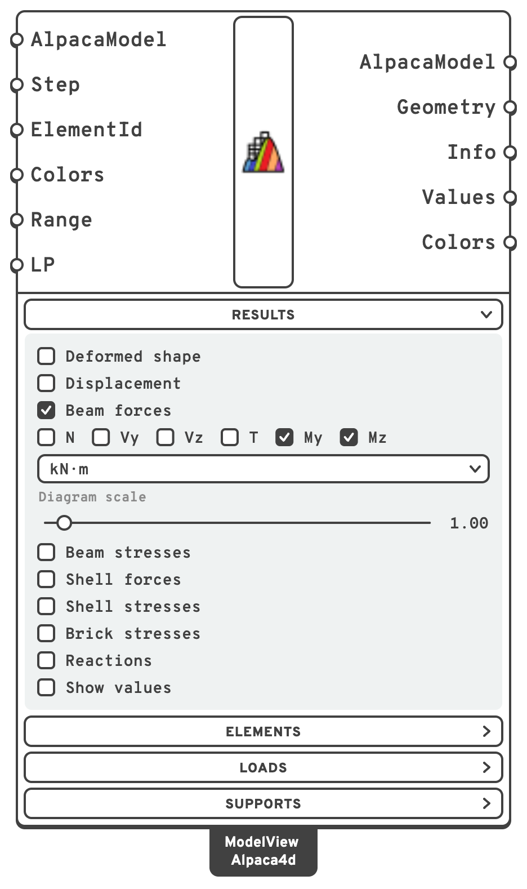

# Read the results of chosen elements and nodes

Each result component can report only part of the model: the elements you named, the joints and
supports you pick. Use it to get the numbers for the members and nodes you care about, without
searching a list of every element.

<figure><figcaption>
The forces along the beams of a frame.
</figcaption></figure>

## You need

- A model analysed by [Run Analysis](../../basics/analysis/run-analysis.md).
- For elements by name, an **ElementId** on their element component:
  [Force Beam Column](../../basics/elements/force-beam-column.md),
  [ASD Shell](../../basics/elements/shell.md), [Brick](../../basics/elements/brick.md),
  [Ten Node Tetrahedron](../../basics/elements/ten-node-tetrahedron.md) or
  [Spring Link](../../basics/elements/spring-link.md).

## Steps

1. Name the elements before you assemble them: type a name into the **ElementId** input of their
   element component, such as `Col`. One name over twenty curves labels all twenty. Give a list to
   name them apart: `Col_1`, `Col_2`.
2. Wire the analysed model into [Beam Forces](../../basics/results/beam-forces.md),
   [Beam Stresses](../../basics/results/beam-stresses.md),
   [Shell Forces](../../basics/results/shell-forces.md),
   [Brick Stresses](../../basics/results/brick-stresses.md) or
   [Utilisation](../../basics/results/utilisation.md). Type into its **ElementId** what to read: a name
   (`Col_3`), a wildcard (`Col*`, `Col_?`), an element tag (`47`) or a regular expression
   (`regex:^Col`). A list of them reads every element any of them matches.
3. For the forces the members bring into a joint, wire the model into
   [Node Forces](../../basics/results/node-forces.md). Give the node by its **Point**, within the
   model's tolerance of a beam end, or by its **NodeTag**. Each node is a branch, with one item per
   member meeting there.
4. For displacements, give [Nodal Displacements](../../basics/results/nodal-displacements.md) the
   **NodeTag** of the nodes to read. **Node IDs**, in the **Elements** menu of
   [Model View](../../basics/visualisation/model-view.md), writes every node's tag on the model.
5. For reactions, give [Reaction Forces](../../basics/results/reaction-forces.md) the points of the
   supports on **PointPos**: the same points you gave the Support component.

## Check

- The **Element** output lists the elements read, in the order of the results. Deconstruct them for
  their tags.
- Nodal Displacements' **Position** output gives where each node read sits, to tie its numbers back
  to the model.
- An ElementId that matches nothing, a Node Forces point at no beam end and a Reaction Forces point
  at no support are each named in a warning, rather than read as nothing.

## Good to know

- Type the same text into Model View's **ElementId**: it draws those elements and greys the rest.
- Each component reads its own kind of element. A shell's ElementId typed into Beam Forces gives a
  warning that it reads beams only.
- Results come in tag order, whatever order **NodeTag** or **Point** gives the nodes in. Node Forces'
  **Position** says which node each branch is.
- Reactions are in each support's own axes, the plane **SupportPosition** gives. For a support placed
  on a point, those are the global axes.

## See also

- [Beam Forces](../../basics/results/beam-forces.md#signs) — the forces along a beam, and their signs
- [Node Forces](../../basics/results/node-forces.md) — the end forces at a joint, and how they balance
- [Nodal Displacements](../../basics/results/nodal-displacements.md) — displacements, rotations, velocities
- [Reaction Forces](../../basics/results/reaction-forces.md) — reactions in the support's own axes
- [Model View](../../basics/visualisation/model-view.md#elements-menu) — Node IDs, Element IDs and the ElementId filter
