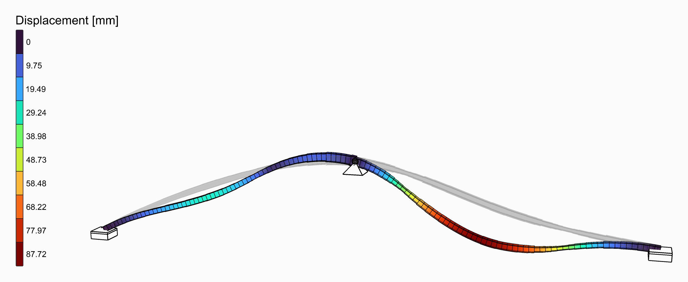

# Show results in colour, with a legend

Model View colours the model by a result, in the unit you pick, and can write the values on it.
Legend draws the colour scale beside it. Use them to read a result on the model it belongs to, or to
make a figure for a report.

<figure><figcaption>
The deformed shape, coloured by displacement, with its Legend.
</figcaption></figure>

## You need

- A model analysed by [Run Analysis](../../basics/analysis/run-analysis.md),
  [Natural Vibration](../../basics/analysis/natural-vibration.md) or
  [Linear Buckling](../../basics/analysis/linear-buckling.md).
- [Model View](../../basics/visualisation/model-view.md) and [Legend](../../basics/visualisation/legend.md),
  from **Alpaca4d ▸ 09_Visualisation**, and [Colors](../../basics/visualisation/colors.md) for a
  gradient other than Turbo.

## Steps

1. Wire the analysed model into the **AlpacaModel** input of Model View. **Step** picks the recorded
   step, `0` the first.
2. In the **Results** menu, tick the result to draw, such as *Displacement*. Under it, pick its
   **Component**, such as `Uz`, and its **Unit**, such as `mm`. Tick **Deformed shape** to draw it on
   the deformed model.
3. Wire the **Values** output of Model View into the **Values** input of Legend, and **Colors** into
   **Colors**. Type the quantity and its unit into **Title**: `Uz [mm]`.
4. For another gradient, wire Colors into the **Colors** input of Model View and set its
   **GradientIndex**:
   `1`, Viridis, for a quantity running from nothing to a maximum, `7`, Coolwarm, for one that
   changes sign. The legend follows through the wires of step 3.
5. To write the values on the model, tick **Show values** in the Results menu. **Text size**, in the
   **Elements** menu, sets their height.
6. To compare two steps or two designs, give **Range** an interval, in the unit picked. The colours
   then stand for the same values in both.

## Check

**Info** has a line per result, with its unit and the range it spans:
`Displacement - Uz [mm], step 0, min -12.3, max 0`. With no **Range**, the legend runs from that
min to that max.

## Good to know

- Tick several results and they are drawn together. **Values** and **Colors** then have a branch per
  result, and one Legend draws a legend for each, side by side. Give **Title** a title per result,
  in the order of the Results menu.
- *Beam forces* has no gradient: its diagrams have colours of their own, it ignores **Colors**, and
  it has no branch in **Values** and no interval in **Range**.
- **Iso-surfaces** colours in bands, one per colour. The legend then writes the band edges between
  its swatches.
- Legend does not read Model View. Fed from anywhere else, give it the same **Colors**, and the two
  ends of the **Range** as its **Values**.

## See also

- [Model View](../../basics/visualisation/model-view.md#results-menu) — every result, its components and units
- [Legend](../../basics/visualisation/legend.md) — position, scale and several legends
- [Colors](../../basics/visualisation/colors.md) — the eighteen gradients, and which to choose
