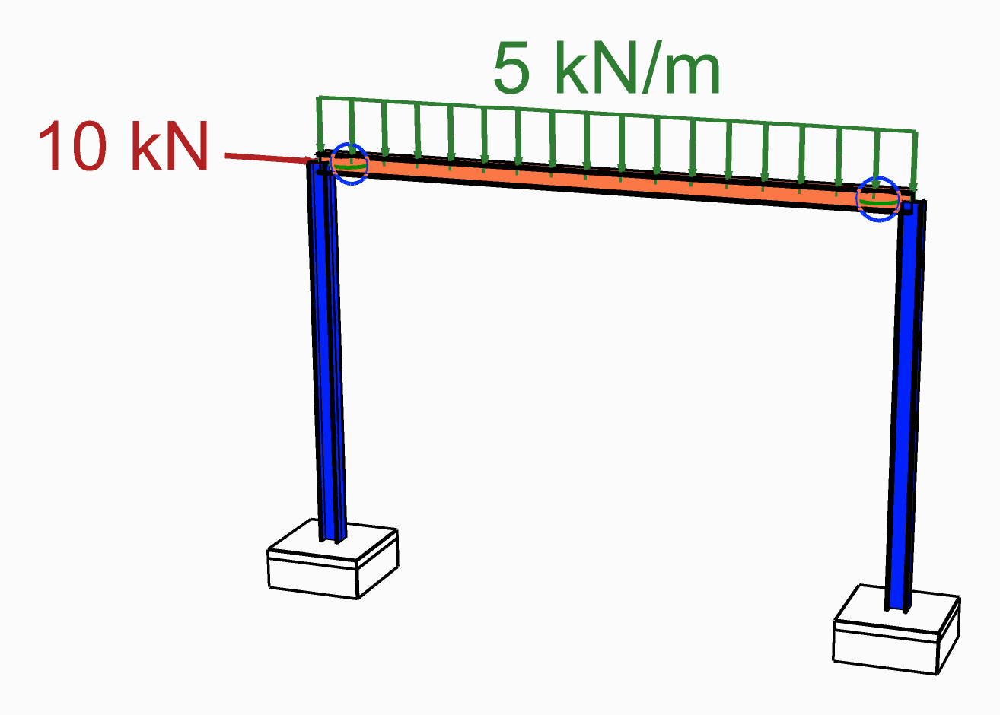

# Release the end of a beam

Pin a beam at one end or both, or release it about one axis only, so that end carries no moment.
The **WithHinges** type of the beam component takes a release for each end.

<figure><figcaption>
The beam is released at both ends, drawn as a circle where it meets each column.
</figcaption></figure>

## You need

- The beam's centreline and a section, as for a
  [Force Beam Column](../../basics/elements/force-beam-column.md).

## Steps

1. Place a Force Beam Column and set its **Element Type** menu to **WithHinges**.
2. Wire the centreline into **Line** and the section into **Section**, as for a plain beam.
3. Place a [Hinge Release](../../basics/elements/hinge-release.md). Its six inputs, **Tx** to **Rz**,
   start `true`: `true` is held, `false` is released, the same way round as on a Support.
4. For a pin, set **Ry** and **Rz** to `false`. For a release about one axis, set that one only.
5. Wire the release into **ReleaseI** for the end at the start of the line, into **ReleaseJ** for
   the end at its end, or into both. An end left empty is fully fixed.
6. Leave **LpI** and **LpJ** empty: they are the hinge lengths, as a fraction of the beam's
   length, `0.05` by default.

## Check

- In [Model View](../../basics/visualisation/model-view.md), **End Releases** in the **Elements**
  menu is on to start with. Each released rotation is drawn as a circle at its end, in the plane
  the end turns in: green for local *y*, blue for local *z*.
- After the analysis, tick *Beam forces* and **My** or **Mz** in Model View's **Results** menu:
  the diagram falls to about zero at the released end.

## Good to know

- **Ry** and **Rz** are about the beam's local *y* and *z* axes. To release one only, turn on
  **Local Axes** in Model View to see which is which.
- A release is a very soft hinge section, its stiffness scaled by 10⁻⁶, not a true free end, so
  the moment there is small rather than zero. **LpI** and **LpJ** are clamped to 0.02 – 0.10.
- To free a beam in torsion as well, release **Rx** at one end only. Released at both ends, the
  beam is free to spin about its own axis, held only by the two soft hinges.
- For a bar that carries axial force only, set **Element Type** to **Truss** instead. Model View
  draws a ball joint at each end of it.

## See also

- [Hinge Release](../../basics/elements/hinge-release.md) — the six booleans of one end
- [Beam With Hinges](../../basics/elements/beam-with-hinges.md) — every input, and how the hinge is
  written for OpenSees
- [Model View](../../basics/visualisation/model-view.md) — **End Releases** and **Local Axes**
- [Alpaca4D to FEM-Design](../../basics/utility/alpaca4d-to-femdesign.md) — a beam pinned at both
  ends, with no beam load on it, goes to FEM-Design as a truss
