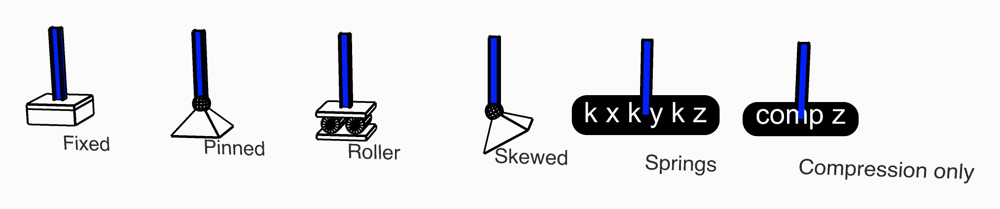

# Hold a node with a support

Fix, pin or roll a node, turn its support to a sloping plane, or hold it on springs or on a
bearing that can lift. One Support component does all of these.

<figure><figcaption>
Six columns, each held another way at its foot.
</figcaption></figure>

## You need

- A point on a node of the model: the end of a beam, a vertex of a shell's mesh, a node of a
  solid.
- [Assemble](../../basics/assemble.md), whose **Supports** input takes the supports.

## Steps

1. Place a [Support](../../basics/elements/support.md) and wire the point into **Position**.
2. Pick the type in its **Support Type** menu: **Rigid** (the default), **Elastic** or
   **Compression Only**.
3. **Rigid**: **Tx** to **Rz** are all `true`, held, to start with. Set to `false` what the node
   is free to do:

   | Support | Set to `false` |
   | --- | --- |
   | Fixed | nothing |
   | Pinned | **Rx**, **Ry**, **Rz** |
   | Roller sliding in X (preset *Sliding in X + Rz restraint*) | **Tx**, **Rx**, **Ry** |
   | Roller sliding in X and Y (preset *Sliding in X and Y + Rz restraint*) | **Tx**, **Ty**, **Rx**, **Ry** |

4. **Skewed**: wire a **Plane** into **Position** instead of a point. The six directions are then
   the plane's own axes. For a roller on a sloping face, give a plane whose Z axis is square to
   the face, hold **Tz** and set **Tx** and **Ty** to `false`.
5. **Elastic**: give a stiffness for each direction the springs hold: **Kx**, **Ky**, **Kz** in
   `kN/m`, **Krx**, **Kry**, **Krz** in `kNm/rad`. Left empty, or zero, the node is free that way.
   Give at least one, or the component warns.
6. **Compression Only**: it holds along the plane's Z only while the node moves against Z: down,
   for a point. Leave **Stiffness** empty for a rigid bearing, or give one in `kN/m`. **Gap**, in
   `m`, is how far the node moves before the support takes hold. Analyse it with the **Newton**
   algorithm in [Analysis Settings](../../basics/analysis/analysis-settings.md), in several steps.

## Check

- In [Model View](../../basics/visualisation/model-view.md), tick **Show Supports** in the
  **Supports** menu. The seven presets of the Support page get their own symbol; any other
  support, springs included, a text tag listing what it holds.
- After the analysis, [Reaction Forces](../../basics/results/reaction-forces.md) gives each
  support's reactions in its own axes. A released direction reads zero, and the vertical
  reactions add up to the load.

## Good to know

- A support takes hold only within Assemble's **Tolerance** of a node. Two supports on one node
  are merged into one, with a remark, unless one of them is skewed or a spring.
- A spring support holds nothing it has no spring for. For a pinned bearing that can lift, put a
  Compression Only support and a Rigid one holding only **Tx** and **Ty** on the same point.
  Do not let the two act along the same direction: Assemble warns when they do.
- Turn the plane over for a Compression Only support that holds only in tension.
- A Compression Only support lets go only in a non-linear analysis. The component says so in a
  remark, and [Run Analysis](../../basics/analysis/run-analysis.md) warns when the algorithm is
  `Linear`.

## See also

- [Support](../../basics/elements/support.md) — every input, the seven presets, and what it writes
  for OpenSees
- [Reaction Forces](../../basics/results/reaction-forces.md) — what each support carries
- [Assemble](../../basics/assemble.md#two-supports-on-one-node) — two supports on one node
- [Spring Link](../../basics/elements/spring-link.md) — a spring between two parts of the model
  rather than to the ground
