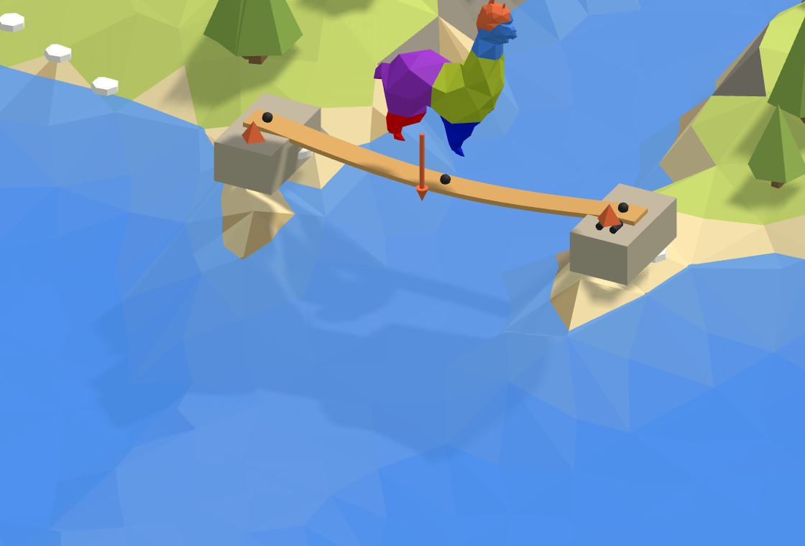

# 🌊 1. River

**A plank across.** A timber plank across the river, a pin at one end and a roller at the other,
with the alpaca standing on it in the middle. How far does it bend?

<figure><figcaption></figcaption></figure>

[river-start](https://raw.githubusercontent.com/Alpaca4d/alpaca4d.github.io/main/doc/learn/01-river/river-start.gh)

[river](https://raw.githubusercontent.com/Alpaca4d/alpaca4d.github.io/main/doc/learn/01-river/river.gh)

Start from **river-start**: the plank's line and its section are there, and the steps below add
the rest. **river** is the finished definition. The same plank is the first area of the
[Playground](https://alpaca4d.github.io/playground.html#river), where you build it a piece at a
time by picking the right Grasshopper snippet, and see what each wrong one would build.

## What you will learn

- How every Alpaca4d model is built: geometry, a section, elements, supports, loads, Assemble
  Model, then an analysis.
- Pin and roller supports: what each holds, and why a plank needs both.
- How far a plank bends under a load at mid-span, and checking it by hand.

## The plank

A C24 timber plank, 300 mm wide and 50 mm thick, lies flat across a 4 m river. The alpaca weighs
0.6 kN, about 60 kg, and stands in the middle. Alpaca4d works in metres and kilonewtons
([Units](../concepts/units.md)), so the plank is 0.3 by 0.05, and the alpaca 0.6.

## Steps

1. **The line.** Open river-start. **Bank A** is at the origin and **Bank B** at X = 4, from the
   **Span** slider: the line runs along X, across the river. Z points up, as in Rhino.
2. **The section.** [Material Library Elastic](../basics/materials/MaterialDatabase.md) makes C24
   from the panel, and [RectangleCS](../basics/sections/rectangular.md) makes the section: **Plank
   width** 0.3 into Width, **Plank thickness** 0.05 into Height, the material into Material. On a
   horizontal beam a rectangle's Height is the side that points up, so the plank lies flat.
3. **The beam.** The alpaca will stand in the middle, and a load has to sit on a node, so the beam
   needs a node there. **Divide Curve** with a Count of 2 gives the middle's parameter, and
   **Shatter** cuts the line there. Wire its segments into the Line of a
   [ForceBeamColumn](../basics/elements/force-beam-column.md), and the section into Section: two
   elements, with nodes at Bank A, in the middle and at Bank B.
4. **The supports.** Two [Supports](../basics/elements/support.md), their Position at Bank A and
   at Bank B. Every input of a Support left empty holds that way, so a Boolean Toggle, **Free**,
   False, frees what each end may do: Ry and Rz at both ends, and Tx at Bank B as well. Bank A is
   the pin, Bank B the roller. Both hold Rx, or nothing would stop the plank turning about its own
   axis.
5. **The alpaca.** **Curve Middle** of the line gives the point, and **Unit Z** with a factor of
   −0.6 the force: 0.6 kN downwards. Wire them into a [Point Load](../basics/loads/point-load.md),
   and the load into a [Load Pattern](../basics/loads/load-pattern.md).
6. **Assemble.** Into [Assemble Model](../basics/assemble.md): the beam's Element into Elements,
   both supports into Supports, the Load Pattern into LoadPatterns. To wire the second support into
   the same input, hold Shift: a new wire otherwise replaces the one there.
7. **Run.** An [Analysis Settings](../basics/analysis/analysis-settings.md) as it comes, a static
   analysis, into the Settings of [Run Analysis](../basics/analysis/run-analysis.md), and its
   AlpacaModel into [Model View](../basics/visualisation/model-view.md), with **Deformed** ticked
   and a Deformation scale of 8.

## Check it by hand

A simply supported beam with a point load P in the middle bends there by

$$\delta = \frac{P L^3}{48 E I}$$

with L = 4 m, E = 10 500 MPa for C24 and I = bh³/12 = 0.3 × 0.05³ / 12 = 3.125 × 10⁻⁶ m⁴:

$$\delta = \frac{0.6 \times 4^3}{48 \times 10\,500\,000 \times 3.125 \times 10^{-6}} = 0.0244\ \text{m} = 24.4\ \text{mm}$$

OpenSees gives 24.4 mm too. The beam's shear adds a hundredth of a millimetre.

## Try

- **Stand the plank on its edge**: swap the wires into Width and Height. It bends 36 times less,
  0.7 mm, because I grows with the cube of the depth. That is why floor joists stand on edge.
- **Build both ends in**: wire Free into nothing. The plank bends a quarter as much, 6.1 mm, which
  a plank resting on blocks does not: its ends can turn.
- **Move the alpaca**: replace Curve Middle by a point at another node, with Count 4 in Divide
  Curve to make more of them.

## The usual mistakes

| You see | Why | Fix |
| --- | --- | --- |
| A plank 300 m wide | 300 typed for 300 mm: Alpaca4d works in metres. | 0.3 and 0.05. |
| A plank 20 times too stiff | Nothing wired into RectangleCS's Material, so it took its default, steel. Grasshopper gives no warning. | Wire the material in. |
| *Point load at location '…' is not part of the model!* | The load sits where the beam has no node: one element, or an odd number of them. | Shatter the line so a node is under the load. |
| *Input parameter Section failed to collect data* | Nothing in ForceBeamColumn's Section, which has no default. | Wire the section in. |
| *Analysis Failed: OpenSees 'analyze' did not converge.* | Both ends free along X, or both free about X: the plank can slide or roll, so the model is a mechanism. | The pin holds Tx, and both hold Rx. |
| The plank bends up | +0.6 into Unit Z: Z points up. | −0.6. |
| Only one support in Supports | The second wire replaced the first. | Hold Shift as you wire the second. |
| *Deformed shape needs an analysed model* | Model View is fed from Assemble Model. | Feed it Run Analysis's AlpacaModel. |
| *Input parameter Settings failed to collect data* | Nothing in Run Analysis's Settings. | Wire in Analysis Settings. |

## The components

- [Material Library Elastic](../basics/materials/MaterialDatabase.md) · [Rectangular](../basics/sections/rectangular.md) · [ForceBeamColumn](../basics/elements/force-beam-column.md) · [Support](../basics/elements/support.md) · [Point Load](../basics/loads/point-load.md) · [Load Pattern](../basics/loads/load-pattern.md) · [Assemble](../basics/assemble.md) · [Analysis Settings](../basics/analysis/analysis-settings.md) · [Run Analysis](../basics/analysis/run-analysis.md) · [Model View](../basics/visualisation/model-view.md)

## See also

- [Hold a node with a support](../how-to/supports-and-releases/supports.md)
- [How a model is built](../concepts/how-a-model-is-built.md)
- [Axes and signs](../concepts/axes-and-signs.md)
