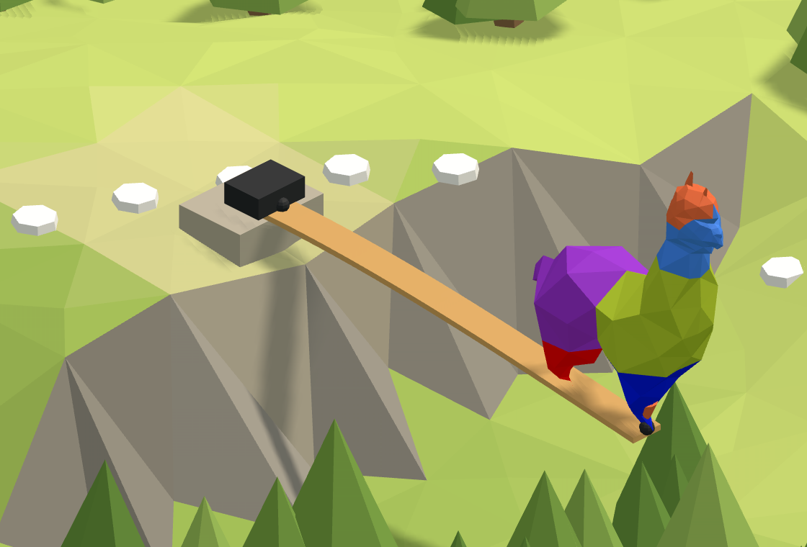

# 🧗 2. Cliff

**A balcony over the drop.** The River's plank, built into the cliff at one end and free over the
drop at the other, with the alpaca standing at its tip. How far does the tip go down?

<figure><figcaption></figcaption></figure>

[cliff-start](https://raw.githubusercontent.com/Alpaca4d/alpaca4d.github.io/main/doc/learn/02-cliff/cliff-start.gh)

[cliff](https://raw.githubusercontent.com/Alpaca4d/alpaca4d.github.io/main/doc/learn/02-cliff/cliff.gh)

Start from **cliff-start**: the balcony's line, section and beam are there, and the steps below add
the rest. **cliff** is the finished definition. The same balcony is the second area of the
[Playground](https://alpaca4d.github.io/playground.html#cliff), where you build it a piece at a time
by picking the right Grasshopper snippet, and see what each wrong one would build.

## What you will learn

- What a fixed support holds, and why a cantilever needs one.
- Reading a displacement as a number with Nodal Displacements.
- Why the same span and load bend a cantilever 16 times as much as a plank held at both ends.

## The balcony

The plank of the [River](01-river.md), C24 timber 300 mm wide and 50 mm thick lying flat, is built
into the cliff at its edge and sticks out 4 m over the drop. The alpaca, 0.6 kN, walks out to its
tip for the view. Alpaca4d works in metres and kilonewtons ([Units](../concepts/units.md)).

## Steps

1. **The balcony.** Open cliff-start. The **Root** is at the origin, at the cliff's edge, and the
   **Tip** at X = 4, from the **Span** slider: the balcony runs along X, out over the drop. The
   section is the River's, and a [ForceBeamColumn](../basics/elements/force-beam-column.md),
   **Balcony**, makes one element of the line. One is enough: a beam's ends are its nodes, and the
   alpaca will stand on the Tip's.
2. **The support.** A [Support](../basics/elements/support.md), its Position at the Root, with
   nothing wired into Tx to Rz. Every input of a Support left empty holds that way, so it holds all
   six: the Root can neither move nor turn. That is a fixed support. Held at one end only, a
   cantilever needs it: the River's pin would let it swing down.
3. **The alpaca.** **End Points** of the line gives its start, S, and its end, E: the Tip. **Unit
   Z** with a factor of −0.6 makes the force, 0.6 kN downwards. Wire E into Point and the vector
   into Force of a [Point Load](../basics/loads/point-load.md), and the load into a
   [Load Pattern](../basics/loads/load-pattern.md).
4. **Assemble.** Into [Assemble Model](../basics/assemble.md): the beam's Element into Elements,
   the support into Supports, the Load Pattern into LoadPatterns.
5. **Run and read.** An [Analysis Settings](../basics/analysis/analysis-settings.md) as it comes
   into the Settings of [Run Analysis](../basics/analysis/run-analysis.md), and its AlpacaModel into
   [Model View](../basics/visualisation/model-view.md), with **Deformed** ticked and a Deformation
   scale of 1: true to scale. Then into
   [Nodal Displacements](../basics/results/nodal-displacements.md): its Displacement lists how far
   each node moved, in metres, in the order Assemble Model numbered them, the Root then the Tip.
   **Deconstruct Vector** splits each into X, Y and Z: the panel **Z in m** shows 0 for the Root
   and −0.390 for the Tip.

## Check it by hand

A cantilever with a point load P at its tip goes down there by

$$\delta = \frac{P L^3}{3 E I}$$

with L = 4 m, E = 10 500 MPa for C24 and I = bh³/12 = 0.3 × 0.05³ / 12 = 3.125 × 10⁻⁶ m⁴:

$$\delta = \frac{0.6 \times 4^3}{3 \times 10\,500\,000 \times 3.125 \times 10^{-6}} = 0.390\ \text{m} = 390\ \text{mm}$$

OpenSees gives 390 mm too; the beam's shear adds 0.05 mm. On two supports with the load in the
middle, the River, it is PL³ / 48EI = 24.4 mm: held at one end only, the same plank, span and load
bend 48 / 3 = 16 times as much.

## Try

- **Make it a balcony you would stand on**: 390 mm is far too much. Stand the plank on its edge,
  swapping Plank width and Plank thickness: I grows 36 times, and the tip goes down 10.8 mm.
- **Halve the span**: Span 2. The tip goes down 2³ = 8 times less, 49 mm: a cantilever's bend grows
  with the cube of its length.
- **Free the Root about Y**: a Boolean Toggle set to False into the Support's Ry. Run Analysis
  fails: nothing stops the balcony turning.

## The usual mistakes

| You see | Why | Fix |
| --- | --- | --- |
| *Analysis Failed: OpenSees 'analyze' did not converge.* | The support lets the Root turn, as the River's pin does: with one support only, the balcony is a mechanism. | Leave Tx to Rz empty, so that the Support holds all six. |
| The tip goes down 0 mm | The Support stands at the Tip, holding it in thin air, or the load is at the Root, on the support. | Support at the Root; the load at End Points' E. |
| *Input parameter Force failed to collect data* | The weight went into Point Load's Moment, and Force is empty. | Wire the vector into Force. |
| *The model is not analysed.* | Nodal Displacements is fed from Assemble Model: there are no results to read yet. | Feed it Run Analysis's AlpacaModel. |
| 0 and 0 in the panel | Deconstruct Vector's X into the panel: the tip goes down, not along the balcony. | Read Z. |
| The balcony lies on the cliff top | Span into the Tip's Y, or a negative Span. | +4 into the Tip's X: X points out over the drop. |

## The components

- [Material Library Elastic](../basics/materials/MaterialDatabase.md) · [Rectangular](../basics/sections/rectangular.md) · [ForceBeamColumn](../basics/elements/force-beam-column.md) · [Support](../basics/elements/support.md) · [Point Load](../basics/loads/point-load.md) · [Load Pattern](../basics/loads/load-pattern.md) · [Assemble](../basics/assemble.md) · [Analysis Settings](../basics/analysis/analysis-settings.md) · [Run Analysis](../basics/analysis/run-analysis.md) · [Model View](../basics/visualisation/model-view.md) · [Nodal Displacements](../basics/results/nodal-displacements.md)

## See also

- [🌊 1. River](01-river.md): the same plank on two supports
- [Hold a node with a support](../how-to/supports-and-releases/supports.md)
- [Axes and signs](../concepts/axes-and-signs.md)
- [Steel Cantilever](https://alpaca4d.github.io/examples/steel-cantilever/)
