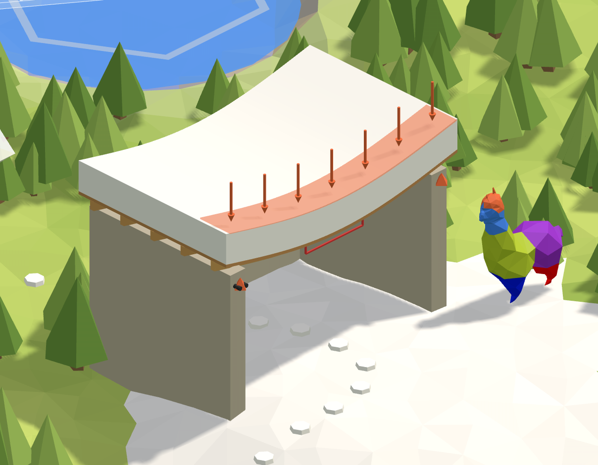

# ❄️ 3. Snowy roof

**A rafter under snow.** A timber rafter of a flat roof, carrying the snow along its length and its
own weight. How deep must it be to sag no more than L/250?

<figure><figcaption></figcaption></figure>

[roof-start](https://raw.githubusercontent.com/Alpaca4d/alpaca4d.github.io/main/doc/learn/03-snowy-roof/roof-start.gh)

[roof](https://raw.githubusercontent.com/Alpaca4d/alpaca4d.github.io/main/doc/learn/03-snowy-roof/roof.gh)

Start from **roof-start**: the rafter is there as the [River](01-river.md) left off, 100 mm deep,
and the steps below load it and size it. **roof** is the finished definition. The same rafter is the
third area of the [Playground](https://alpaca4d.github.io/playground.html#roof), where you build it
a piece at a time by picking the right Grasshopper snippet, and see what each wrong one would build.

## What you will learn

- A load along a beam, in kN per metre, from a load on a roof in kN per square metre.
- The beam's own weight, from Gravity Load, and both loads in one Load Pattern.
- Twice as deep is eight times as stiff; checking a sag against L/250.

## The rafter

A flat roof of C24 rafters, 75 mm wide, spans 4 m from Wall A to Wall B, on a pin and a roller.
The rafters are 0.6 m apart, and 1.5 kN of snow lies on every square metre of the roof. Alpaca4d
works in metres and kilonewtons ([Units](../concepts/units.md)).

## Steps

1. **The rafter.** Open roof-start. The rafter's line runs 4 m along X, cut into four elements by
   Divide Curve and Shatter, with a pin at Wall A and a roller at Wall B, as on the River. Its section
   is a [RectangleCS](../basics/sections/rectangular.md), **Width** 0.075 and **Depth** 0.1 into
   Height: on a horizontal beam Height points up, so the rafter stands on its edge.
2. **The snow.** Each rafter holds up a strip of roof 0.6 m wide, so it carries 1.5 × 0.6 = 0.9 kN
   on every metre of its length. A **Multiplication** of **Snow**, −1.5, and **Spacing**, 0.6, into
   **Unit Z** makes the force, 0.9 kN down. Wire it into the Force of a
   [Linear Load](../basics/loads/beam-load.md), and leave its Beam|Id empty: the load goes on every
   beam, the rafter's four elements.
3. **Its own weight.** A [Gravity Load](../basics/loads/gravity.md) weighs every element from its
   section and its material's density, 410 kg/m³ for C24, and pulls it down. Leave its Factor at 1,
   the true weight.
4. **The load pattern.** Wire both loads into the Loads of a
   [Load Pattern](../basics/loads/load-pattern.md): hold Shift as you wire the second, or it replaces
   the first. Its TimeSeries left empty, the loads act at full size.
5. **Run.** The rafter, both supports and the Load Pattern into
   [Assemble Model](../basics/assemble.md), then [Run Analysis](../basics/analysis/run-analysis.md)
   with an [Analysis Settings](../basics/analysis/analysis-settings.md) as it comes, and its
   AlpacaModel into [Model View](../basics/visualisation/model-view.md), with **Deformed** ticked and
   a Deformation scale of 20. The rafter sags 47 mm: three times L/250 = 4000 / 250 = 16 mm.
6. **How deep.** Move **Depth** to 0.15. The rafter sags 14.3 mm, under 16 mm.

## Check it by hand

A simply supported beam under a uniform load w sags in the middle by

$$\delta = \frac{5 w L^4}{384 E I}$$

The load is the snow and the rafter's weight, w = 0.9 + 0.075 × 0.15 × 410 × 9.81 / 1000 = 0.945 kN/m,
and with L = 4 m, E = 10 500 MPa and I = bh³/12 = 0.075 × 0.15³ / 12 = 2.11 × 10⁻⁵ m⁴:

$$\delta = \frac{5 \times 0.945 \times 4^4}{384 \times 10\,500\,000 \times 2.11 \times 10^{-5}} = 0.0142\ \text{m} = 14.2\ \text{mm} \le \frac{L}{250} = 16\ \text{mm}$$

OpenSees gives 14.3 mm. The beam's shear adds the twentieth of a millimetre.

## Try

- **Twice as deep**: Depth 0.2 sags 6.1 mm, about an eighth of the 47 mm at 0.1, because I grows with the
  cube of the depth. Twice as wide, Width 0.15 with Depth 0.1, sags 24.4 mm: only twice as stiff,
  for the same timber.
- **More snow**: a mountain roof can carry 3 kN/m². Find the depth it needs.
- **Wider apart**: Spacing 1.2 doubles each rafter's snow. Fewer, deeper rafters or more, shallower
  ones?

## The usual mistakes

| You see | Why | Fix |
| --- | --- | --- |
| The rafter sags two thirds more than it should | 1.5 kN/m² wired straight into Linear Load, which reads kN per metre of beam. | Multiply by the spacing: 1.5 × 0.6 = 0.9 kN/m. |
| The rafter sags four times as much, or breaks | The snow on the whole rafter, 3.6 kN, given as its Force: Linear Load puts it on every metre. | Its Force is per metre: 0.9. |
| The roof bends up | +0.9 into Unit Z: Z points up. | A weight is negative: −0.9. |
| The rafter ten times as heavy | Gravity Load's Factor set to 9.81: it already multiplies the mass by g. | Leave Factor at 1. |
| *Unsupported item at LoadPatterns input: LineLoad* | A load wired straight into Assemble Model's LoadPatterns. | Put the loads in a Load Pattern first. |
| 0.0 mm, and no message | Nothing in Assemble Model's LoadPatterns: the model solves with no loads. | Wire the Load Pattern in. |
| A few percent too little sag, and no message | Algorithm Linear in Analysis Settings: one solve, and a ForceBeamColumn takes in the bending of a load along it only as it iterates. | Leave Algorithm at Newton. |

## The components

- [Linear Load](../basics/loads/beam-load.md) · [Gravity Load](../basics/loads/gravity.md) · [Load Pattern](../basics/loads/load-pattern.md) · [Rectangular](../basics/sections/rectangular.md) · [Material Library Elastic](../basics/materials/MaterialDatabase.md) · [ForceBeamColumn](../basics/elements/force-beam-column.md) · [Support](../basics/elements/support.md) · [Assemble](../basics/assemble.md) · [Analysis Settings](../basics/analysis/analysis-settings.md) · [Run Analysis](../basics/analysis/run-analysis.md) · [Model View](../basics/visualisation/model-view.md)

## See also

- [Load elements by name](../how-to/loading/load-by-name.md)
- [How a model is built](../concepts/how-a-model-is-built.md)
- [Axes and signs](../concepts/axes-and-signs.md)
