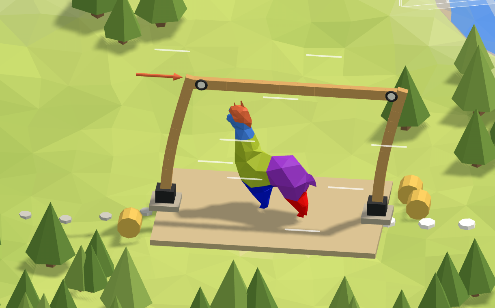

# 🌾 4. Barn

**A portal frame in the wind.** One frame of a timber barn: two posts set in concrete footings, a
beam bolted across their tops, and the wind pushing at the eaves. How far does it sway?

<figure><figcaption></figcaption></figure>

[barn-start](https://raw.githubusercontent.com/Alpaca4d/alpaca4d.github.io/main/doc/learn/04-barn/barn-start.gh)

[barn](https://raw.githubusercontent.com/Alpaca4d/alpaca4d.github.io/main/doc/learn/04-barn/barn.gh)

Start from **barn-start**: the frame's three lines and their section are there, and the steps below
add the rest. **barn** is the finished definition. The same frame is the fourth area of the
[Playground](https://alpaca4d.github.io/playground.html#barn), where you build it a piece at a
time by picking the right Grasshopper snippet, and see what each wrong one would build.

## What you will learn

- Building a model from several elements, and wiring more than one of them into one input.
- What a joint holds: knees rigid or hinged with a Hinge Release, feet clamped or pinned with a
  Support.
- Why a frame needs rigid joints somewhere, and checking how far it sways by hand.

## The frame

Two C24 timber posts 4 m tall, 6 m apart, and a beam across their tops, all 200 × 300 mm with the
300 in the frame's plane. The posts are set in concrete footings, which hold them every way; the
beam is bolted on, so it can turn at the knees. The wind on this bay of the wall, 3 kN, gathers at
the top of the first post. Alpaca4d works in metres and kilonewtons
([Units](../concepts/units.md)).

## Steps

1. **The frame.** Open barn-start. **Base A** is at the origin and **Base B** at X = 6, from
   **Span**; **Top A** and **Top B** are above them, with **Height**, 4, in their Z. Three Lines
   join them: **Post A** from Base A to Top A, the **Beam line** from Top A to Top B, and **Post
   B** from Base B to Top B. Each line ends where the next begins, so the members will share their
   nodes at the knees.
2. **The posts.** [Material Library Elastic](../basics/materials/MaterialDatabase.md) makes C24,
   and [RectangleCS](../basics/sections/rectangular.md) the section: **Width** 0.2 into Width,
   **Depth** 0.3 into Height. On an upright member a rectangle's Height lies along X, in the
   frame's plane, so the posts bend their strong way. A
   [ForceBeamColumn](../basics/elements/force-beam-column.md), **Posts**, takes both posts' lines
   in its Line, two elements, and the section in its Section. Hold Shift as you wire the second
   line: a new wire otherwise replaces the one there.
3. **The beam.** A second ForceBeamColumn, **Beam**, its Element Type menu set to
   [WithHinges](../basics/elements/beam-with-hinges.md): the Beam line into Line, the section into
   Section. A [Hinge Release](../basics/elements/hinge-release.md), **Knee**, goes into both its
   ReleaseI, the end at Top A, and its ReleaseJ, the end at Top B. A Boolean Toggle, **Free**,
   False, frees the Knee's Rz: the beam's turn about its own z, across the barn, which is how it
   turns in the frame's plane. Both knees are hinges.
4. **The footings.** Two [Supports](../basics/elements/support.md), their Position at Base A and
   at Base B, nothing else wired: every input left empty holds, as concrete holds a post set in
   it.
5. **The wind.** **Wind**, 3, into the X of a Vector XYZ, **Push**. A
   [Point Load](../basics/loads/point-load.md), **Gust**, at Top A with Push as its Force, into a
   [Load Pattern](../basics/loads/load-pattern.md), **Wind load**.
6. **Assemble.** Into [Assemble Model](../basics/assemble.md): Posts and Beam into Elements, both
   footings into Supports, Wind load into LoadPatterns. Hold Shift for the second wire into
   Elements and into Supports.
7. **Run.** An [Analysis Settings](../basics/analysis/analysis-settings.md) as it comes, a static
   analysis, into the Settings of [Run Analysis](../basics/analysis/run-analysis.md), and its
   AlpacaModel into [Model View](../basics/visualisation/model-view.md), with **Deformed** ticked
   and a Deformation scale of 100.

## Check it by hand

With both knees hinged, the beam can't bend the posts: it only ties their tops together. They sway
together, and each is a cantilever from its footing, pushed by half the wind:

$$\delta = \frac{(H/2)\, h^3}{3 E I} = \frac{H h^3}{6 E I}$$

with H = 3 kN, h = 4 m, E = 10 500 MPa for C24 and I = bh³/12 = 0.2 × 0.3³ / 12 = 4.5 × 10⁻⁴ m⁴:

$$\delta = \frac{3 \times 4^3}{6 \times 10\,500\,000 \times 4.5 \times 10^{-4}} = 0.0068\ \text{m} = 6.8\ \text{mm}$$

OpenSees gives 6.8 mm too. The posts' shear adds four hundredths of a millimetre.

## Try

- **Make the knees rigid**: unwire Free from the Knee. Now the beam bends with the posts and helps
  them: 2.8 mm, two and a half times stiffer, as if the knees were glued or welded.
- **Pin the feet as well**: wire Free into both footings' Ry. Four hinges, and nothing holds the
  frame square: it folds. OpenSees still solves it, because Alpaca4d gives a released joint a
  millionth of its stiffness, and sways it 1.5 km. Then make the knees rigid again: pinned feet
  and rigid knees are the classic portal frame, and it sways 12.0 mm.
- **Blow across the barn**: wire Wind into Push's Y instead. One frame is weakest out of its
  plane: Top A moves 23 mm. A barn's walls and roof bracing take the wind that way.

## The usual mistakes

| You see | Why | Fix |
| --- | --- | --- |
| Only one post | The second wire into Posts' Line replaced the first. | Hold Shift as you wire the second post. |
| 15.3 mm, not 6.8 | Width and Height swapped: on a post Height lies along X, so the 300 runs across the barn and the posts bend the weak way. | Depth into Height. |
| 2.8 mm, not 6.8 | Nothing in the Knee's Rz, or Free in its Ry instead: Ry is the beam's turn about its own y, which points up, so the knees stay rigid in the frame's plane. | Free into the Knee's Rz. |
| 4.6 mm | The Knee only in ReleaseI: an empty ReleaseJ holds everything, so the knee at Top B is rigid. | The Knee into both. |
| 1.5 km of sway | Pinned feet and hinged knees: four hinges, a mechanism. | Clamp the feet, or make the knees rigid. |
| 13.6 mm | Free in Footing B's Tx: Post B's foot slides, and Post A carries all the wind. | Hold Tx at both footings. |
| The posts bend across the barn | The wind wired into Push's Y. | Into its X. |
| Nothing sways | The Gust at Base A: the footing holds it. | Put it at Top A. |
| *Deformed shape needs an analysed model* | Model View is fed from Assemble Model. | Feed it Run Analysis's AlpacaModel. |

## The components

- [Material Library Elastic](../basics/materials/MaterialDatabase.md) · [Rectangular](../basics/sections/rectangular.md) · [ForceBeamColumn](../basics/elements/force-beam-column.md) · [Beam With Hinges](../basics/elements/beam-with-hinges.md) · [Hinge Release](../basics/elements/hinge-release.md) · [Support](../basics/elements/support.md) · [Point Load](../basics/loads/point-load.md) · [Load Pattern](../basics/loads/load-pattern.md) · [Assemble](../basics/assemble.md) · [Analysis Settings](../basics/analysis/analysis-settings.md) · [Run Analysis](../basics/analysis/run-analysis.md) · [Model View](../basics/visualisation/model-view.md)

## See also

- [Release the end of a beam](../how-to/supports-and-releases/hinges.md)
- [Hold a node with a support](../how-to/supports-and-releases/supports.md)
- [Put wind on a building](../how-to/loading/wind.md)
- [Axes and signs](../concepts/axes-and-signs.md)
- [🧗 2. Cliff](02-cliff.md): one cantilever, the same sum.
