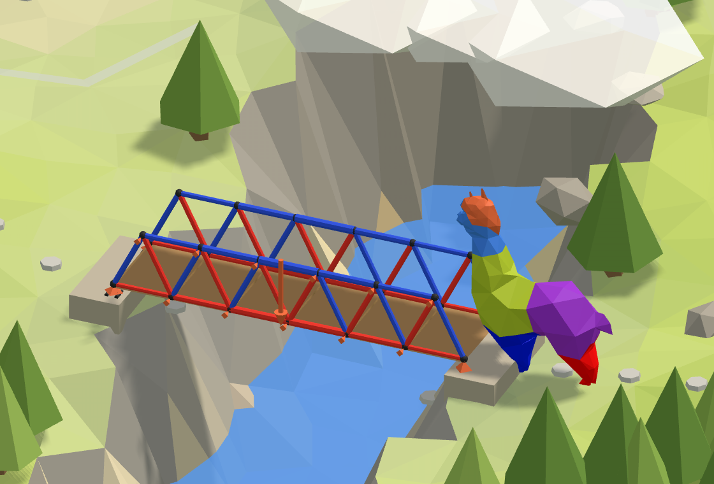

# 🌉 5. Valley

**A truss bridge over the gorge.** A steel truss across the gorge, made of triangles of bars that
only pull or push, with the alpaca standing on its deck in the middle. Which bars are pulled, which
are pushed, and how hard?

<figure><figcaption></figcaption></figure>

[valley-start](https://raw.githubusercontent.com/Alpaca4d/alpaca4d.github.io/main/doc/learn/05-valley/valley-start.gh)

[valley](https://raw.githubusercontent.com/Alpaca4d/alpaca4d.github.io/main/doc/learn/05-valley/valley.gh)

Start from **valley-start**: the deck and the triangles over it are there, as lines, and the steps
below make them a truss. **valley** is the finished definition. The same bridge is the fifth area of
the [Playground](https://alpaca4d.github.io/playground.html#valley), where you build it a piece at a
time by picking the right Grasshopper snippet, and see what each wrong one would build.

## What you will learn

- Why trusses are made of triangles, and what happens to a panel that has none.
- Truss elements: bars that carry an axial force N, pulled or pushed, and nothing else.
- Why a flat truss in 3D has to be held sideways.
- Which bars are in tension and which in compression, and checking them by hand.

## The bridge

A Warren truss 12 m long, in six panels of 2 m, 2 m deep, crosses the gorge. Its bars are steel
tubes 100 mm across with a 5 mm wall, in S355. The bridge has two trusses side by side, with the
deck and the bracing between them; the model is one of them. The alpaca, 0.6 kN, stands on the
deck in the middle. Alpaca4d works in metres and kilonewtons ([Units](../concepts/units.md)).

## Steps

1. **The deck.** Open valley-start. **Bank A** is at the origin and **Bank B** at X = 12, from the
   **Span** slider. **Divide Curve** with **Panels** = 6 gives the parameters of the deck's joints,
   and **Shatter** cuts the deck line there into the **Bottom chord**: six lines of 2 m, with a joint
   at 6 m, under the alpaca.
2. **The triangles.** **End Points** gives each panel's start S and end E. **Move** lifts the
   panels' middles by **Unit Z**, **Depth** long: the **Top joints**. **Up diagonals** run from each
   start to its top joint and **Down diagonals** from it to the panel's end, and the **Top chord**
   runs through the top joints, exploded into a line per panel.
3. **The bars.** Switch the beam component to Truss from its Element Type menu
   ([ForceBeamColumn, Truss](../basics/elements/force-beam-column.md)) and name it **Truss**. Wire
   the four lists into its Line: the bottom chord, both diagonals and the top bars, holding Shift for
   every wire after the first. Its Section is a [CircleCS](../basics/sections/circular.md), Diameter
   0.1 and Thickness 0.005, of S355 from [Material Library Elastic](../basics/materials/MaterialDatabase.md).
   Leave WorksIn as it is: Both.
4. **The supports.** Three [Supports](../basics/elements/support.md), and a Boolean Toggle,
   **Free**, False. The **Pin** at Bank A holds everything. The **Roller** at Bank B has Free in Tx,
   so it slides along X. The **Side support** holds every other joint along Y only, with Free in Tx
   and Tz: the deck's inner joints and the top joints. **Shift List** gives the inner deck joints:
   the panels' starts without the first, with a toggle **Wrap**, False, in its W, so that the first
   is not put back at the end. At a joint only bars reach, a support's rotations change nothing.
5. **The alpaca.** **Curve Middle** of the deck line gives the joint at 6 m, and **Unit Z** with a
   Factor of −0.6 the force. Wire them into a [Point Load](../basics/loads/point-load.md), and that
   into a [Load Pattern](../basics/loads/load-pattern.md).
6. **Assemble.** Into [Assemble Model](../basics/assemble.md): the Truss into Elements, the three
   supports into Supports, the Load Pattern into LoadPatterns.
7. **Run.** [Analysis Settings](../basics/analysis/analysis-settings.md) as it comes into
   [Run Analysis](../basics/analysis/run-analysis.md), and its AlpacaModel into
   [Model View](../basics/visualisation/model-view.md), with Beam forces ticked under Results, N
   picked, and Show values on. Model View draws N red where a bar is pulled and blue where it is
   pushed.

## Check it by hand

Each bank holds up half the alpaca, R = 0.3 kN. Cut through the middle panel and turn about the
deck joint under the alpaca: the top chord above it, h = 2 m up, holds the moment there.

$$N_\text{top} = -\frac{R \times 6}{h} = -\frac{0.3 \times 6}{2} = -0.90\ \text{kN}$$

Pushed. Turn about the top joint at 5 m for the bottom chord below it:

$$N_\text{bottom} = \frac{R \times 5}{h} = \frac{0.3 \times 5}{2} = 0.75\ \text{kN}$$

Pulled. Every diagonal carries the shear, 0.3 kN, at its slope, 2 m up over 1 m along:

$$N_\text{diagonal} = \pm \frac{R}{2 / \sqrt{5}} = \pm 0.335\ \text{kN}$$

OpenSees gives −0.900, 0.750 and ±0.335 kN. In the half of the bridge towards Bank A the up
diagonals are pushed and the down diagonals pulled; past the middle it is the other way round.

## Try

- **Halve Depth**: 1 m deep, the chords carry twice as much, 1.8 kN in the middle of the top chord.
  A truss works like a deep beam, whose chords carry the bending moment over the depth.
- **Pull the deck up**: Alpaca +0.6. Every bar keeps its size of force and changes colour.
- **WorksIn Tension**: every bar becomes a rod that goes slack when pushed. The top chord and half
  the diagonals let go, and the analysis fails.

## The usual mistakes

| You see | Why | Fix |
| --- | --- | --- |
| *Analysis Failed: OpenSees 'analyze' did not converge.* | Nothing holds the joints along Y: a flat truss's bars only push and pull in its plane. | A Side support holding Ty at every joint between the banks. |
| *Analysis Failed: OpenSees 'analyze' did not converge.* | A panel with no diagonal across it - a down diagonal drawn over an up one, or the top bars left out of Line: it folds without any bar stretching. | Triangles: an up and a down diagonal per panel, and all four lists in Line. |
| *Analysis Failed: OpenSees 'analyze' did not converge.* | The top chord's polyline, or the deck line, went in whole. Its points lie on a line, so a Truss takes it as one bar touching no joint between. | Explode the polyline, Shatter the deck line. |
| *Analysis Failed: OpenSees 'analyze' did not converge.* | WorksIn is Tension: the pushed bars go slack. | Both, the default. |
| The bridge hangs straight down from Bank A, and no error | Bank B's Tz is free too. The corotational Truss bars follow the bridge as it swings, and OpenSees finds where it comes to rest. | The roller holds Tz: only Tx goes free. |
| The deck's end bars pushed | Both banks hold X, so the deck cannot stretch: the banks take 0.45 kN of its pull. | Free in the roller's Tx. |
| *Point load at location '6,0,2' is not part of the model!* | Curve Middle of the top chord: its middle is halfway along a top bar. | Curve Middle of the deck line, on the joint at 6 m. |
| *Data conversion failed from Point to Number* | Divide Curve's points P into Shatter's t. | Its parameters t. |
| *Beam forces need an analysed model* | Model View is fed from Assemble Model. | Feed it Run Analysis's AlpacaModel. |

## The components

- [ForceBeamColumn, Truss](../basics/elements/force-beam-column.md) · [CircleCS](../basics/sections/circular.md) · [Material Library Elastic](../basics/materials/MaterialDatabase.md) · [Support](../basics/elements/support.md) · [Point Load](../basics/loads/point-load.md) · [Load Pattern](../basics/loads/load-pattern.md) · [Assemble](../basics/assemble.md) · [Analysis Settings](../basics/analysis/analysis-settings.md) · [Run Analysis](../basics/analysis/run-analysis.md) · [Model View](../basics/visualisation/model-view.md) · [Beam Forces](../basics/results/beam-forces.md)

## See also

- [🌊 1. River](01-river.md), the first lesson: how every model is built
- [Which element](../concepts/which-element.md)
- [Hold a node with a support](../how-to/supports-and-releases/supports.md)
- [Axes and signs](../concepts/axes-and-signs.md)
