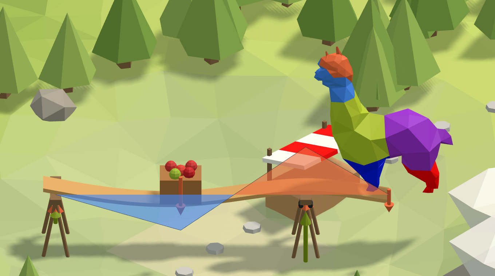

# 🏪 6. Market

**Predict, then check.** A market stall's shelf rests on two trestles, with its end sticking out
past the second one. It carries a crate of apples between the trestles and the alpaca on its end.
Work out what each trestle carries and how the shelf bends, by hand, then read both from the model.

<figure><figcaption></figcaption></figure>

[market-start](https://raw.githubusercontent.com/Alpaca4d/alpaca4d.github.io/main/doc/learn/06-market/market-start.gh)

[market](https://raw.githubusercontent.com/Alpaca4d/alpaca4d.github.io/main/doc/learn/06-market/market.gh)

Start from **market-start**: the stall is built and solved, and the steps below read it.
**market** is the finished definition. The same stall is the sixth area of the
[Playground](https://alpaca4d.github.io/playground.html#market), where you pick the right
prediction and the right reading, and see what each wrong one would mean.

## What you will learn

- Equilibrium: the reactions add up to the loads, and their moments balance the loads' moments.
- How to read the reactions with Reaction Forces, and what their signs mean.
- Which output of Beam Forces holds the bending, and what sagging and hogging are.
- Why the largest moment can be where the heaviest load is not.

## The stall

The shelf is the River's plank: C24 timber, 300 mm wide and 50 mm thick, lying flat, here 4 m
long. Trestle A, under its start, is a pin. Trestle B, 3 m along, is a roller. The last metre
sticks out past trestle B. The crate weighs 1 kN and sits 1.5 m along, half way between the
trestles. The alpaca weighs 0.6 kN and stands on the end, 4 m along. **Elements** cuts the shelf
into eight elements of 0.5 m, so there is a node under each load and on each trestle.

## Steps

1. **Predict the reactions.** Open market-start. Before reading anything, work out what each
   trestle carries, and type it into a panel. Up and down, the two add up to the loads,
   1.6 kN. Taking moments about trestle A gives trestle B's: B × 3 = 1 × 1.5 + 0.6 × 4.
2. **Read them.** Add [Reaction Forces](../basics/results/reaction-forces.md), its AlpacaModel
   from Run Analysis, and wire ReactionForce into a panel: {0, 0, 0.3} and {0, 0, 1.3}. It gives
   one vector per support, in the order Assemble Model has them, the pin's first. Each vector is
   in the support's own axes, here the global ones. A reaction is the force the support puts on
   the shelf, so positive Z is a trestle pushing up.
3. **Read the bending.** Add [Beam Forces](../basics/results/beam-forces.md), its AlpacaModel
   from Run Analysis, and wire Mz into a panel. It gives one branch per element, holding the values
   along it from its I end to its J end. With nothing in ZAxis, a horizontal beam's local y points
   up and local z runs across it. Mz bends the shelf about local z, up and down, and positive Mz is
   sagging. My and N are zero all along, and Vy is the shear.
4. **Draw it.** In [Model View](../basics/visualisation/model-view.md), fed from Run Analysis,
   tick Beam forces under Results and pick Mz. Model View draws a moment on the side it
   stretches, and writes each element's largest value beside it. Under the crate the diagram
   sags below the shelf. Over trestle B it hogs above it.
5. **Say the largest.** In a panel beside it: 0.6 kNm, hogging, over trestle B.

## Check it by hand

Moments about trestle A, then up and down:

$$R_B = \frac{1 \times 1.5 + 0.6 \times 4}{3} = 1.3\ \text{kN} \qquad R_A = 1.6 - 1.3 = 0.3\ \text{kN}$$

Under the crate, only trestle A's 0.3 kN acts on its left. Over trestle B, only the alpaca's
0.6 kN, 1 m out, acts on its right:

$$M_\text{crate} = 0.3 \times 1.5 = 0.45\ \text{kNm, sagging} \qquad M_B = -0.6 \times 1 = -0.6\ \text{kNm, hogging}$$

OpenSees gives the same: 0.3 and 1.3 kN, and +0.45 and −0.6 kNm. The shear between them is
+0.3 kN, then −0.7 kN, then +0.6 kN out to the alpaca. The crate is the heavier load, but the
alpaca makes the larger moment: it has the longer lever past a support, and nothing beyond it.

## Try

- **Move trestle B to 2 m**: set **Trestle B at** to 2. Trestle A reads {0, 0, −0.35}: it pulls
  the shelf down. A real trestle cannot do that, so the shelf would tip like a see-saw. A Support
  in Alpaca4d holds both ways.
- **Move trestle B to the end**: set it to 4. Nothing sticks out, the alpaca stands on trestle B,
  and the moment under the crate doubles, to 0.94 kNm. The alpaca on the overhang was lifting the
  span.
- **Make the plank twice as thick**: set **Plank thickness** to 0.1. The reactions and the
  moments stay the same, because on two supports they come from equilibrium alone. Only how far
  the shelf bends changes.

## The usual mistakes

| You see | Why | Fix |
| --- | --- | --- |
| Half the load on each trestle | Up and down balances, but turning does not: a load nearer one trestle puts more on it. | Take moments about one trestle. |
| *The model is not analysed.* on Reaction Forces | It is fed from Assemble Model, whose model has not been solved, so there are no results to read. | Feed it Run Analysis's AlpacaModel. |
| *No support is within 0.01 of 4,0,0* | PointPos is given a point where there is no support. | Leave PointPos empty, or give it the points the supports are on. |
| {0, 0, 0} for the reactions | ReactionMoment is wired, and a pin and a roller hold no moment. | Wire ReactionForce. |
| Zeros for the bending | That is My or N: the shelf bends about local z. | Read Mz. |
| A diagram stepping up and down | That is Vy, the shear: the slope of the moment. | Read Mz. |
| Trestle A pulls down | The overhang and what stands on it outweigh the span. | Move trestle B out, or hold the shelf down. |
| *Analysis Failed: OpenSees 'analyze' did not converge.* | Both trestles are free along X, so the shelf can slide off. | The pin holds Tx. |

## The components

- [Reaction Forces](../basics/results/reaction-forces.md) · [Beam Forces](../basics/results/beam-forces.md) · [Model View](../basics/visualisation/model-view.md) · [Support](../basics/elements/support.md) · [Point Load](../basics/loads/point-load.md) · [Assemble](../basics/assemble.md) · [Run Analysis](../basics/analysis/run-analysis.md)

## See also

- [Show the results of an analysis](../how-to/results/show-results.md)
- [Read the results of chosen elements and nodes](../how-to/results/named-results.md)
- [Axes and signs](../concepts/axes-and-signs.md)
- [🌊 1. River](01-river.md)
