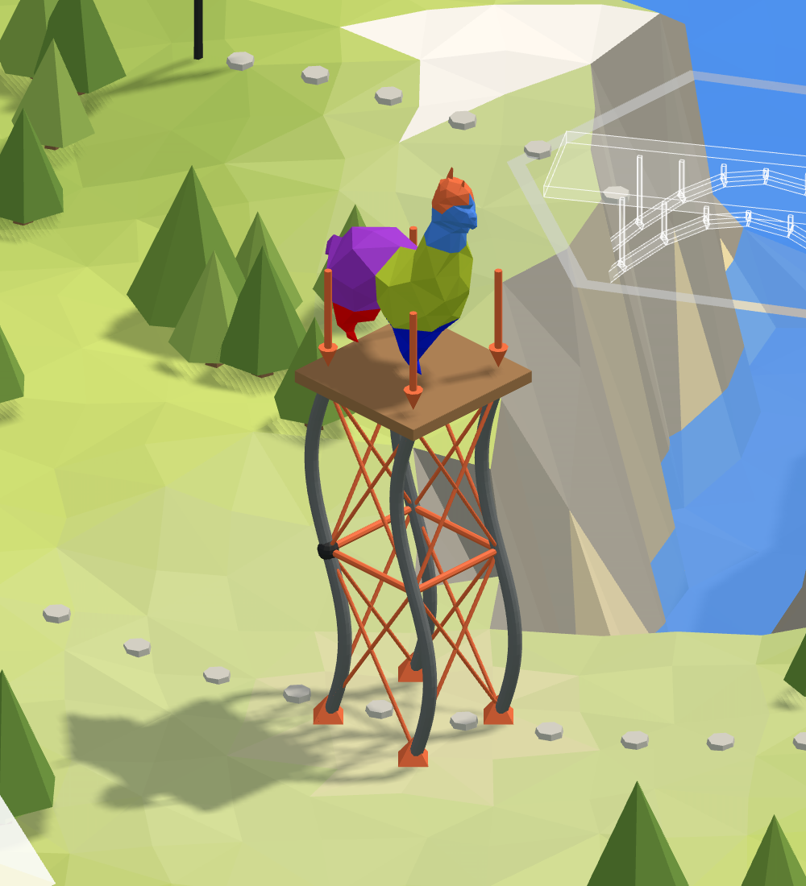

# 🗼 7. Watchtower

**Legs that must not buckle.** One leg of a steel watchtower: a tube 6 m tall, pinned at its
foot, held sideways by the bracing at mid-height and by the platform at its head. How much more
than the platform could it carry before it buckles?

<figure><figcaption></figcaption></figure>

[tower-start](https://raw.githubusercontent.com/Alpaca4d/alpaca4d.github.io/main/doc/learn/07-watchtower/tower-start.gh)

[tower](https://raw.githubusercontent.com/Alpaca4d/alpaca4d.github.io/main/doc/learn/07-watchtower/tower.gh)

Start from **tower-start**: the leg's line and its tube are there, and the steps below add the
rest. **tower** is the finished definition. The same leg is the seventh area of the
[Playground](https://alpaca4d.github.io/playground.html#tower), where you build it a piece at a
time by picking the right Grasshopper snippet, and see what each wrong one would build.

## What you will learn

- Euler buckling, and the load factor Linear Buckling Analysis gives: what the loads are
  multiplied by for the structure to buckle.
- How the supports set a column's buckling length, and why bracing at mid-height makes a leg four
  times as strong.
- Why a member that buckles between its ends needs **Divisions**.

## The leg

A circular hollow section, 60.3 mm across with walls 3.2 mm thick, in S235 steel, 6 m tall. The
platform puts 8 kN on each leg. Alpaca4d works in metres and kilonewtons
([Units](../concepts/units.md)), so the tube is 0.0603 by 0.0032, and the load −8 along Z.

## Steps

1. **The leg.** Open tower-start. **Foot** is at the origin and **Head** at Z = 6, from the
   **Height** slider: the line stands up along Z, as a column does
   ([Axes and signs](../concepts/axes-and-signs.md)).
2. **The tube.** [Material Library Elastic](../basics/materials/MaterialDatabase.md) makes S235
   from the panel, and [CircleCS](../basics/sections/circular.md) the section: **Outside
   diameter** 0.0603 into Diameter, **Wall** 0.0032 into Thickness, the material into Material.
   CircleCS takes the diameter, not the radius.
3. **The beam.** The bracing will hold the leg at mid-height, and a support holds only a node, so
   the beam needs a node there. **Divide Curve** with a Count of 2 gives the middle's parameter
   t, and **Shatter** cuts the line there. Wire its segments into the Line of a
   [ForceBeamColumn](../basics/elements/force-beam-column.md), and the tube into Section.
4. **The supports.** Three [Supports](../basics/elements/support.md): **Top** at Head, **Brace**
   at **Curve Middle** of the line, **Base** at Foot. Every input of a Support left empty holds
   that way, so a Boolean Toggle, **Free**, False, frees what each may do: Tz, Rx, Ry and Rz of
   the Top and of the Brace, Rx and Ry of the Base. The top and the brace hold the leg sideways
   only, and the base holds Rz too, or nothing would stop the leg spinning about its own axis.
5. **The platform.** **Unit Z** with a factor of −8 makes the force, 8 kN down, on Head. Wire them
   into a [Point Load](../basics/loads/point-load.md), and the load into a
   [Load Pattern](../basics/loads/load-pattern.md).
6. **Assemble.** Into [Assemble Model](../basics/assemble.md): the leg's Element into Elements,
   the three supports into Supports, the Load Pattern into LoadPatterns. Hold Shift to wire the
   second and third support into the same input: a new wire otherwise replaces the one there.
7. **Buckle.** [Linear Buckling Analysis](../basics/analysis/linear-buckling.md) with
   **Divisions** 8: it splits each element in 8 for the analysis. Its Load Factors into a panel,
   and its AlpacaModel into [Model View](../basics/visualisation/model-view.md) with **Deformed**
   ticked: the shape the leg buckles into.

## Check it by hand

Braced at mid-height, each half of the leg is a column 3 m long, pinned at both ends. Euler's
load for it is

$$P_{cr} = \frac{\pi^2 E I}{L^2}$$

with E = 210 000 MPa, L = 3 m and I = π(D⁴ − d⁴)/64 = π(0.0603⁴ − 0.0539⁴)/64 = 2.347 × 10⁻⁷ m⁴:

$$P_{cr} = \frac{\pi^2 \times 210\,000\,000 \times 2.347 \times 10^{-7}}{3^2} = 54.0\ \text{kN} = 6.76 \times 8\ \text{kN}$$

Linear Buckling gives 6.83. Its beams are straight pieces, which come at the curved shape from
above: 1.2 % high with 8 pieces to a half wave, 0.2 % with 16.

## Try

- **Take the bracing away**: wire Free into the Brace's Tx and Ty too. The leg buckles over its
  whole 6 m, at 1.69, a quarter as much: twice the length, a quarter of the load.
- **Brace it one way only**: Free into the Brace's Ty alone. 1.69 again, the leg bending along Y. A
  tube is as weak one way as the other, so its bracing has to hold it both ways.
- **Free the head**: Free into the Top's Tx and Ty. The leg sways above the brace like a flagpole:
  0.93, and Linear Buckling warns that it buckles before its load is reached.
- **Divisions**: 4 gives 7.10, 2 gives 8.20, 1 nothing at all.

## The usual mistakes

| You see | Why | Fix |
| --- | --- | --- |
| A leg lying on the ground | Height wired into X or Y: Z points up. | Wire it into Z. |
| A leg going into the ground | Height −6: the right direction, the wrong sign. | +6. |
| *The first load factor is 0.731: the model buckles before its loads are reached.* | The radius, 0.0302, wired into Diameter: a tube half as wide is nine times less stiff. | 0.0603, the diameter. |
| A load factor of 15.1 and a heavy leg | Nothing wired into Thickness, so CircleCS took its default, 10 mm. Grasshopper gives no warning. | Wire the wall in. |
| A load factor of five billion | 60.3 and 3.2 typed for millimetres: a tube 60 m across. | 0.0603 and 0.0032. |
| *Support node at location '0,0,3' is not part of the model!* | No node at mid-height: the line wired straight into Line, or an odd number of elements. | Shatter the line in two. |
| *Data conversion failed from Point to Number* | Divide Curve's points, P, wired into Shatter's t. | Its parameters, t. |
| *Nothing buckles under these loads: no member is compressed by them.* | The top support holds Z and takes the load itself; or the load points up, or sits on the foot; or Divisions is 1, and no piece of the leg has a node between two held ends. | Free the Top's Tz; −8 on Head; Divisions 4 or more. |
| *The first load factor is 0.931: the model buckles before its loads are reached.* | Nothing holds the head sideways. | The Top holds Tx and Ty. |
| *The first load factor is 0.007: the model buckles before its loads are reached.* | 8000 typed for 8 kN. | −8. |
| A load factor 20 % too high | Divisions 2: two straight pieces to a half wave are too stiff. | Divisions 8. |

## The components

- [Material Library Elastic](../basics/materials/MaterialDatabase.md) · [Circular](../basics/sections/circular.md) · [ForceBeamColumn](../basics/elements/force-beam-column.md) · [Support](../basics/elements/support.md) · [Point Load](../basics/loads/point-load.md) · [Load Pattern](../basics/loads/load-pattern.md) · [Assemble](../basics/assemble.md) · [Linear Buckling](../basics/analysis/linear-buckling.md) · [Model View](../basics/visualisation/model-view.md)

## See also

- [Find the load factor a model buckles at](../how-to/analysis/buckling.md)
- [Hold a node with a support](../how-to/supports-and-releases/supports.md)
- [Which analysis](../concepts/which-analysis.md)
- [Axes and signs](../concepts/axes-and-signs.md)
