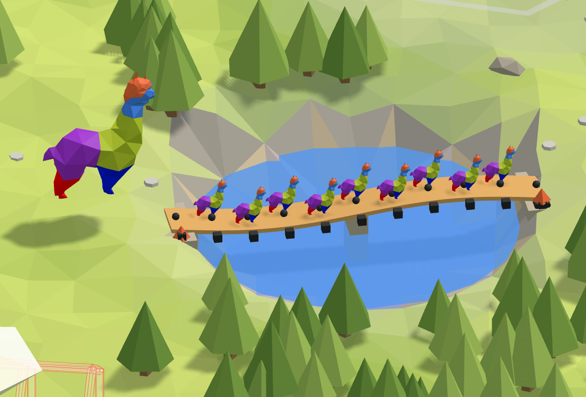

# 🚶 8. Footbridge

**It bounces too much.** A timber footbridge across the lake bounces whenever the herd of alpacas
crosses it. How many times a second, and what stops it?

<figure><figcaption></figcaption></figure>

[footbridge-start](https://raw.githubusercontent.com/Alpaca4d/alpaca4d.github.io/main/doc/learn/08-footbridge/footbridge-start.gh)

[footbridge](https://raw.githubusercontent.com/Alpaca4d/alpaca4d.github.io/main/doc/learn/08-footbridge/footbridge.gh)

Start from **footbridge-start**: the deck, its span and its abutments are there, built the way the
[River](01-river.md) builds its plank, and the steps below add the rest. **footbridge** is the
finished definition, pier and all. The same footbridge is area 8 of the
[Playground](https://alpaca4d.github.io/playground.html#footbridge), where you build it a piece at a
time by picking the right Grasshopper snippet, and see what each wrong one would build.

## What you will learn

- Where the mass of a vibrating model comes from: the material's density, and Mass Points in kg.
- Natural frequencies and mode shapes, with Natural Vibration Analysis, and telling a frequency
  from a period and an eigenvalue.
- Frequency rises with stiffness and falls with mass, and goes with one over the span squared.

## The footbridge

A C24 timber deck, 1.2 m wide and 120 mm deep, spans 10 m across the lake on a pin and a roller.
The herd crosses nose to tail, an alpaca of 60 kg on every metre. Alpaca4d works in metres and
kilonewtons, and takes masses in kilograms ([Units](../concepts/units.md)): a weight of 0.6 kN,
a mass of 60 kg.

## Steps

1. **The deck.** Open footbridge-start. [Material Library Elastic](../basics/materials/MaterialDatabase.md)
   makes C24 from the panel, and [RectangleCS](../basics/sections/rectangular.md) the section:
   **Deck width** 1.2 into Width, **Deck depth** 0.12 into Height, the material into Material. The
   material brings the stiffness, E = 10 500 MPa, and the density, 410 kg/m³: Alpaca4d gives every
   element the mass its section and density make, 59 kg in every metre of this deck.
2. **The span.** **Bank B** is 10 m along X. **Divide Curve** with **Elements** 10 and **Shatter**
   cut the line into ten elements of a [ForceBeamColumn](../basics/elements/force-beam-column.md),
   **Deck**. An element puts half its mass on each of its two nodes, and a deck can only vibrate
   through mass on nodes that can move: nine of the eleven are between the abutments.
3. **The abutments.** Two [Supports](../basics/elements/support.md), **Pin** at Bank A and
   **Roller** at Bank B, with the **Free** toggle in Ry and Rz of both and in Tx of the roller.
4. **The herd.** **Alpaca mass**, 60, into X, Y and Z of a **Vector XYZ**, and that into the
   TransMass of a [Mass Point](../basics/loads/mass-point.md), **Herd**, with Divide Curve's points
   into Point: an alpaca on each of the eleven nodes. A mass resists being moved whichever way it
   goes, so it goes along all three axes.
5. **Assemble.** Into [Assemble Model](../basics/assemble.md): Deck into Elements, both supports
   into Supports (hold Shift for the second wire), and Herd straight into LoadPatterns. A Mass
   Point goes there beside any load patterns, not inside one, and a vibration needs no load at all.
6. **Natural vibration.** [Natural Vibration Analysis](../basics/analysis/natural-vibration.md)
   takes the AlpacaModel straight from Assemble Model, with no Analysis Settings. **Modes** 3 into
   Vibration Modes, its Frequencies into a panel, and its AlpacaModel into
   [Model View](../basics/visualisation/model-view.md), with **Deformed** ticked, to draw the first
   mode: the panel reads 1.94, 7.75 and 17.4 Hz.
7. **The pier.** **Curve Middle** of the deck's line gives the middle, and a third Support,
   **Pier**, holds the deck up there: Free into its Tx, Ry and Rz. Wire it into Assemble Model's
   Supports beside the other two, holding Shift. The first frequency is now 7.75 Hz.

## Check it by hand

A simply supported beam with its mass spread evenly vibrates first at

$$f = \frac{\pi}{2L^2}\sqrt{\frac{EI}{m}}$$

with L = 10 m, EI = 10 500 MPa × 1.2 × 0.12³ / 12 = 1 814 kN·m² = 1 814 000 N·m², and m the mass
in every metre, the deck's 410 × 1.2 × 0.12 = 59 kg and the herd's 60, 119 kg:

$$f = \frac{\pi}{2 \times 10^2}\sqrt{\frac{1\,814\,000}{119}} = 1.94\ \text{Hz}$$

OpenSees gives 1.94 Hz too. People walk at about two steps a second, so every step pushes the deck
just as it comes back up, and the bounce builds; Eurocode 0 asks for a comfort check of a footbridge
whose first vertical frequency is below 5 Hz. With the pier each half is a 5 m bridge, and the
frequency goes with 1/L²: four times as quick, 7.76 Hz by hand and 7.75 Hz in OpenSees.

## Try

- **Make the deck twice as deep**, 0.24: 4.48 Hz, not yet 5. The deck is eight times as stiff and
  twice as heavy, and the herd as heavy as before. Without the herd it would be exactly twice as
  quick, 2.75 to 5.50 Hz: a solid deck's stiffness grows with its depth cubed, its mass with its
  depth.
- **Make it twice as wide**, 2.4: 2.24 Hz, hardly any better. Width adds stiffness and mass alike.
- **Unwire the herd** from Assemble Model: 2.75 Hz. Mass makes a deck slower.
- **Read the other modes**: 7.75 and 17.4 Hz, four and nine times the first, with two and three
  half-waves along the deck. Feed Model View's Step 1 or 2 to draw them.

## The usual mistakes

| You see | Why | Fix |
| --- | --- | --- |
| 2.74 Hz with the herd on the deck | Alpaca mass is 0.6: that is the alpaca's weight in kN, and a Mass Point takes kg. | 60. |
| 2.75 Hz with the herd on the deck | The mass goes along X only, so the deck going up and down does not feel it. | The same mass along X, Y and Z. |
| A deck 19 times as heavy | Nothing wired into RectangleCS's Material, so it took its default, steel. | Wire the material in. |
| *Analysis Failed*, and the log says ARPACK *Could not build an Arnoldi factorization* | One element: its two nodes sit on the abutments, so all the mass is where nothing can move. | Shatter the line into elements. |
| *-symmBandLapack solves only the standard eigenvalue problem…* | That solver leaves the mass out. | Leave Solver empty: -genBandArpack. |
| 0.516 in the panel | Period, the time one bounce takes, in seconds. | Wire Frequencies: 1 / 0.516 = 1.94 Hz. |
| 148 in the panel | Eigenvalues, ω² in rad²/s². | Wire Frequencies: √148 / 2π = 1.94 Hz. |
| 4.39 Hz | Both ends built in: nothing wired from Free. A deck on abutments turns at its ends. | Free into the pin and the roller. |
| The pier changes nothing | Free wired into the pier's Tz, so it does not hold the deck up. | Leave Tz empty. |

## The components

- [Material Library Elastic](../basics/materials/MaterialDatabase.md) · [Rectangular](../basics/sections/rectangular.md) · [ForceBeamColumn](../basics/elements/force-beam-column.md) · [Support](../basics/elements/support.md) · [Mass Point](../basics/loads/mass-point.md) · [Assemble](../basics/assemble.md) · [Natural Vibration](../basics/analysis/natural-vibration.md) · [Model View](../basics/visualisation/model-view.md)

## See also

- [Find natural frequencies and mode shapes](../how-to/analysis/natural-frequencies.md)
- [Which analysis](../concepts/which-analysis.md)
- [Natural Vibration](https://alpaca4d.github.io/examples/natural-vibration/), an example in the gallery
