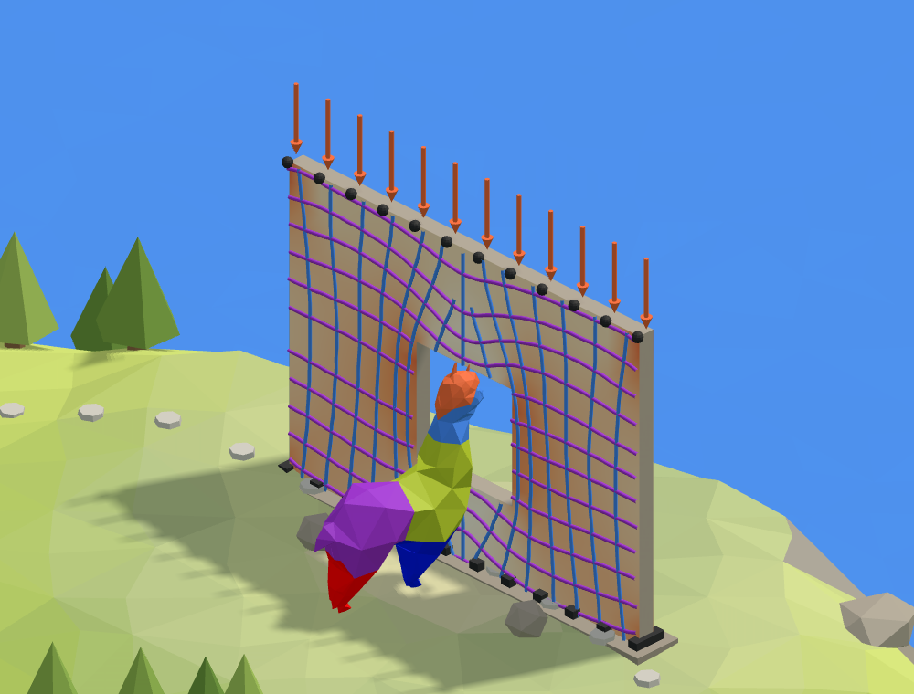

# 🪟 9. Wall with a window

**Forces around an opening.** A concrete wall standing on its foundation, with a window cut into
it and a floor bearing on its top. How do the floor's forces get round the window to the ground?

<figure><figcaption></figcaption></figure>

[wall-start](https://raw.githubusercontent.com/Alpaca4d/alpaca4d.github.io/main/doc/learn/09-wall-with-a-window/wall-start.gh)

[wall](https://raw.githubusercontent.com/Alpaca4d/alpaca4d.github.io/main/doc/learn/09-wall-with-a-window/wall.gh)

Start from **wall-start**: the wall with its window, meshed and made of shells, and the steps below
add the rest. **wall** is the finished definition. Both need Rhino to solve, because Mesh Brep meshes
with Rhino's QuadRemesh. The same wall is the ninth area of the
[Playground](https://alpaca4d.github.io/playground.html#wall), where you build it a piece at a time by
picking the right Grasshopper snippet, and see what each wrong one would build.

## What you will learn

- How a shell model is built: a surface, a mesh with a node wherever a support or a load goes, a
  section and shells, then supports, loads and an analysis.
- Why a shell's Local X has to run along it.
- How forces flow round an opening, read from principal stress lines, and checking the stress
  beside it by hand.

## The wall

A concrete wall 5.5 m long, 4 m tall and 200 mm thick stands on its foundation. A window 1.5 m
square is cut into its middle, its sill 1 m up. A floor bears on its top: 50 kN on each of 12 points
0.5 m apart, 600 kN in all. Concrete is E = 33 000 MPa with a Poisson's ratio of 0.2. Alpaca4d works
in metres and kilonewtons ([Units](../concepts/units.md)), so E is 33 000 000 kN/m², the thickness 0.2.

## Steps

1. **The wall.** Open wall-start. **Corner**, **Along** and **Up** are the wall's corners: Length
   into Along's X, and Length and Height into Up's X and Z. Rectangle 3Pt draws the outline through
   them, standing up in the XZ plane, and the **Window**, whose corners are typed into its inputs.
   Both go into **Boundary Surfaces**, which cuts the window out of the outline. A curve meant to be
   a hole has to go in with the outline.
2. **The mesh.** **Explode** gives the outline's sides; **Base edge** and **Top edge**, List Items 0
   and 2, are its bottom and its top, and Divide Curve cuts each into **Divisions**, 11, for 12
   points 0.5 m apart. **Mesh Brep** meshes the surface into quads of **Edge length** 0.25 m and
   pulls a node onto each of the points in its Points input. It keeps the window's edges, and with
   quads half as wide as the points are apart, every point has a node of its own to take.
3. **The shell.** An [nD](../basics/materials/ND.md) material, **Concrete**, into a
   [Plate Fiber Section](../basics/sections/plate-fiber.md) of **Thickness** 0.2, and the mesh and
   the section into an [ASD Shell](../basics/elements/shell.md): one shell per quad. **Unit X** goes
   into its Local X, so that σ11 is the stress along the wall and σ22 the stress up it.
4. **The supports.** A [Support](../basics/elements/support.md), **Foundation**, with the base
   points in its Position and nothing else wired: every input left empty holds that way, so the wall
   stands on its foundation as if cast onto it.
5. **The floor.** **Floor**, −50, into **Unit Z**, and the vector into the Force of a
   [Point Load](../basics/loads/point-load.md) with the top points in its Point: 50 kN down on each.
   The load into a [Load Pattern](../basics/loads/load-pattern.md).
6. **Assemble.** Into [Assemble Model](../basics/assemble.md): the shells into Elements, the
   Foundation into Supports, the Load Pattern into LoadPatterns.
7. **Run.** An [Analysis Settings](../basics/analysis/analysis-settings.md) as it comes into
   [Run Analysis](../basics/analysis/run-analysis.md), and its AlpacaModel into
   [Model View](../basics/visualisation/model-view.md), showing Shell stresses, σ22, and into
   [Principal Stress Lines](../basics/visualisation/principal-stress-lines.md), with a **Seed** in
   the left pier. It grows a field of lines from the seed: SL2, along the most compressive principal
   stress, runs down the wall and bends round the window into the piers; SL1 runs across it and
   arches over the window.

## Check it by hand

Far from the window, the floor's 600 kN is spread along the whole wall:

$$\sigma = \frac{F}{L\,t} = \frac{600}{5.5 \times 0.2} = 545\ \text{kN/m}^2 = 0.55\ \text{MPa}$$

Beside the window there is less wall to carry the same force: the two piers are 5.5 − 1.5 = 4 m
long between them.

$$\sigma = \frac{F}{(L - w)\,t} = \frac{600}{4 \times 0.2} = 750\ \text{kN/m}^2 = 0.75\ \text{MPa}$$

OpenSees gives the same mean across the piers at the window's mid-height, as it must: the forces in
them add up to the 600 kN above. It is not even across them, though: 0.56 MPa at the wall's ends,
1.0 MPa right beside the window, and about 1.5 MPa at the window's top corners, where the forces
coming round it gather. That is where walls crack first, and why a lintel or a rounded corner helps.

## Try

- **Push the floor along the wall**: Unit X in place of Unit Z, as wind or an earthquake would.
  The wall works as a shear wall: the lines cross it on the diagonals, and the window's corners
  reach 4.5 MPa.
- **Widen the window**: type corners 1.5 and 4 m along into Window. The piers are then 3 m long,
  and carry 600 / (3 × 0.2) = 1.0 MPa on average.
- **Take the window away**: wire only the outline into Boundary Surfaces. The lines run straight
  down, and the wall carries about 0.55 MPa all across it.

## The usual mistakes

| You see | Why | Fix |
| --- | --- | --- |
| The wall lies flat on the ground | Height went into the Up corner's Y: Z points up. | Height into Z. |
| A wall with no window | Only the outline went into Boundary Surfaces. | Wire the window's rectangle in with it. |
| *Point … found no node left to move onto it* on Mesh Brep, then *Support node at location '…' is not part of the model!* | Edge length too big for points 0.5 m apart: there are fewer nodes along the edge than points. | Quads half as wide as the points are apart: 0.25. |
| The results show no window | Mesh Plane meshed the outline, which knows nothing of the window. | Mesh Brep on the surface. |
| ASD Shell red: *The Local X Axis (0, 1, 0) lies within 1° of the normal of … faces* | Local X along Y, the wall's normal: nothing of it lies in the wall. | A Local X along the wall: Unit X. |
| Stresses a thousand times too small | 200 typed for 200 mm: a wall 200 m thick. | 0.2. |
| No stress anywhere | The supports on the top points, or the load on the base points: the load goes straight into the supports. | Supports along the base, the load along the top. |
| *Analysis Failed: OpenSees 'analyze' did not converge.* | Tz free at every support: nothing holds the wall up. | Leave Tz empty: held. |
| Stresses a thousand times too big | 50 000 typed for 50 kN. | −50. |
| Principal Stress Lines: *The model is not analysed.* | It is fed from Assemble Model, which nothing has solved. | Feed it Run Analysis's AlpacaModel. |
| Only one line of each | Single Line is True. | False, for a field of lines. |

## The components

- [nD](../basics/materials/ND.md) · [Plate Fiber Section](../basics/sections/plate-fiber.md) · [ASD Shell](../basics/elements/shell.md) · [Support](../basics/elements/support.md) · [Point Load](../basics/loads/point-load.md) · [Load Pattern](../basics/loads/load-pattern.md) · [Assemble](../basics/assemble.md) · [Analysis Settings](../basics/analysis/analysis-settings.md) · [Run Analysis](../basics/analysis/run-analysis.md) · [Model View](../basics/visualisation/model-view.md) · [Principal Stress Lines](../basics/visualisation/principal-stress-lines.md)

## See also

- [Shell Forces](../basics/results/shell-forces.md), for the forces per metre the stresses come from
- [Mesh Load](../basics/loads/shell-load.md), for a load spread over the shells' faces
- [Which element](../concepts/which-element.md)
- [How a model is built](../concepts/how-a-model-is-built.md)
- [Axes and signs](../concepts/axes-and-signs.md)
