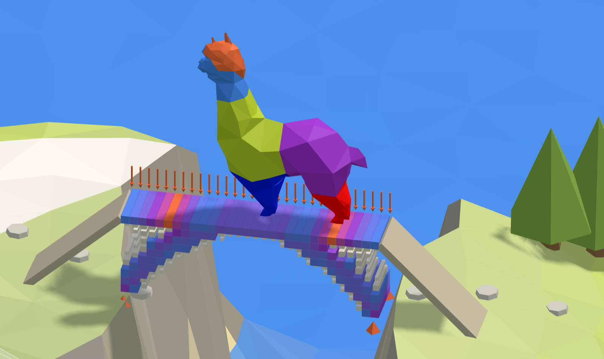

# ⛰️ 10. Summit bridge

**The lightest bridge.** A block of concrete fills the chasm at the summit, pinned to the rock at both
ends. Topology Optimisation keeps a quarter of it, only where the forces flow, and finds an arch.

<figure><figcaption></figcaption></figure>

[summit-start](https://raw.githubusercontent.com/Alpaca4d/alpaca4d.github.io/main/doc/learn/10-summit-bridge/summit-start.gh)

[summit](https://raw.githubusercontent.com/Alpaca4d/alpaca4d.github.io/main/doc/learn/10-summit-bridge/summit.gh)

Start from **summit-start**: the block, its concrete, the rocks and the walkway are there, and the
steps below add the rest. **summit** is the finished definition: it runs as it opens, in about a
second. The same bridge is the last area of the
[Playground](https://alpaca4d.github.io/playground.html#summit), where you build it a piece at a
time and watch what each wrong piece would carve.

## What you will learn

- How Topology Optimisation works: a block of solid elements, the design domain, of which it keeps
  the share you allow, where it makes the structure stiffest.
- What Keep and VolumeFraction do, and why the deck has to be kept.
- Why supports shape the result: rock that pushes back gets an arch, a roller gets a tie.

## The block

The chasm is 12 m across. The block that fills it is 4 m deep and 1.2 m wide, in C30/37 concrete
(E = 33 000 MPa, 2.5 t/m³), cut into 30 × 10 bricks of 0.4 m: 300 bricks, 144 t. Topology
Optimisation runs without a license on models of up to 500 elements. A walkway of 5 kN/m² stands on
its top row, the deck. Alpaca4d works in metres and kilonewtons ([Units](../concepts/units.md)).

## Steps

1. **The block.** Open summit-start. **Plan** is the deck's plan, 12 × 1.2 m, and **Plan mesh**
   cuts it into **Along** faces, 30. **Heights** copies it up to 11 levels, 0.4 m apart, and
   [Mesh Series to Brick](../basics/utility/mesh-series-to-brick.md) makes a layer of bricks between
   each level and the next: 10 layers need 11 levels. It makes them from the bottom up, so the
   deck's 30 bricks are the last.
2. **Concrete.** **Split List** cuts the bricks at **Deck starts**, 30 × 9 = 270: the first 270 into
   the [SSP Brick](../basics/elements/brick.md) named Domain, the last 30 into the one named Deck.
   Both take the C30/37 [nD material](../basics/materials/ND.md). The name in ElementId is how
   Topology Optimisation will find the deck.
3. **The rocks.** Two [Supports](../basics/elements/support.md), **Rock A** at X = 0 and **Rock B**
   at X = 12, each at both edges across, at the bottom of the block. **Free** frees Rx, Ry and Rz,
   which a brick's node does not have anyway; Tx, Ty and Tz are held at both, so the rock pushes the
   bridge back in.
4. **The walkway.** 5 kN/m² × 12 m × 1.2 m = 72 kN, shared by the 62 nodes of the deck's top that
   **Deconstruct Mesh** gives: 1.16 kN each, down, as [Point Loads](../basics/loads/point-load.md)
   in a [Load Pattern](../basics/loads/load-pattern.md).
5. **Assemble.** Into [Assemble Model](../basics/assemble.md): the Domain and the Deck into
   Elements, both rocks into Supports, the Load Pattern into LoadPatterns. Hold Shift to wire a
   second source into the same input.
6. **What it keeps.** A panel **Keep** holding `Deck`, and a slider **Share kept** at 0.25.
7. **Topology Optimisation.** Wire the model into
   [Topology Optimisation](../basics/optimisation/topology-optimisation.md)'s AlpacaModel, Keep into
   Keep, Share kept into VolumeFraction, a toggle **Run** set to True into Run, and a slider
   **Step** into Step. It runs: 40 iterations, about a second. Drag Step back to watch it again.

## Check it by hand

**What it keeps.** VolumeFraction counts only the bricks it designs; the ones in Keep come on top.
A brick is 0.4 × 1.2 × 0.4 = 0.192 m³, 0.48 t:

$$30 \times 0.48 + 0.25 \times 270 \times 0.48 = 14.4 + 32.4 = 46.8\ \text{t}$$

of the block's 144 t. The design that comes out, the 90 bricks at a density of 0.5 or more, is
43.2 t.

**The push on the rock.** An arch carrying w = 5 × 1.2 = 6 kN/m over L = 12 m, rising
f = 3.8 m from the foot of the rock to the middle of the deck, pushes each wall out with

$$H = \frac{w L^2}{8 f} = \frac{6 \times 12^2}{8 \times 3.8} = 28.4\ \text{kN}$$

OpenSees gives 26.8 kN on the design: the deck carries some of the walkway itself. Group 8 of
summit.gh analyses the design and colours it by Von Mises stress; past 50 elements, Run Analysis
needs a license.

## Try

- **Free Rock B along X**: wire Free into its Tx. Nothing pushes the ends together any more, so the
  optimiser ties them with a row of bricks along the bottom: a bowstring, 3.6 times as flexible,
  with its tie in tension.
- **Hold it at the top**: wire Depth into the Z of both feet. The bridge hangs between the tops of
  the walls, and the optimiser finds a hanging shape, 2.3 times as flexible. Concrete wants pushing.
- **Carry the alpaca alone**: one point at the middle of the deck instead of the walkway. It finds
  two struts meeting under that one spot.
- **Change Share kept**: 0.4 makes a heavier, stiffer arch; 1 keeps the whole block.

## The usual mistakes

| You see | Why | Fix |
| --- | --- | --- |
| *Point load at location '0,0,4' is not part of the model!*, and Deck orange | Up wired straight into Heights' Count: 10 levels make 9 layers, so the block is 3.6 m deep and has no deck. | n layers need n + 1 levels: Up + 1. |
| *Without a license Topology Optimisation takes models of up to 500 elements* | Too fine: 60 × 20 bricks is 1 200. | 0.4 m bricks, 30 × 10, show the shape. |
| The walkway crumbles at both ends | Keep is empty, so the deck is designed too. | Keep `Deck`. |
| *"Dek" matched none of the 300 elements that have an ElementId* | A misspelt name in Keep. Case does not matter. | Spell it as in ElementId. |
| The walkway is gone, the block below solid | The Deck and Domain names swapped, so Keep holds the block below. | Deck on the top row. |
| *No part of the design is held still by the supports, so AlpacaModel is empty.* | Share kept too small: 0.05 cannot reach from the deck to the rock. | 0.25. |
| *Set Run to true to start the optimisation.* | Run is False. | A toggle set to True into Run. |
| A tie along the bottom | Rock B on a roller: nothing pushes the ends together. | Hold Tx at both rocks. |

## The components

- [Mesh Series to Brick](../basics/utility/mesh-series-to-brick.md) · [SSP Brick](../basics/elements/brick.md) · [nD](../basics/materials/ND.md) · [Support](../basics/elements/support.md) · [Point Load](../basics/loads/point-load.md) · [Load Pattern](../basics/loads/load-pattern.md) · [Assemble](../basics/assemble.md) · [Topology Optimisation](../basics/optimisation/topology-optimisation.md) · [Run Analysis](../basics/analysis/run-analysis.md) · [Model View](../basics/visualisation/model-view.md)

## See also

- [Find a structure with topology optimisation](../how-to/optimisation/topology.md)
- [Topology Bridge](https://alpaca4d.github.io/examples/topology-bridge/), the same idea in steel, 16 m long
- [9. Wall with a window](09-wall-with-a-window.md): the stress lines that a topology follows
