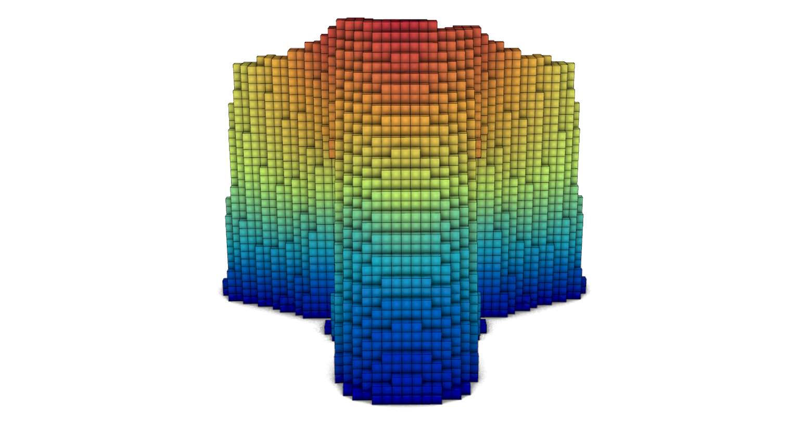

# 🖨️ 3d Printed Structure

<figure><figcaption></figcaption></figure>

[3d-printed-structure](3d-printed-structure.gh)

This example shows how to model and analyse a small 3D‑printed structure using Alpaca4d.  
Open the Grasshopper file, explore how the geometry is generated from simple parameters, and then inspect how materials, sections, supports and loads are assigned to evaluate global stiffness and stress distribution.
