# 🖨️ 3D Printed Structure

<figure>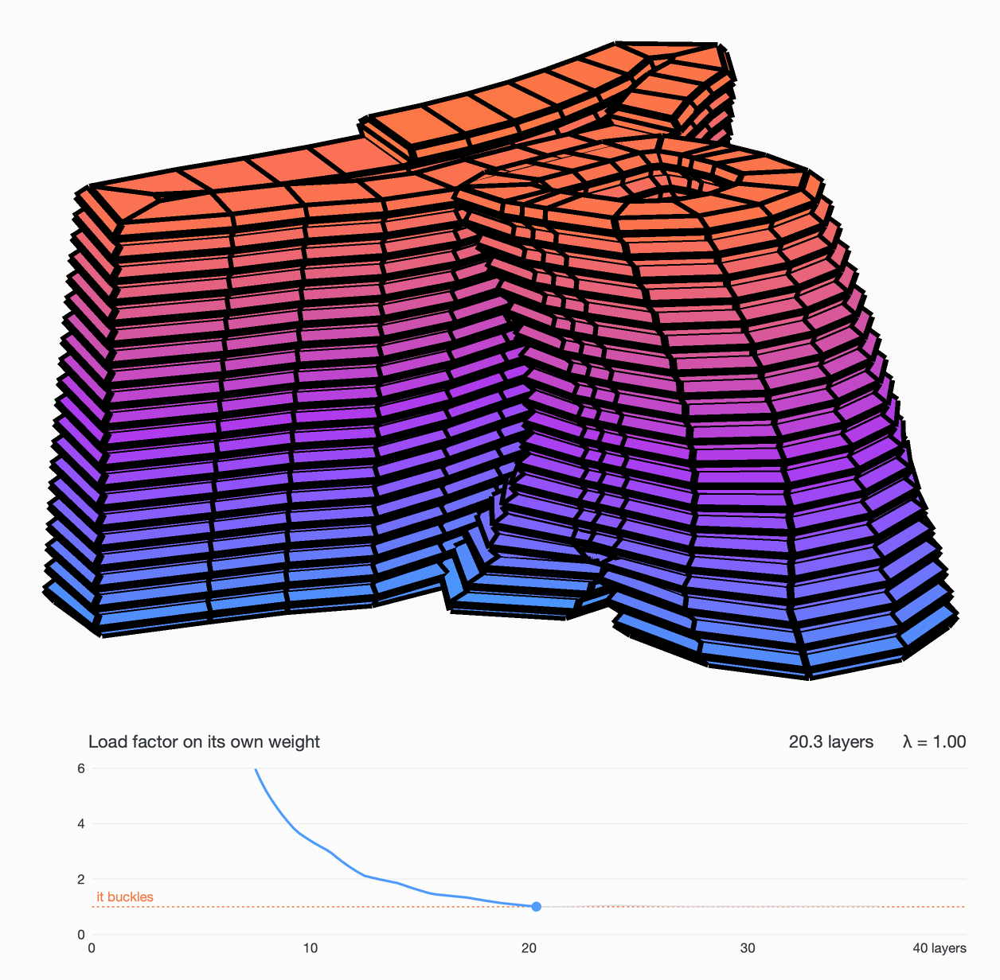<figcaption></figcaption></figure>

[3d-printed-structure](3d-printed-structure.gh)

A 3D printed shell carries its own weight from the first layer, while its concrete is still
setting. This example prints a branching shell, three legs on the print bed that merge into two and
then into one and open at the crown, layer by layer along its own sections. It checks the shell for
buckling at each moment: move **Time** on and more is printed, and
[Linear Buckling](../../docs/basics/analysis/linear-buckling.md) gives the factor on its own weight
at which it buckles at that moment. [Further down](#more-shapes), the same definition prints a twisted
column, a wavy wall, a dome, and a column that leans over, printed in layers that lean with it.

The shape is the one of the earlier version of this example, 0.33 × 0.43 m and 0.36 m tall. That
version cut it into voxels with a plugin; here a filament is laid along each section, so the bricks
follow the wall and lean with it. The filament is 40 mm wide and 10 mm high, round at the sides, and
printed at 5 m/min. The mortar is TU/e's (Wolfs, Bos and Salet, *Cement and Concrete Research* 106,
2018): $$E = 0.078 + 0.0012\,t$$ MPa with $$t$$ in minutes, 2070 kg/m³. The
[Printed Cylinder](../printed-cylinder/printed-cylinder.md) is the same idea on a simpler shape.

<figure><video src="3d-printed-structure-printing.mp4" autoplay loop muted playsinline></video><figcaption>
The shell printed to its last layer, its concrete coloured by age - orange just printed, blue the oldest. Under it, the load factor on its own weight: down to 1.00 at 20 layers, and never above 1.05 after.
</figcaption></figure>

<figure>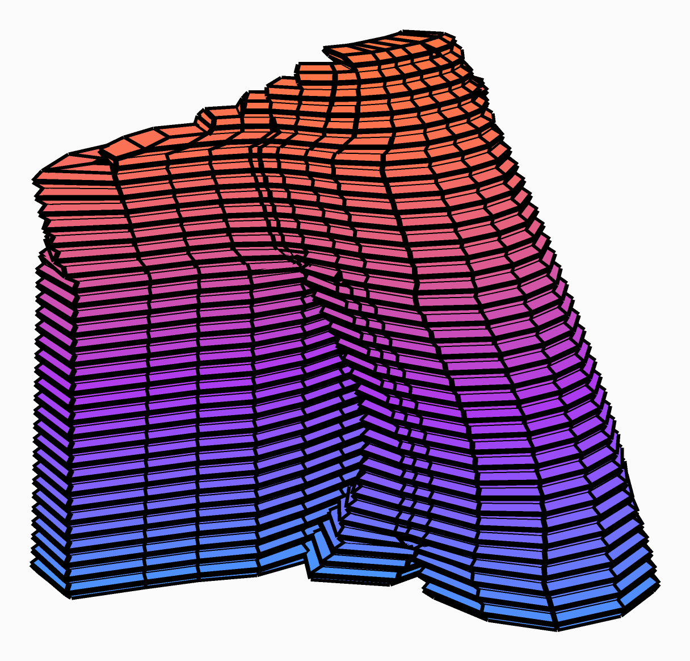<figcaption>
The whole print, 36 layers in 7.8 minutes: the concrete just printed in orange, the oldest in blue.
</figcaption></figure>

## The model

| Group | What it does |
| --- | --- |
| 1 - The shape | The shell, a surface in metres with its foot on the print bed, kept in the definition. Put your own in its place. |
| 2 - Printing | **Printed Layers**, a GhPython component: the shape cut every **Height** - flat, or square to a **Path** - a filament **Width** × **Height** laid along each section, its sides round, cut 1 brick across, 2 up and about 4 cm along, printed at **Speed**. **Time** says how far the print has got; each brick comes with its age and a colour by age. |
| 3 - Fresh concrete | **Fresh Concrete**, a GhPython component: each brick's age into its stiffness, Wolfs' mortar. |
| 4 - The joint and the bricks | With **Joint** above 0, a band that thick at the bottom of each layer, which **Surface Connection**, a GhPython component, gives a stiffness per area **Ks**; at 0 the layers are bonded, as wet on wet. Then the [SSP Bricks](../../docs/basics/elements/brick.md), coloured by age. |
| 5 - The print bed | A [Support](../../docs/basics/elements/support.md) holding the first layer where it rests. |
| 6 - Self-weight | [Gravity Load](../../docs/basics/loads/gravity.md): the only load while printing. |
| 7 - Assemble | [Assemble](../../docs/basics/assemble.md), with a tolerance of 0.5 mm, below the distance between two rows of nodes. |
| 8 - Buckle | [Linear Buckling](../../docs/basics/analysis/linear-buckling.md): the factor on the concrete's weight at which the shell buckles, and the shell in that shape. A second [Model View](../../docs/basics/visualisation/model-view.md) draws the shell as printed. |
| 9 - Settle | [Run Analysis](../../docs/basics/analysis/run-analysis.md): how far the shell settles under its own weight. |

## How the layers follow the shape

**Printed Layers** is part of this example, not of the plugin: open it to see or change how it works.

- **Sections:** the shape is cut every **Height**, from just above its foot. Each section is a print
  path, and the nozzle runs them one after the other.
- **Along a path:** given a **Path**, a curve from the foot of the shape up through it, the shape is
  cut square to the path every **Height** along it instead, as a printer that tilts its nozzle to follow
  the path lays it. A layer is then as thick at each point as the next section is from it: thicker on
  the outside of a bend, thinner on its inside. The nozzle's **Axis** says which way it points.
- **Nodes:** the first section is divided a **Segment** apart. A brick runs from two nodes of one
  section to where those nodes land on the next, so the layers follow the wall node for node.
- **The same wall a layer up:** where a section carries every node of a loop below, the nodes keep
  their spacing. Each sits at the same share of the section's length as it did below, and the whole
  loop turns as the section turned. A wall that leans, twists, grows or shrinks is cut the same way
  all the way up.
- **Merging legs:** where legs merge or a wall splits, each node goes to its closest point on the
  section above. Nodes that land on one another become one. Where a section runs on with no nodes
  below it, across the crotch where two legs meet or along an open edge, new nodes are added a
  **Segment** apart. The bricks there bridge, held only by their neighbours along the layer, as the
  filament is.
- **Gaps and tight turns:** a section whose ends are closer than the filament is wide is printed
  closed, since the filament fills the gap. On the inside of a tight turn, the filament is drawn in so
  that no brick folds through itself.
- **The filament:** each brick's section is the cylinder's oval, swept from one node to the next. A
  brick's age is the time since the nozzle passed its middle.

**Fresh Concrete** and **Surface Connection** are the cylinder's: see
[its page](../printed-cylinder/printed-cylinder.md#the-three-python-components).

## What it shows

At 6 layers the shell could carry eight times its own weight before buckling, at 11 layers three
times, at 14 layers 1.85 times and at 19 layers 1.14 times. At 20 layers, 5.5 minutes into the print,
it is down to 1.00, as its last two legs are about to merge. It then stays between 1.00 and 1.05 to
the end of the print, and ends at 1.02. It never quite buckles, but it is on the edge for the whole
second half of the print: the flat wall along the back of its long leg, about 43 cm long and held
only at its two ends, is ready to bow out at the top.

On the edge, how the shell is cut into bricks decides which side it falls. With every node carried to
its closest point on the section above, rather than evenly, it reaches 1 at 19.4 layers and goes down
to 0.86.
The print is also too short for this mortar to help much: halve **Speed** and the concrete at the
foot is only about a tenth stiffer when the print ends. This is the elastic buckling alone; a printed
wall can also yield at its base before it buckles.

<figure>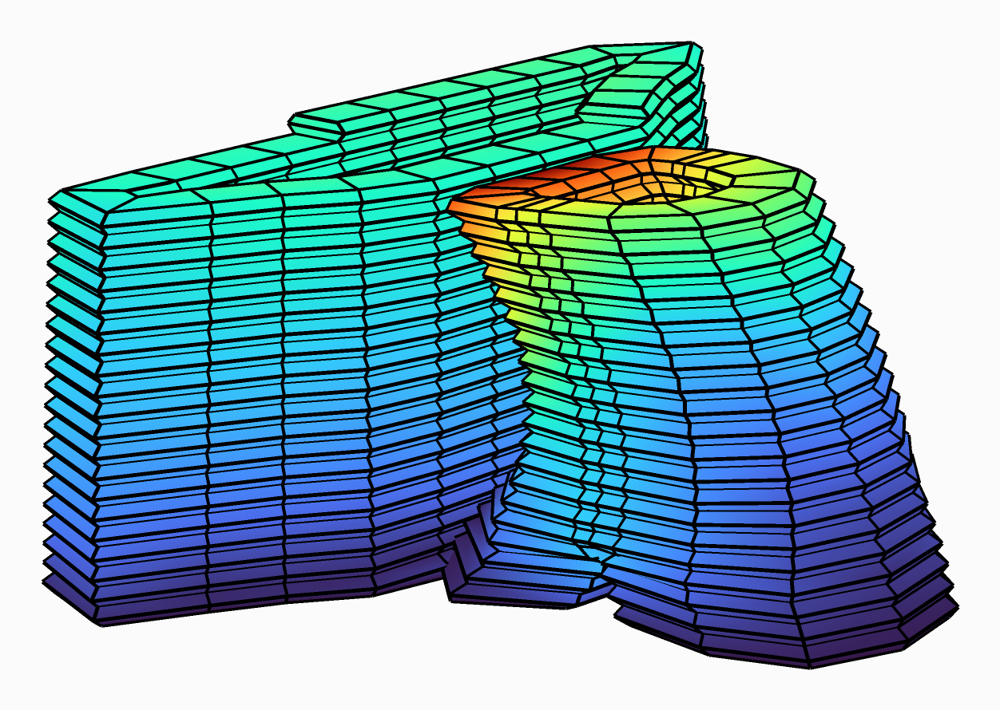<figcaption>
How far it settles under its own weight at 20 layers: up to 15 mm, at the top of the merged leg (red), nothing at the print bed (blue).
</figcaption></figure>

Each move of **Time** is a new analysis: about 5 seconds at 14 layers, 8 at 20.

**Try:**

- **Height** 5 mm: a finer print, twice the layers, and a slower one.
- **Joint** 1 mm and **Ks** lower: the layers slip on their joints, and the factor falls further.
- **Width** larger: a thicker wall, which stands further from the edge.
- Your own shape in **1 - The shape**: a surface whose foot is on the print bed, in metres.

<figure>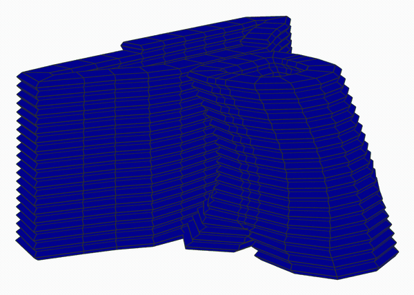<figcaption>
The buckling mode at 20 layers, where the factor is lowest: the flat back of the long leg bows out, red where it moves most.
</figcaption></figure>

## More shapes

The same definition around four more shapes, each kept in its own file. They use the same filament,
mortar and speed, and each is printed to its last layer. The last, a leaning column, is printed with
a nozzle that tilts as it goes.

### Twisted column

<figure>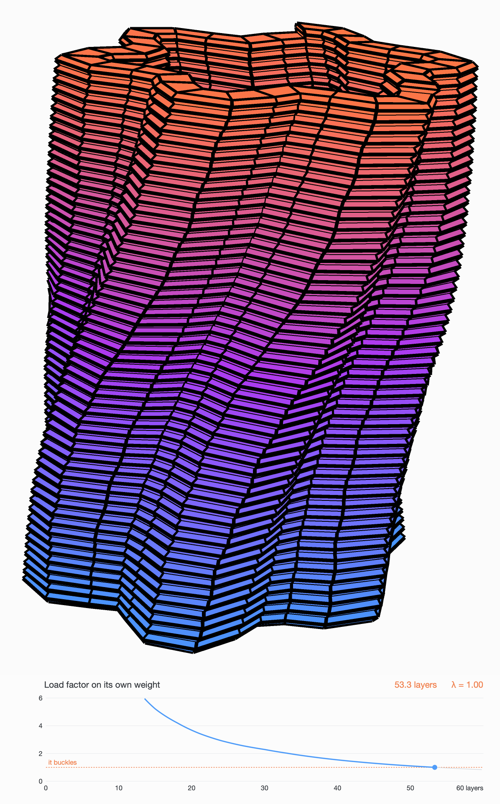<figcaption></figcaption></figure>

[twisted-column](twisted-column.gh)

Six lobes round a radius of 160 mm, 18% deep, turning 60 degrees, one lobe, over its 0.6 m: 60
layers of 64 bricks, 14.7 minutes of printing. The nodes turn with the twist, so every layer is cut
the same.

The factor on its own weight is 10 at 9 layers, 2.6 at 27 and 1.3 at 45. It reaches 1 at 53 layers,
13 minutes in, and the column sways over as a whole. TU/e's plain
[cylinder](../printed-cylinder/printed-cylinder.md), wider at 250 mm, buckles at 47 layers: the lobes
stiffen the wall.

<figure><video src="twisted-column-printing.mp4" autoplay loop muted playsinline></video><figcaption>
The column printed to its 60th layer, with the load factor under it, reaching 1 at 53 layers.
</figcaption></figure>

<figure>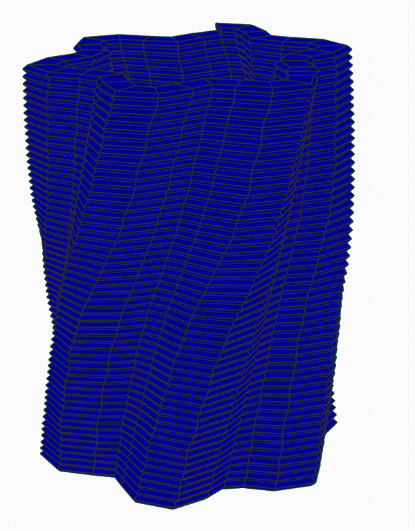<figcaption>
Its buckling mode at 53 layers, red where it moves most: the column sways over as a whole.
</figcaption></figure>

### Wavy wall

<figure>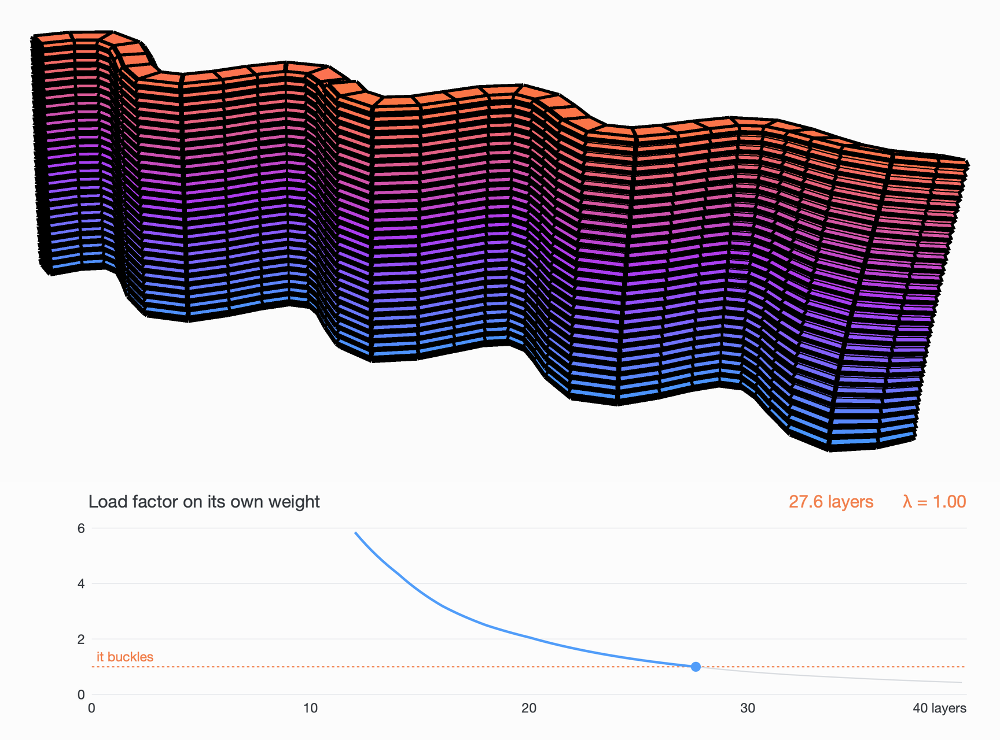<figcaption></figcaption></figure>

[wavy-wall](wavy-wall.gh)

A free-standing wall 1 m long, in waves 250 mm long and 50 mm deep, 0.4 m tall: 40 layers of 68
bricks, 10.4 minutes of printing.

The factor is 5.9 at 12 layers, 2.5 at 18 and 1.4 at 24. It reaches 1 at 27.6 layers, 7.2 minutes
in, and the wall's free end swings out. A flat wall of the same length, cut the same way, buckles at
about 15 layers: the waves nearly double the height it can be printed to.

<figure><video src="wavy-wall-printing.mp4" autoplay loop muted playsinline></video><figcaption>
The wall printed to its 40th layer, with the load factor under it, reaching 1 at 27.6 layers.
</figcaption></figure>

<figure>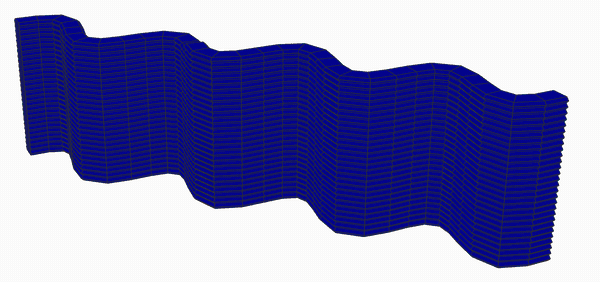<figcaption>
Its buckling mode at 27.6 layers, red where it moves most: the free end swings out.
</figcaption></figure>

### Dome

<figure>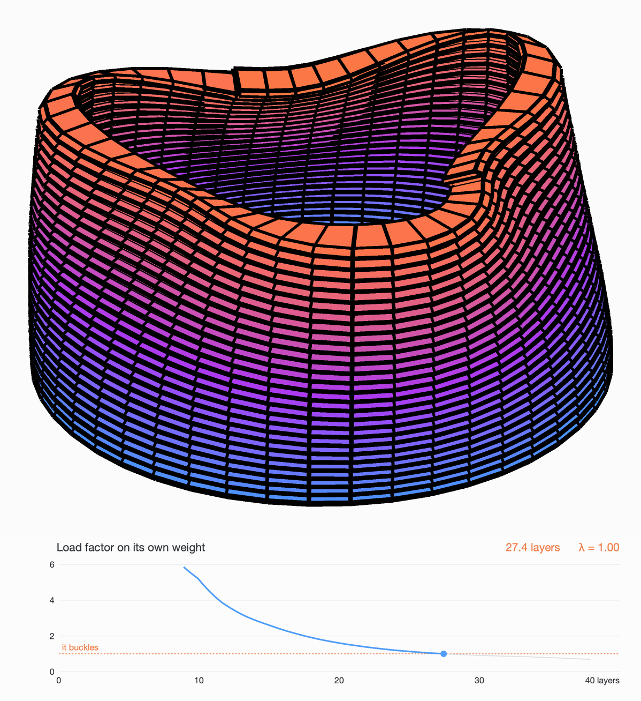<figcaption></figcaption></figure>

[dome](dome.gh)

A beehive dome 0.6 m across its foot, leaning in as it rises to an opening 0.31 m across at 0.39 m.
Each layer rests a little inside the one below, up to 40 degrees from upright at the top: 38 layers
of 96 bricks, 12.3 minutes of printing.

The factor is 5.2 at 10 layers, 2.6 at 15 and 1.5 at 20. It reaches 1 at 27.4 layers, 9.6 minutes
in, and the rim goes oval.

<figure><video src="dome-printing.mp4" autoplay loop muted playsinline></video><figcaption>
The dome printed to its 38th layer, with the load factor under it, reaching 1 at 27.4 layers.
</figcaption></figure>

<figure>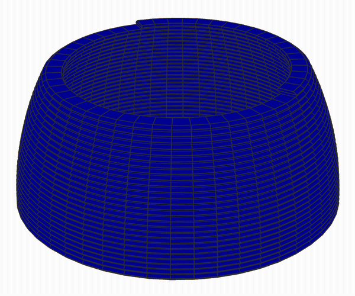<figcaption>
Its buckling mode at 27.4 layers, red where it moves most: the rim goes oval.
</figcaption></figure>

### Leaning column, printed along its axis

<figure>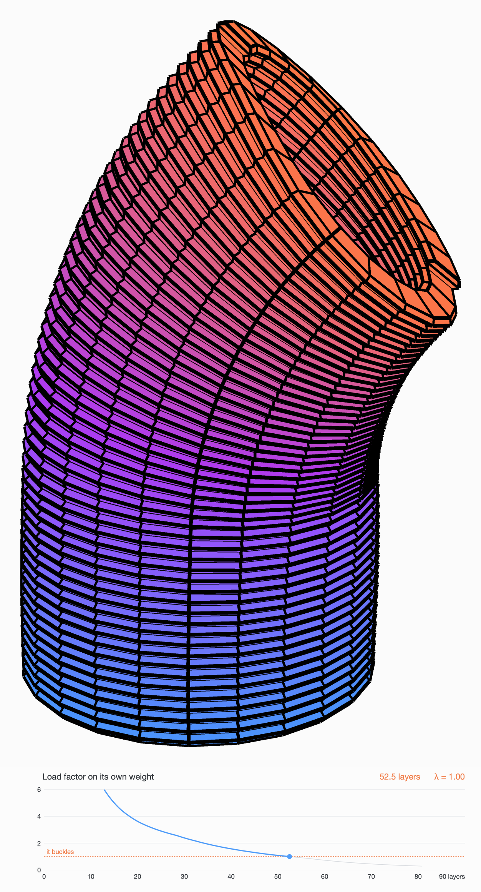<figcaption></figcaption></figure>

[leaning-column](leaning-column.gh)

A column that rises and then leans over: a tube 0.3 m across, up 0.2 m, then bending over to 45
degrees on a radius of 0.4 m and on 0.3 m. Here the nozzle does not stay upright. **Printed Layers**
is given a **Path**, the column's axis, and cuts the tube square to it every **Height** along it, as a
printer that tilts its nozzle to follow the axis lays it. Every layer rests squarely on the one below
and keeps the wall 40 mm thick. Round the bend, the layers fan out, 6 mm thick on the inside of the bend
and 14 mm on the outside. That is 81 layers of 48 bricks, 15.2 minutes of printing.

The factor on its own weight is 10 at 8 layers, 3.0 at 24 and 1.5 at 41. It reaches 1 at 52.5 layers,
9.9 minutes in, just past the end of the bend: the leaning top nods further over and its open end
flattens. By then the top has settled 88 mm under its own weight.

<figure><video src="leaning-column-printing.mp4" autoplay loop muted playsinline></video><figcaption>
The column printed along its axis to its 81st layer, the nozzle tilting with it, with the load factor under it, reaching 1 at 52.5 layers.
</figcaption></figure>

<figure>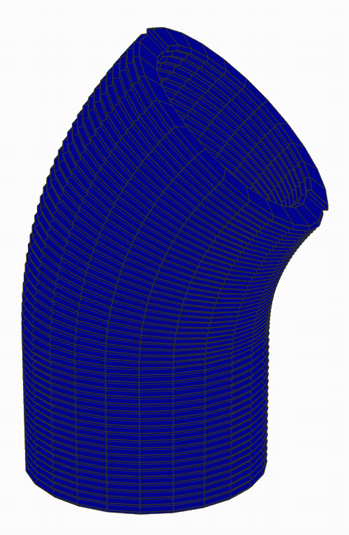<figcaption>
Its buckling mode at 52.5 layers, red where it moves most.
</figcaption></figure>

Unplug **Path** and the same tube is printed in flat layers, each a little out over the one below, up
to 10 mm where the wall leans 45 degrees. Its 45-degree wall is then only 28 mm thick square to it,
however wide the filament. Printed flat, the column reaches 1 sooner, at 47.5 of its 80 layers, 9.2
minutes in, as its overhanging lip droops, and it has settled 114 mm by then. Printing along the axis
takes it 5 layers further, about 40 seconds of printing, though not far into the 45-degree stretch:
with this mortar at 5 m/min, neither print reaches the top of this column.

<figure><video src="leaning-column-both-printing.mp4" autoplay loop muted playsinline></video><figcaption>
The two prints at the same moment: along the axis, the nozzle tilting (left), and in flat layers, the nozzle upright (right).
</figcaption></figure>

<figure>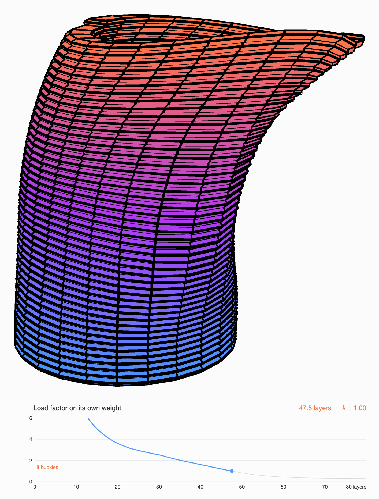<figcaption>
Printed flat, at 47.5 layers: the overhanging lip droops.
</figcaption></figure>
